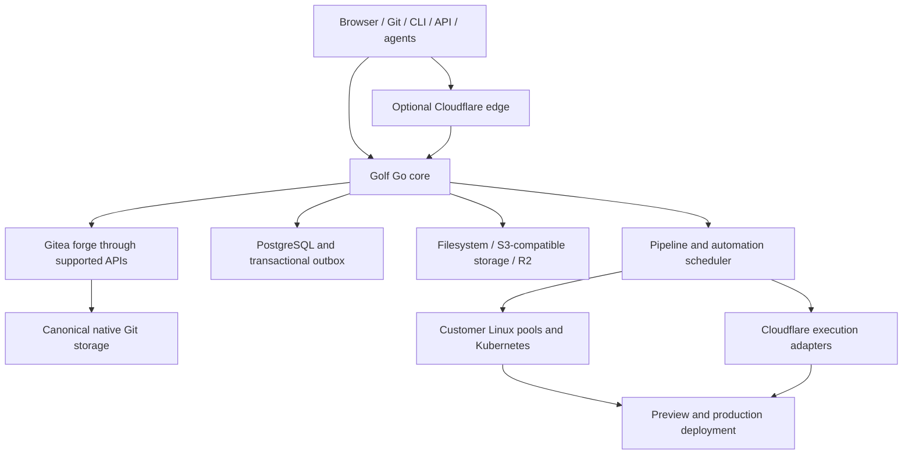

# Golf implementation plan

Status: product direction and implementation roadmap; completeness review and shared Gitea first-release decision incorporated on 2026-10-01. Provider proofs and implementation evidence remain required. Explicit defaults are engineering decisions that can be revisited through ADRs.

Execution evidence: the [implementation ledger](docs/IMPLEMENTATION_STATUS.md) records the local developer preview, including bounded repository/source/history/commit-diff, issue and PR/native-review reads, member-scoped organization browsing, own-account session activity and the JSON CLI. These increments do not mark an entire phase, v1 or the Cloudflare competition milestone complete.

Prepared: 2026-10-01. Provider documentation and limits must be rechecked when implementing each integration.

Historical reference: [original planning conversation](docs/archive/plan-conversation-2026-10-01.md). That conversation contains claims about a previous build that are not verified by this checkout.

## Contents

1. [Product, requirements, and release boundary](#1-product-requirements-and-release-boundary)
2. [Architecture and authoritative ownership](#2-architecture-and-authoritative-ownership)
3. [Technology guide adoption](#3-technology-guide-adoption)
4. [Forge backends and collaboration](#4-forge-backends-and-collaboration)
5. [GitHub/GitLab connections and direct import](#5-githubgitlab-connections-and-direct-import)
6. [Modern interface and themes](#6-modern-interface-and-themes)
7. [Actions and GitLab pipeline compatibility](#7-actions-and-gitlab-pipeline-compatibility)
8. [Runners, isolation, and autoscaling](#8-runners-isolation-and-autoscaling)
9. [Agent automations, protocols, and authentication](#9-agent-automations-protocols-and-authentication)
10. [Cloudflare integrations](#10-cloudflare-integrations)
11. [Environment setup, protected previews, and production CD](#11-environment-setup-protected-previews-and-production-cd)
12. [Public interfaces and durable contracts](#12-public-interfaces-and-durable-contracts)
13. [Installation profiles, OSS, and enterprise](#13-installation-profiles-oss-and-enterprise)
14. [Security, supply chain, and government capabilities](#14-security-supply-chain-and-government-capabilities)
15. [Performance, cost, reliability, and recovery](#15-performance-cost-reliability-and-recovery)
16. [Implementation phases and tasks](#16-implementation-phases-and-tasks)
17. [Verification and release gates](#17-verification-and-release-gates)
18. [Risks, defaults, and deferred work](#18-risks-defaults-and-deferred-work)
19. [Primary references](#19-primary-references)
20. [Research review and incorporated decisions](#20-research-review-and-incorporated-decisions)
21. [Latest Cloudflare announcements and adoption register](#21-latest-cloudflare-announcements-and-adoption-register)
22. [Cloudflare showcase and portable proof](#22-cloudflare-showcase-and-portable-proof)
23. [Requirement coverage and delivery controls](#23-requirement-coverage-and-delivery-controls)
24. [Marketing and versioned documentation sites](#24-marketing-and-versioned-documentation-sites)

## 1. Product, requirements, and release boundary

### 1.1 Purpose

Golf is a better, more agentic, faster, and scalable GitHub replacement. Humans and coding agents use the same repository, collaboration, execution, and delivery operations under the same server-enforced authorization.

AI is optional. Git hosting, collaboration, deterministic automation, CI/CD, email/webhooks, protected previews, deployment and recovery work with every model provider and coding harness disabled. Agent-ready APIs, permissions and evidence remain useful to CLI tools, scripts and external automation. AI configuration is opt-in, never an installation, account, repository or core-workflow prerequisite.

The complete development loop is:

> Connect or import code → collaborate → run CI and agents → inspect a protected deployment → review evidence → merge → deploy production → observe → recover.

Golf must also enhance repositories that remain on GitHub or GitLab. Direct migration is supported, but is not required before customers can use Golf's agents, runners, previews, or deployment features.

### 1.2 Two infrastructure tracks

| Track | Required behavior |
| --- | --- |
| Cloudflare | First-class managed integrations across edge delivery, compute, runners, inference, storage, orchestration, protected previews, production deployment, DNS, access, and observability. |
| Portable/self-hosted | Runs in Docker Compose and Kubernetes without Cloudflare. May opt into individual Cloudflare integrations. Essential forge, CI, identity, agent, and delivery behavior has a portable implementation. |

The Cloudflare competition applies only to the Cloudflare-focused track. The portable track must remain fully runnable in Docker Compose or Kubernetes with no Cloudflare account; operators can select individual Cloudflare-compatible backends and mix them with local or other providers.

These are infrastructure tracks, not separate products or editions. Use the same frontend, API contracts, domain rules, and permissions. A portable installation may use R2 or Workers AI without enabling every Cloudflare product.

### 1.3 Settled decisions

| Area | Decision |
| --- | --- |
| Name | Golf throughout UI, commands, documentation, and distributions. |
| Core | Shared portable Go/PostgreSQL core; thin TypeScript Workers integrations where appropriate. |
| Forge foundation | Gitea-backed in both infrastructure tracks for v1; Golf-native is conditional later work. |
| Pipeline inputs | GitHub Actions and GitLab CI/CD, with a published compatibility contract. |
| Runner OS | Linux in v1; unsupported OS jobs are blocked explicitly. |
| Execution | Customer hosts/VMs/Kubernetes and eligible scalable Cloudflare execution. |
| Agents | Claude Code, Codex, OpenCode, Grok Build, and Pi. |
| Authentication | Native account/subscription login where supported, API credentials, personal and managed runners. |
| Default authority | Agents propose PRs; explicit policy may authorize automatic merge, release, and deployment. |
| Inference | Optional; Workers AI is first-class when enabled, alongside Anthropic, OpenAI, xAI, compatible APIs, and local inference. |
| Protocols | UI, CLI, typed API, MCP, and ACP where the selected agent supports it. |
| UI | Modern responsive light/dark/system themes; dark is black/dark charcoal, not navy. |
| Cloud accounts | Customer-owned accounts first; Golf-managed hosting later. |
| Editions | Permissive OSS core and optional enterprise capabilities, with one shared core. |
| Guide | Technology Selection Guide baseline with explicit ADRs and verification for deviations. |

### 1.4 v1 boundary

V1 includes organizations/teams, repositories and Git protocols, LFS, issues/boards, PRs/reviews, branch protection, checks, releases, import/export, live GitHub/GitLab connections, supported Actions/GitLab pipelines, scalable Linux runners, all five agents, inference providers, protected previews, and production CD.

Both infrastructure tracks must work for this common surface using the same Gitea-backed forge contract. The Cloudflare track is hybrid: Gitea and Golf's authoritative core run on supported persistent origin infrastructure while Cloudflare supplies qualified developer services. A second forge implementation is not a v1 requirement.

Discussions, wikis, package registries, richer security dashboards, hosted interactive IDEs, additional OS support, and broader provider API compatibility follow as explicit expansion work. The core-forge-plus-CI/CD release boundary is the working default; broader GitHub/GitLab parity requires additional published contracts.

### 1.5 What counts as completed

A feature is complete when its real integration works, failures are represented correctly, and its acceptance tests pass. Mock execution and placeholder deployment links cannot appear as completed production capability.

Maintain separate implementation state (`planned`, `implemented`, `verified`) and installation state (`disabled`, `unconfigured`, `ready`, `degraded`). An integration is available only when verified and ready in the installation.

## 2. Architecture and authoritative ownership

### 2.1 Initial topology

Start with a modular Go application, separately runnable background workers, and runner/deployment processes. Scale these independently when needed. Do not create a dozen services before their operational boundaries are justified.

The initial Cloudflare track is hybrid: Golf's authoritative core, Gitea and canonical Git run on customer or managed origin infrastructure while Cloudflare supplies extensive managed functions. Qualify its reachability, persistent storage, backups and failure behavior alongside the Cloudflare adapters. An all-Cloudflare forge is a separate architecture decision, not a claim of this release.

### 2.2 Owners

| Data/operation | v1 authority in both tracks |
| --- | --- |
| Repository metadata, issues, PRs, reviews, releases, forge permissions | Gitea, through supported Golf integration. |
| Canonical Git | Gitea-managed native repositories and supported Git receive paths. |
| Tasks, automations, workspaces, agent runs | Golf. |
| Pipeline orchestration, job attempts, runner leases | Golf; duplicate Gitea Actions execution disabled. |
| Projects, environments, deployment policy and records | Golf. |
| Golf membership and credential references | Golf, mapped to Gitea identities; never writes Gitea's database directly. |
| Effective repository access | Gitea authorization plus restrictive Golf policy. |
| Search, read caches, activity projections | Rebuildable derived state. |

Do not create a second editable PR or repository-permission database. Store Gitea identifiers and read projections, not competing authorities. Golf-specific policies can restrict operations but cannot grant access denied by Gitea. Gitea and Golf use separately owned databases and roles, even when they share a PostgreSQL deployment; each runs only its own supported migrations.

A repository has one canonical forge: Gitea for Golf-hosted repositories, or its original GitHub/GitLab provider in connected mode. Origin cutover and Gitea instance relocation are fenced migrations with validation, not toggles that start two writers. Any later native-forge adoption requires the same explicit migration boundary.

### 2.3 Provider boundaries

Create interfaces only where the plan has actual multiple implementations: object storage, executor, inference, origin connection, and deployment targets. Use a concrete Gitea integration with small operation sets and behavior tests; do not build a speculative native-forge abstraction. Connected-origin adapters retain their distinct source-of-truth semantics.

The Gitea and connected-origin capability catalogs report supported operations and known limitations. Infrastructure track, Gitea version or deployment profile must not silently change protection or approval semantics.

### 2.4 Write integrity

Enforce policy on HTTPS/SSH Git writes, API mutations, the web editor, background merges, and agent submissions. Authenticate before authorizing; never rely on post-push webhooks to reject unauthorized writes.

Gitea owns canonical repository storage and writes through its supported Git receive, API and merge operations. Golf does not write Gitea's repository refs or database directly. Qualify server-controlled protection, expected-candidate/base checks, repository ownership fencing and supported maintenance. Golf-owned task repositories may use standard Git executables and conditional ref updates independently. Never pass untrusted repository names as shell fragments.

Golf's PostgreSQL state and Gitea operations cannot commit atomically. Record a mutation intent before requesting a canonical write, perform the qualified Gitea operation, finalize from its observed result and reconcile incomplete intents through Gitea after a crash. Do not retry an ambiguous merge or transfer blindly. Emit product events from finalized observations, deduplicated with Gitea events. Test interruption at every boundary.

Checks and approvals reference exact commits. A merge candidate is tested against the current base, and its final update verifies the expected base. If the base changes, reconstruct and retest. Approval invalidation follows the configured review policy, never a stale green badge.

Gitea protection must be configured and contract-tested across protocols and background operations. See [protected branches](https://docs.gitea.com/1.27/usage/access-control/protected-branches/).

Gitea integration must close bypass routes for Golf-specific restrictions. Public Git HTTPS/SSH, web/API mutations and background merges must pass an enforceable Golf policy boundary, or equivalent backend policy proven by tests. Backend administration/internal APIs are private; generic privileged service tokens are not exposed to clients. Qualify the exact expected-head/base merge contract in P0.8; a Golf queue lock alone cannot fence other Gitea writers. Where a restriction cannot be enforced on every write path, report the capability as unsupported and block that protected workflow. Resolve any required v1 blocker through a documented supported approach or explicit scope decision, not direct ref/database writes or a silent fork. A post-write event or restrictive UI alone does not satisfy this contract.

Implementation qualification: the [pinned protected-write investigation](docs/GITEA_PROTECTED_WRITE_QUALIFICATION.md) reproduced a stale-approval acceptance window, found no caller expected-base merge predicate, and showed that code writers can satisfy native required status contexts. Exclusive merger accounts and explicit Git base leases are useful tested primitives, but do not alone close the full source/base/candidate/approval contract. P0.8 remains open; protected integration stays unavailable until a supported enforcement design passes its complete corpus. The [role qualification](docs/GITEA_IDENTITY_ROLE_QUALIFICATION.md) separately records viewer/maintainer and recoverable-owner mapping gaps. These findings apply to both infrastructure tracks and do not relax the requirements above. [Proposed ADR 0004](docs/decisions/0004-protected-integration-enforcement.md) defines a fully mediated publication candidate, its uncertainty/fork boundaries and the next P0.8-PUBLISH-1 qualification harness; it is not an accepted or implemented enforcement design. Its [pinned mutation inventory](docs/GITEA_MUTATION_BOUNDARY_INVENTORY.md) explicitly covers native API/web/Git/OAuth routes, private forks and background writers; static inventory does not prove enforced admission. The [live publisher fault qualification](docs/GITEA_PUBLISHER_QUALIFICATION.md) verifies narrow exact-C push and manual bookkeeping while reproducing old-authority/private-fork source races and deleted-head fallback; its experimental journal does not close P0.8.

### 2.5 Cloudflare Artifacts

Artifacts is first-class for eligible task/workspace repositories. It is not mandatory canonical Git storage in v1. The documented snapshot limits are 1 GB per repository and 32 MB per blob; history must be checked, not only the working tree. See [Artifacts](https://developers.cloudflare.com/artifacts/) and [limits](https://developers.cloudflare.com/artifacts/platform/limits/).

Large repositories use native Git workspaces. Canonical Artifacts support is deferred until protected writes, conditional updates, ingress, export/restore, and workloads pass equivalent gates. No user or untrusted runner receives canonical Artifacts write credentials that bypass Golf policy.

### 2.6 Git compatibility and repository lifecycle

V1 creates SHA-1 repositories with the standard files ref backend for broad interoperability. Store the object-format identifier alongside opaque object IDs; never assume every future ID is 40 characters. Import preflight blocks unsupported SHA-256/reftable combinations rather than rewriting history. Git documents that SHA-1 and SHA-256 repositories currently lack interoperability; end-to-end qualification is required before expanding the catalog. See [git-init](https://git-scm.com/docs/git-init).

Qualify Gitea's Git receive quarantine and validation of incoming objects, limits and protected refs before accepting them. Imported hooks are data, never executable server policy. Expected-old-object updates and Git ref transactions underpin applicable Git operations; Golf must preserve them through supported Gitea paths rather than bypass Gitea to call them on canonical repositories. They do not create an atomic transaction with Golf's PostgreSQL state. See [receive-pack](https://git-scm.com/docs/git-receive-pack) and [update-ref](https://git-scm.com/docs/git-update-ref).

Schedule bounded repository maintenance, commit-graph/multi-pack optimization, integrity checks, and retention of active task/candidate refs. Coordinate maintenance with writes and backup; prune only after the retention policy releases objects. Avoid shared-clone alternates whose upstream garbage collection can destroy a dependent checkout. Qualify protocol-v2 partial clone and sparse checkout against each backend; hydrate missing objects before offline execution or export. Apply explicit limits to checkout, pack expansion, LFS, and recursive submodules; submodule URLs cannot inherit unrelated repository credentials. See [maintenance](https://git-scm.com/docs/git-maintenance), [clone](https://git-scm.com/docs/git-clone), [protocol v2](https://git-scm.com/docs/gitprotocol-v2), and [submodules](https://git-scm.com/docs/gitmodules).

### 2.7 Artifacts event and build handoffs

Qualify current Workers bindings, repository fork/import/token operations, repository event subscriptions, jurisdiction options and metrics for eligible task repositories. Preserve one authoritative repository/event owner; deduplicate provider events with Golf mutation observations. Workers Builds can own an eligible task preview build, but production branch auto-deploy must never circumvent Golf's approved candidate/promotion boundary. Use separate preview/production credentials and explicitly configured build ownership. Section 21 tracks the new announcement; canonical Artifacts remains conditional on section 2.5's integrity and protection gates.

### 2.8 Accepted first-release forge decision

Use Gitea as the shared forge foundation for both infrastructure tracks. Golf owns the developer interface, task/evidence system, CI orchestration, agent integrations and deployment experience. The Cloudflare track remains hybrid; Artifacts serves eligible task repositories and approved handoffs. P0.8 verifies the supported API inventory, identity mapping and policy boundary before the dependent implementation tasks proceed. This decision replaces the earlier dual-forge v1 proposal.

| Option | Reuse / operational shape | Main tradeoff |
| --- | --- | --- |
| Gitea-backed Golf in both tracks — selected for v1 | Gitea supplies canonical Git and conventional collaboration; Golf supplies its UI, task/evidence system, pipelines and deployment integrations. CF track remains hybrid and uses Artifacts for eligible task repositories. | Fastest route to broad forge functionality; requires proven APIs, identity mapping and enforcement of Golf policy without an invasive fork. |
| Golf-native core in both tracks — conditional later alternative | Golf would own collaboration/permissions; portable native Git and qualified CF Artifacts could be storage/execution choices beneath that one product model. | More independent ownership, but requires a separately approved implementation/migration plan for the missing forge features; Artifacts does not supply a complete collaboration application. |
| Gitea collaboration only on portable, native collaboration only on CF — deferred | Shared UI over separate collaboration implementations. | Duplicated policy/identity/migration/behavior testing; reopen only for a demonstrated requirement that the shared foundation cannot meet. |

Phase 3 therefore hardens Gitea integration, policy, migration and recovery rather than implementing another forge. Reconsider Golf-native only after a documented API/policy blocker or firm all-Cloudflare hosting requirement justifies its cost. A future ADR must define ownership, feature contracts, migration/export and verification before adding that work; do not assume Gitea can use Artifacts as its internal repository filesystem.

Use released Gitea APIs/events and supported deployment/storage configuration. Do not link its internal packages as a stable library, write its database directly, or undertake a deep fork without a measured blocker. Validate the actual UI/API operation inventory and policy boundary first. Gitea can retain forge ownership while Golf provides its own interface, but its authentication/permission model cannot simply be ignored. Canonical Git storage requires its supported persistent repository layout; R2-compatible object storage applies only to the qualified object categories. See [Gitea features](https://docs.gitea.com/), [API](https://docs.gitea.com/api/1.27/), [configuration](https://docs.gitea.com/administration/config-cheat-sheet/) and [Docker deployment](https://docs.gitea.com/installation/install-with-docker/).

Cloudflare Artifacts supplies Git-compatible repository primitives and task forks, not the entire Golf issue/review/approval/identity domain. Its documented 1 GB repository and 32 MB blob limits also constrain canonical use. Removing Gitea therefore moves collaboration/protection responsibilities into Golf; it is not merely changing a storage endpoint. See [Artifacts](https://developers.cloudflare.com/artifacts/) and [limits](https://developers.cloudflare.com/artifacts/platform/limits/).

## 3. Technology guide adoption

Reference: [Technology Selection Guide](https://technology-selection-guide.aws.ablabs.io/) and [full agent-readable content](https://technology-selection-guide.aws.ablabs.io/llms-full.txt). The dated [Golf adoption register](docs/TECHNOLOGY_GUIDE_REGISTER.md) records source digests, all chapter/ADR coverage, 81 grouped prescriptions, bootstrap gaps, disposition rationale and acceptance tasks. Source review is complete for that revision; pending ADRs and implementation conformance remain separate gates.

Follow applicable MUST requirements, document SHOULD deviations, and record any deliberate departures as ADRs. Maintain a requirement register: source chapter/anchor, prescription, implementation task, verification, applicability, and ADR if changed. This register covers the whole guide, not only the TL;DR summaries.

### 3.1 Stack and compliance matrix

| Guide area | Golf target (not completion status) | Verification / deliberate differences |
| --- | --- | --- |
| Architecture | Go domains under `internal`; handler/service/store; one composition root; no mutable global runtime state | Package review; no operator until an actual controller requirement exists. |
| Data | PostgreSQL, pgx, sqlc, embedded goose migrations with advisory lock; tenant-scoped reads | Real database tests, concurrent migrations, org-boundary tests. |
| Surface | Connect-RPC on chi; generated protobuf/Connect-Web clients; shared domain-error mapping; proto enums at boundaries | Generated-client and error-contract tests; REST for protocols/callbacks/health. |
| Frontend | React 19, strict TypeScript, Vite, Tailwind v4, Radix/shadcn, TanStack, Zod, Lucide | Router/Form substitutions explicitly recorded; pin compatible versions. |
| Tooling | Make targets, Air, Vite proxy, golangci-lint v2, multi-stage images | Go version derived from `go.mod`; no toolchain in normal web/API runtime images. Runner images legitimately contain toolchains. |
| Observability | zerolog JSON, OTLP tracing, Prometheus metrics, composite pgx instrumentation | Correlated logs/traces/metrics; optional local full observability Compose profile. |
| Security | JWT v5, refresh rotation, centralized authz, encrypted credentials, scanning | Git/SSH/webhook authorization has corresponding checks outside Connect interceptors. |
| Testing | Go table tests, real PostgreSQL, Playwright, gotestsum/JUnit, integration build tags | Use testcontainers/pgtestdb as prescribed; provider checks use controlled real accounts. |
| Discipline | Correctness first, source-of-truth contracts, real backends, root-cause fixes | ADRs and review checklist; no obsolete preproduction compatibility scaffolding. |
| Air-gap | Signed offline bundle, local OCI/dependency mirrors, no implicit public fallback | First boot and complete portable paths tested without external network. |
| TypeScript | Generated clients, strict types, runtime input validation, pinned toolchain | Node 24 LTS default; guide snapshots revalidated before pinning. |
| Multi-language | Go backend, TypeScript browser/Workers, small Python/Bash tooling only where needed | Workers backend exception justified in ADR; all languages share supply-chain and observability requirements. |

### 3.2 Required ADRs

- Shared Go core, Gitea in both infrastructure tracks, and selective TypeScript Workers adapters.
- TanStack Router for typed navigation and TanStack Form for the requested frontend foundation.
- Authoritative ownership and Gitea identity/permission mapping.
- PostgreSQL jobs for minimal installations; optional NATS/Cloudflare delivery at scale.
- Lightweight production profile versus the guide's full local observability stack.
- Session cookie policy: use `HttpOnly; Secure; SameSite=Lax` with explicit state/nonce/PKCE for OAuth/OIDC callbacks, CSRF protection on mutations, and origin checks. Record departure from the security chapter's Strict recommendation, which differs from the surface chapter.
- Credential encryption and government/FIPS distribution; default age path versus an approved assurance-specific path.
- Pipeline compatibility engines/coordinator subset and release contract.
- Infrastructure configuration ownership and deployment reconciliation.
- OSS/enterprise boundary and licensing.

Effect is a proposed library candidate for substantive TypeScript integration adapters, subject to a comparative Workers/portable-runtime qualification. See [ADR 0002](docs/decisions/0002-effect-typescript-adapters.md) for the concrete failure/cancellation/resource-cleanup pilot. It is not a new dependency of the Go core, UI, marketing site or docs, and does not create a second durable job authority.

### 3.3 Versions

Do not hardcode stale guide forecasts or copy old version claims. Select maintained stable versions within the chosen supported families, pin them in manifests/lockfiles/image digests, record source and verification date, and test updates through the compatibility corpus. A version update must not silently expand or weaken a published contract.

### 3.4 Guide completeness and implementation baseline

P0.2 must preserve a dated guide revision/content digest and register every normative prescription in Architecture, Data, Surface, Infrastructure/Tooling, Observability, Security, Testing, Discipline, Air-gap, TypeScript and Multi-Language, plus applicable guide ADRs. Each row has `adopted`, `deviation` or `not applicable`, with reason, Golf task and verification. Guide-site publishing choices are not automatically Golf runtime requirements. Section 3.1 is a summary, not a substitute for that register or a claim that compliance has already passed.

Specific implementation details to carry into that register: checked-in generated SQL/protobuf clients and generation-drift checks; documented JSONB schemas and tenant/soft-delete rules; ordered recovery/tracing/logging/authentication/authorization/validation middleware; bounded cursor pagination; short-lived access sessions and refresh rotation; private metrics endpoints and reproducible observability configuration; signed offline image bundles including supporting containers; reachable object-download endpoints; offline entitlement verification where applicable.

Additional ADRs required for Golf's existing choices: filesystem storage in minimal installations versus the guide's S3-only local storage prescription; optional observability profile; supported architecture bundles versus the guide's multiarchitecture requirement; explicit service endpoints/cluster DNS versus Kubernetes API discovery; and external-provider features being unavailable in disconnected installations. A deviation must retain the original requirement and rationale, not silently redefine guide compliance.

Initial source layout: thin `cmd/golf` (server/worker modes), `cmd/golfctl` (installed command `golf`) and `cmd/golf-runner`; Go domains under `internal`; SQL queries/migrations under `internal/server/database`; versioned API definitions under `api`; React under `web`; only required provider adapters under `workers`; Compose/Helm under `deploy`; fixtures under `testdata`; ADRs/runbooks under `docs`. Create directories when their first task needs them. P0.1 supplies Make targets for dev/build/generate/lint/vet/fmt/test/test-integration/migrate/check, with a fresh-clone build and no generation drift. No custom operator is needed.

## 4. Forge backends and collaboration

### 4.1 Common v1 contract

The shared Gitea-backed forge contract covers repository creation/deletion/visibility, effective access, trees/files/history/blame/diffs, Git HTTPS/SSH, LFS, organizations/teams, issues/comments/labels/milestones, boards, PRs/reviews/comments, checks/statuses, protection, tags/releases/attachments, events, and import/export on both infrastructure tracks.

Reuse upstream Gitea behavior through supported APIs and events. Add Golf-owned workflow/evidence behavior only where it extends that foundation without creating competing collaboration authorities. Disable duplicate workflow execution by Gitea when Golf owns the workflow.

### 4.2 Collaboration rules

Boards describe planning stages; moving a card to Done does not imply tests passed or production deployed. Agent task status, PR status, pipeline status, and deployment status remain separate.

PR detail displays source/base commits, review state, checks, agent runs, exact tested candidates, preview links, and deployment evidence. Use optimistic concurrency for comments/settings/board mutations where conflicting edits can lose data.

Current bounded increment: the [PR read contract](docs/PULL_REQUEST_READ_CONTRACT.md) exposes list/detail/native-review observations through the generated API, typed UI and read-only CLI. List heads are retained snapshots; detail can also fall back to retained refs. Native review states/flags are not Golf eligibility or trusted evidence, and empty filtered review pages can still advance. The [commit-diff contract](docs/COMMIT_DIFF_CONTRACT.md) additionally qualifies immutable-object root/first-parent reads through API/UI/CLI, bounded to 512 KiB of native plain text. A native stream is not independently verified patch completeness or merge evidence. These implement part of P1.4/P2.1/P2.2/P5.5 only; mutations, PR comparisons/inline threads, policy and protected publication remain open. Qualification outcomes belong in the [implementation ledger](docs/IMPLEMENTATION_STATUS.md).

Required check context names remain stable. Changed commits invalidate previous success where appropriate. Code-owner review and protected-file changes are enforced as repository policy, not advisory UI warnings.

### 4.3 Identity

OSS includes local invite-only accounts, configurable OIDC login, organizations, teams, and safe bootstrap. Bootstrap issues a one-time administrator enrollment credential; it is invalidated after enrollment. No public default password. Local password storage uses a reviewed password-hashing implementation; hardened profiles may require external federation instead.

Login with GitHub/GitLab is separate from authorizing a repository connection. Matching an email alone cannot merge identities or grant organization membership. Account linking requires proof of control of both accounts.

Map Golf accounts and groups to Gitea identities; evaluate Gitea permissions for writes and sensitive reads. Do not mint an unrestricted administrator token for every product operation.

### 4.4 Ingress and search

Provide a direct Git/LFS ingress option for request sizes or protocols not suited to ordinary Cloudflare proxy limits. SSH is an explicit endpoint; ordinary Workers HTTP routing is not a generic SSH server.

Start with authorized repository-local search. Add Zoekt for indexed cross-repository code search in the scale profile. Search results, cached content, and retrieval must be filtered by effective repository access, including revocation. Content hashes are not authorization.

### 4.5 Merge queues and effective review policy

Provide a serial queue per protected target branch in v1. Construct and test an immutable candidate against the current base, retain its evidence, and merge conditionally. Moving base/head, changed policy, revoked approval, or cancellation invalidates admission; rebuild and retest. Begin with one active candidate per branch; speculative parallel trains are a later measured optimization.

Connected GitHub execution consumes `merge_group` / `checks_requested` and reports checks on the actual group commit, not the PR head. Connected GitLab execution must distinguish ordinary MR, merged-result, and merge-train candidates; unsupported instance/version/tier behavior is a named blocker, not a green approximation. Full GitLab train scheduling parity is outside the initial catalog. See [GitHub merge queues](https://docs.github.com/en/repositories/configuring-branches-and-merges-in-your-repository/configuring-pull-request-merges/managing-a-merge-queue) and [GitLab merge trains](https://docs.gitlab.com/ci/pipelines/merge_trains/).

Preserve effective rules across overlapping rulesets, bypass identities, protected branches/tags, and code-owner approval requirements. Parse GitHub and GitLab CODEOWNERS as distinct formats with tested precedence, sections, identities, and approval counts where supported. Evaluate the policy file from the applicable base; a PR cannot approve itself by weakening its own rules. Agent authorship, executing principal, approving principal, and cryptographic signer are separate evidence. An agent acting for an author cannot satisfy an independent-review rule. See [rulesets](https://docs.github.com/en/repositories/managing-your-repositorys-settings-and-features/customizing-your-repository/about-rulesets), [GitHub CODEOWNERS](https://docs.github.com/en/repositories/configuring-branches-and-merges-in-your-repository/managing-rulesets/about-code-owners), and [GitLab CODEOWNERS reference](https://docs.gitlab.com/user/project/codeowners/reference/).

### 4.6 Repository lifecycle, forks and large files

The common v1 contract explicitly includes public/private repositories, create-from-template, fork creation and upstream relationships, cross-repository PRs, draft/ready state, reviewer assignment, resolved/unresolved threads, merge/squash/rebase policies, archive/unarchive, rename/transfer and controlled deletion. Test same-repository and fork contributions through Gitea on both infrastructure tracks. Private forks retain an explicit access boundary; changing parent visibility or membership must not unexpectedly publish code. Rename/transfer updates Git URLs, origin mappings, hooks, automation, deployment and credential references; redirects never grant broader access or forward credentials to an unrelated host.

LFS v1 publishes supported discovery, batch/basic transfer, upload verification, size/hash integrity, authentication and locking behavior. Default target includes lock/list/verify/unlock with owner/admin rules; unsupported backend/transport combinations are preflight blockers. Object existence or a guessed hash never grants repository access. Enforce upload quotas before accepting bytes, expire incomplete uploads, and retain LFS objects referenced by retained branches/tags/imports. Reachable missing LFS objects block verified import/backup completion. See [LFS batch](https://github.com/git-lfs/git-lfs/blob/main/docs/api/batch.md) and [locking](https://github.com/git-lfs/git-lfs/blob/main/docs/api/locking.md).

Expose commit/tag signature verification with signer identity and trust state, separate from author email and build provenance. Never label imported or agent-authored commits as verified without actual signature verification. If signed-commit protection is enabled, every relevant path must enforce its qualified backend policy.

### 4.7 Human and machine identity lifecycle

Define owner/admin, maintainer, developer, reporter and viewer capabilities per organization/repository; environment deployment and credential administration are separate grants. Service accounts and agents receive explicit subsets. Backend mappings must preserve effective permissions or reject unsupported mappings. Document audit-visible emergency administration and prevent removing the last recoverable owner.

Support scoped expiring personal/service tokens, user SSH keys, repository deploy keys, token/key listing with last use, rotation and revocation. Store verifier hashes for opaque tokens and private keys only where Golf actually needs them. Git SSH runs an allowlisted Git command against an authorized repository, never a general shell. Publish host-key fingerprints and rotation instructions. Browser login cannot substitute for Git transport credentials.

Local accounts need verified enrollment, reset/recovery, session listing/revocation and optional TOTP MFA using maintained libraries; external OIDC can satisfy enforced MFA through validated assurance policy. Require step-up authentication for account linking, credential and recovery changes. CLI login uses a documented browser PKCE flow with loopback callback, or scoped token input for headless use; credentials use the OS store where available and restrictive files otherwise. No password/token in command arguments, history or verbose output.

## 5. GitHub/GitLab connections and direct import

### 5.1 Connection modes

| Mode | Source of truth | Behavior |
| --- | --- | --- |
| Connected origin | GitHub/GitLab | Golf receives events, runs eligible CI/agents, returns checks/comments/PRs or merge requests, and deploys projects without claiming forge ownership. |
| Migration rehearsal | Origin until cutover | Golf imports into a staging destination, reports fidelity, and validates before switching writes. |
| Imported repository | Gitea through Golf | Gitea owns new collaboration/Git writes under Golf's qualified policy boundary; historical origin identifiers remain preserved. |
| Read mirror | Explicit origin | One-way Git synchronization for authorized uses; no implicit two-way metadata synchronization. |

These modes are explicit per repository. V1 does not attempt a conflict-prone universal bidirectional forge synchronization system.

### 5.2 Provider authentication

GitHub: GitHub App installation for selected repositories, scoped installation tokens, authenticated webhooks, and user authorization for user-specific operations. Support configured GitHub Enterprise Server endpoints with version-tested capability reporting.

GitLab: OAuth for delegated access and scoped project/group/service credentials where appropriate for unattended automation. Support GitLab.com and configured self-managed endpoints. Record required scopes per operation; write APIs and Git transport require different capabilities. See [GitHub Apps](https://docs.github.com/en/apps/creating-github-apps/about-creating-github-apps/about-creating-github-apps) and [GitLab OAuth](https://docs.gitlab.com/integration/oauth_provider/).

Connection setup includes repository/group discovery, permission verification, webhook registration where authorized, encrypted credential references, expiry/refresh, reconnect/revoke, and provider rate-limit handling. Self-hosted endpoint access is administrator-configured to prevent SSRF into arbitrary internal services.

### 5.3 Connected execution

Normalize authenticated push, PR/MR, issue, comment-command, pipeline, and release events. Record delivery IDs and deduplicate. Check current authorization at execution time rather than trusting old webhook permissions.

Results return to the origin through supported checks/statuses, comments, and PR/MR APIs. Disable writes when credentials are revoked. An origin branch moving during work creates a stale candidate, not permission to overwrite it.

Default external mutations are PR/MR proposals. Auto-merge or production deployment requires explicit policy and origin capability. Link evidence and previews to exact origin commits.

### 5.4 Direct import workflow

1. Connect account/instance and select repositories.
2. Audit history, refs, blobs, LFS, submodules, metadata, workflows, policies, and integrations.
3. Produce an unchanged/adaptable/blocked report before import.
4. Select the destination Gitea installation/organization and map identities/groups deliberately.
5. Import Git and supported collaboration metadata into a staging destination.
6. Verify refs/object integrity, attachments, counts, relationships, and fidelity losses.
7. Freeze source writes for cutover and synchronize the final delta.
8. Switch authoritative mode and ingress only after validation.
9. Reconnect secrets, environments, and deployment credentials explicitly.
10. Retain source mapping, export, and documented cutover recovery.

Import issues, PRs/MRs, comments, labels, milestones, releases, and available attachments with original timestamps/authorship references where possible. Historical users who cannot be mapped are attributed as imported identities, not impersonated active accounts. Permission and secret transfer is never inferred from imported text.

The report names unsupported package/security/wiki/discussion data. Do not silently discard it; include an export or blocker. Test public/private repositories, nested GitLab groups, large history, missing users, forks, pagination, interrupted imports, and API rate limits.

The migration auditor compares effective source and destination protection, bypass, code-owner, approval, and token policies. Unmapped identities or weaker enforcement block protected-repository cutover until explicitly resolved; copying configuration text is insufficient.

### 5.5 Event recovery and permission reconciliation

Acknowledge authenticated webhooks only after durable intake. Hydrate truncated/incomplete events through scoped APIs, handle out-of-order deliveries using observed object versions, and periodically reconcile repositories, permissions, checks, and open changes. Keep per-connection cursors and rate-limit/backoff budgets. GitHub does not automatically redeliver failed webhooks; inspect delivery records and request redelivery where authorized, with periodic state reconciliation for gaps beyond delivery retention. Do not assume GitLab instances have identical retry behavior. Revocation/removal must clear accessible projections and pause queued writes. See [failed webhook deliveries](https://docs.github.com/en/webhooks/using-webhooks/handling-failed-webhook-deliveries).

## 6. Modern interface and themes

### 6.1 Design

Use React/TypeScript, Vite, Tailwind/shadcn/Radix, Lucide, and TanStack Router/Query/Table/Virtual/Form. Use TanStack Store only for genuinely shared non-server UI state; defer TanStack DB until a verified sync requirement exists.

Primary areas: overview, repositories, issues/boards, PRs, pipelines, automations, workspaces/runners, projects/deployments, connections, and administration. Shared navigation and consistent detail panels prevent unrelated administrative screens from becoming the product experience.

Filters/sort/pagination live in typed URLs. Paginate server data and virtualize large trees/diffs/logs. Stream logs with reconnect and sequence handling. Display actionable failure/blocker messages and capability availability.

### 6.2 Theme tokens

| Token | Dark default | Light default |
| --- | --- | --- |
| Page background | `#09090B` | `#FAFAFA` |
| Panel/sidebar | `#111113` | `#FFFFFF` |
| Raised surface | `#18181B` | `#F4F4F5` |
| Border | `#303036` | `#E4E4E7` |
| Main text | `#FAFAFA` | `#18181B` |
| Secondary text | `#A1A1AA` | `#52525B` |

Dark mode is black/dark charcoal with neutral surfaces, not navy. Accent colors are semantic and do not replace readable labels. Verify final tokens against WCAG contrast; do not assume the table itself proves compliance.

Offer light/dark/system selection. System is the initial default; persist explicit choice locally and in the user preference when signed in. Apply theme before rendering to avoid flashes. Preview applications never share Golf's session cookies or storage origin.

### 6.3 Accessibility and verification

Keyboard navigation, visible focus, accessible labels, reduced motion, screen-reader status, responsive layouts, and readable diffs/logs are baseline requirements. Test both themes and a narrow mobile viewport. Capture representative screenshots of repository, PR, pipeline, automation, and deployment views against the real API.

## 7. Actions and GitLab pipeline compatibility

### 7.1 Architecture and contract

Read `.github/workflows/*.yml` and `.gitlab-ci.yml` without rewriting supported source files. Each frontend validates and compiles source-specific semantics into an immutable execution plan. The scheduler does not reinterpret conditions differently from the frontend.

Publish a versioned catalog with syntax, contexts/variables, action/component versions, supported provider endpoints, runtime requirements, security semantics, and runnable fixtures. Unsupported behavior fails preflight with file location, reason, and adaptation path. No unmeasured compatibility percentage.

Keep compilation bounded: input size, nesting, matrix expansion, include recursion, execution graph, and expression evaluation all have configured limits. Include resolution is allowlisted and commit-pinned, protects credentials across hosts, and detects cycles. Record resolved includes/action commits with the run.

### 7.2 Actions initial contract

| Surface | V1 contract |
| --- | --- |
| Events | `push`, `pull_request`, `merge_group` (`checks_requested`), `workflow_dispatch`, and `schedule`; explicit branch/path filters and correct candidate commit. Other events are blocked until cataloged. |
| Graph | Jobs, `needs`, matrices with include/exclude, supported strategy fail-fast/max-parallel, job/step conditions. |
| Expressions | Literals, documented coercions, property/index access, supported object filters, comparison/logical operators; `contains`, `startsWith`, `endsWith`, `format`, `join`, `toJSON`, `fromJSON`, `hashFiles`, `success`, `failure`, `cancelled`, `always`. Each has upstream-derived fixtures. |
| Contexts | Supported fields of `github`, `env`, `vars`, `secrets`, `runner`, `job`, `steps`, `needs`, `strategy`, `matrix`, `inputs`. Unsupported fields are diagnosed; null/coercion behavior follows the published reference. |
| Execution | Shell steps; pinned JavaScript, composite, and Docker action versions in the verified catalog; pre/post behavior and command-file outputs. |
| Runtime | Linux image families and explicit tool versions; job/service containers only on verified pools; no hidden hosted-runner image equivalence. |
| Control | Concurrency/cancellation, timeout, outputs, continue-on-error behavior, retry only where Golf explicitly defines it without altering Actions source semantics. |
| Services | Verified artifact/cache actions and versions, logs/checks/statuses, job tokens, approved environment gates, scoped OIDC. |

Advanced reusable workflows, `pull_request_target`, other event families, and unsupported provider APIs are blocked in the first catalog and expanded deliberately. `pull_request_target` is not treated as an ordinary untrusted PR event.

The contract is a target, not a claim that upstream `act` already supports all of it. Reuse maintained `act` components for supported parsing/action execution. Golf supplies missing orchestration/security, and only advertises entries after passing conformance fixtures. See [GitHub workflow syntax](https://docs.github.com/en/actions/reference/workflows-and-actions/workflow-syntax) and [Actions runner](https://github.com/actions/runner).

### 7.3 GitLab initial contract

| Surface | V1 contract |
| --- | --- |
| Graph | `stages`, `stage`, `needs`, selected artifact dependencies, parallel/matrix expansion. |
| Configuration | `default`, `variables`, `inherit`, `extends`; local includes and authenticated project includes pinned to a commit. |
| Rules | Ordered `rules` with supported `if`, `changes`, `exists`, and `when`; compatible `workflow:rules`. Rule variable/regex semantics have fixtures. |
| Execution | `image`, `services`, `script`, `before_script`, `after_script`, supported shell behavior, tags, timeouts. |
| Control | Manual jobs, retries with supported failure classes, `allow_failure`, interruptibility, `resource_group`, cancellation. |
| Data | Artifacts including supported reports, caches, dotenv outputs, variable precedence, protected/masked variables. |
| Security/delivery | Protected environments, supported job-token endpoints, supported `id_tokens` claims, required deployment approval. |

Remote/template/component includes, child/dynamic/downstream pipelines, provider-specific security products, unsupported release/pages behavior, and unimplemented identity federation are blocked until separately verified. Required manual or security gates cannot be ignored.

GitLab rules, stage ordering, variable precedence, and failure propagation retain GitLab meaning rather than being approximated as Actions. See [GitLab CI syntax](https://docs.gitlab.com/ci/yaml/).

### 7.4 Execution-engine reuse

Pin GitLab Runner and implement the bounded coordinator compatibility endpoints it requires: registration/session authentication, job request/assignment, trace upload, job state updates, scoped Git fetch, artifact upload/download, and supported cache/ID-token behavior. Use Docker/Kubernetes executors where they fit and its custom-executor boundary for Cloudflare jobs.

Validate the exact transport and custom-executor lifecycle in Phase 0. Source availability does not make its coordinator interchangeable. Drop-in support for every GitHub/GitLab runner binary/version is outside v1. If an engine proof fails, its advertised support stays blocked and the task must resolve the failure before the applicable release gate.

See [GitLab executors](https://docs.gitlab.com/runner/executors/), [custom executor](https://docs.gitlab.com/runner/executors/custom/), and [autoscaling](https://docs.gitlab.com/runner/runner_autoscale/).

### 7.5 Security and execution evidence

Job tokens are attempt-scoped and least-privilege. Untrusted forks cannot receive trusted caches or secrets. Permissions and environments are evaluated by Golf even when an engine does not enforce them. Environment approvals bind exact inputs; OIDC uses a configured issuer/audience and truthful organization/repository/ref/job claims. Do not impersonate GitHub/GitLab's issuer.

Artifact/cache protocols are version-tested; `actions/upload-artifact` support is not inferred from YAML parsing. Hardcoded provider endpoints are blocked or covered by a narrowly published adapter. Never rewrite arbitrary URLs and credentials transparently.

Cross-project GitLab job-token access requires the target allowlist, authorized actor, supported endpoint, and applicable fine-grained permissions. No attempt token becomes a general user/API credential. Preflight diagnoses workflows that require unsupported package/registry endpoints. See [job tokens](https://docs.gitlab.com/ci/jobs/ci_job_token/) and [fine-grained permissions](https://docs.gitlab.com/ci/jobs/fine_grained_permissions/).

Record event causality, actor, token type, automation ID, and bounded generation depth. Provider-specific token event suppression is version-tested; avoid a blanket rule that prevents agent-created PRs from running required CI. Repeated automation dispatch is bounded independently from legitimate PR/check/deployment events. Privileged `workflow_run` remains blocked until untrusted-artifact and upstream-workflow trust checks are implemented. See [trigger behavior](https://docs.github.com/en/actions/how-tos/write-workflows/choose-when-workflows-run/trigger-a-workflow).

### 7.6 Trustworthy checks and workflow ownership

A required check is identified by its authorized producer, workflow/policy revision, commit/candidate and attempt, not only a display name or submitted status. Ordinary repository tokens and agents cannot manufacture required success. Protect the definitions of mandatory checks; a PR that edits tests/workflows cannot remove its own required evaluation. Retain source, test-suite changes and independent evaluation results for review.

In connected mode select one execution owner for each check/workflow: origin execution observed by Golf, or Golf execution reporting an authorized distinct context. Do not silently disable origin CI. Setup shows duplicate-trigger risk and how required origin checks map to Golf results. If a provider action requires an unimplemented GitHub/GitLab API, block it even when its shell portion runs.

Fork execution has explicit approval and credential/cache/network policy at the exact commit. Approval of a previous fork revision does not authorize changed code. Repository instructions and workflow edits remain untrusted inputs; action/plugin dependencies resolve to immutable versions in each recorded run.

## 8. Runners, isolation, and autoscaling

### 8.1 Common runner contract

Pools advertise Linux distro/image digest, architecture, CPU/memory/disk, labels, action/runtime versions, service/container/image-build support, isolation, network access, trust class, region/locality, quota, warm capacity, and health.

An assignment references the exact repository/commit, immutable plan/configuration, attempt and lease epoch, deadline, resource limits, allowed network, credential references, and artifact destinations. The runner fetches assignment-scoped material through outbound authenticated connections.

Register using an expiring enrollment credential; replace it with a revocable identity and short-lived session tokens. Support heartbeat, acquire/acknowledge, log sequence/upload, terminal result, cancellation, drain, and cleanup. Fence stale attempts so they cannot publish checks or artifacts for newer work.

### 8.2 Execution pools

| Pool | Use | Scaling/isolation |
| --- | --- | --- |
| Single-host Linux | Minimal trusted installation | Fixed concurrency; dedicated processes/containers, not shared forge process. |
| Customer VM pool | Private network, custom toolchains, stronger isolation | Registered capacity and supported provisioning; ephemeral VMs for hostile workloads. |
| Kubernetes | Customer-controlled Linux scale | Job/Pod per attempt; explicit requests/limits; cluster autoscaling integration. |
| Cloudflare Sandboxes | Verified agent/build workloads | Per-task provisioning and provider/account quota controls. |
| Cloudflare Containers / CI SDK | Verified Linux CI jobs and application runtime | Provider adapter reports supported resources/network/image constraints. |

Linux amd64 is the first verified Cloudflare pool. Portable arm64 is advertised only after its image/action corpus passes. macOS/Windows requests are explicit preflight blockers in v1.

### 8.3 Scheduler

Separate pools for untrusted PRs, trusted CI, agents, and release/deployment. Use organization fairness, concurrency caps, queue age, priority classes, regional constraints, cache locality, and budget reservations. Do not let agent fan-out consume all CI capacity.

For portable scale use queued demand plus requested resources to create execution Jobs; allow cluster autoscaler to add nodes. Scale down idle managed capacity only after draining. Customer-provided fixed runners remain supported without a provider provisioner.

For Cloudflare create instances on eligible demand, enforce per-account and Golf quotas, back off on rate limits, expose capacity saturation, and retain configured warm capacity only when the provider capability is verified. Do not invent an unsupported provider `min_instances` option.

Fallback is explicit per pool/job policy, including permitted account/region and data movement. Unsupported workloads are blocked; they are never made runnable by silently granting privileges or dropping services.

### 8.4 Isolation, networking, and caches

Hosted hostile code requires a validated sandbox or VM-backed boundary. Ordinary containers and Kubernetes namespaces alone are not represented as a universal hostile-code boundary. Use runtime-class/VM pools where required; dedicate privileged workloads.

Never mount the Golf host Docker socket into untrusted jobs. Image builds use rootless BuildKit where supported or dedicated approved builders. Pool qualification covers service-container networking, nested container requirements, disk, CPU, memory, runtime, and cleanup.

Use immutable images, authorized Git mirrors, tenant/trust-separated caches, and content-addressed build inputs. Do not persist another tenant's writable checkout. Cache keys include toolchain, lockfiles, dependencies, relevant configuration, and trust. Cloudflare limits are queried/rechecked during qualification; see [Containers limits](https://developers.cloudflare.com/containers/platform/limits/).

Logs stream with sequence numbers/reconnect, artifact upload supports retry/integrity checks, and terminal success is published only after required artifact/evidence finalization. Cancellation revokes credentials and tears down execution; cleanup failures create tracked reconciliation work.

### 8.5 Agent checkout and snapshot boundaries

Git worktrees share refs and repository configuration by default. Accordingly, Golf treats them as a performance convenience for trusted same-repository tasks, not a tenant or hostile-code isolation boundary. Use independent authorized clones/filesystems for incompatible trust levels; never mount the canonical repository common directory into arbitrary agent code. See [worktree](https://git-scm.com/docs/git-worktree).

Snapshot acceleration is optional after measurement. Snapshots have tenant/task/trust ownership, encryption, TTL, dependency/image provenance, and restore authorization. Exclude credentials and token-bearing Git URLs/configuration; restore always issues fresh attempt credentials and re-evaluates policy. Cloudflare sandbox names are scoped from authenticated identity and task/attempt IDs: looking up a sandbox by name does not authorize the caller. Use documented outbound secret injection where compatible rather than exposing provider tokens inside the sandbox. See [Sandbox security](https://developers.cloudflare.com/sandbox/concepts/security/).

## 9. Agent automations, protocols, and authentication

### 9.1 Event-driven model

Agents are executable development workers, not only a chat interface. Trigger from authenticated pushes, PR/MR changes, issues, approved comment commands, schedules, failed CI, deployment outcomes, or manual requests.

Each automation records name/version, repositories, trigger/filters, task template, acceptance criteria, harness, inference configuration, credential references, runner requirements, authority, budget/runtime/concurrency, and completion behavior.

The chain is:

> Event → authenticate/deduplicate → snapshot configuration and policy → task → isolated workspace → agent run → independent checks → evidence → proposal → policy-authorized completion → cleanup.

Tasks, workspaces, runs, changes, and evidence are separate entities. A run can succeed at writing a proposal while checks fail; the UI must distinguish those outcomes.

### 9.2 Defaults and examples

Default authority is read authorized code, edit isolated workspace, run allowed tools/tests, and propose a PR/MR. Direct protected-branch writes, production changes, policy changes, release signing, and broader credentials are not granted implicitly.

Examples shipped as executable templates: scheduled dependency update; PR review; failed-build repair; docs maintenance after code changes; release-note proposal; preview smoke-test repair; approved production deployment after required checks. Each template includes expected outputs and safety/evaluation examples.

Schedules have an explicit timezone, default UTC. Missed occurrences default to skip; optional catch-up creates at most one occurrence. Deduplicate by automation/version and occurrence/event. Ignore self-generated events for the same automation unless explicitly enabled with bounded depth and budget. Coalesce superseded code-change runs by policy.

Snapshot task inputs and configuration. Mid-run permission revocation stops further privileged operations. A global/org/repository kill switch cancels pending work, revokes run credentials, and blocks new admission.

### 9.3 Harness adapters

| Harness | Interface / authentication |
| --- | --- |
| Claude Code | Documented headless structured execution; native supported account/API authentication. |
| Codex | Documented CLI/app-server execution; native ChatGPT/API or supported automation credentials. |
| OpenCode | Documented SDK/server/CLI integration; provider combinations from verified catalog. |
| Grok Build | Headless structured output and ACP; documented browser/device/API login paths. |
| Pi | Pinned RPC/SDK integration; provider/authentication combinations verified from upstream package. |

Every adapter implements start, structured events, status, cancel, terminal outcome, evidence/artifact collection, and permission failure. Session reuse is opt-in within the same organization/repository/trust boundary and never shares credential state across tenants.

Use each harness's actual interface instead of requiring ACP where unavailable. See [Claude authentication](https://code.claude.com/docs/en/authentication), [Codex authentication](https://learn.chatgpt.com/docs/auth), [OpenCode providers](https://opencode.ai/docs/providers/), [Grok Build](https://docs.x.ai/build/overview), [Grok CLI](https://docs.x.ai/build/cli/reference), and [Pi upstream](https://github.com/badlogic/pi-mono).

### 9.4 Four credential domains

Keep Golf identity, coding-agent account login, model API credentials, and infrastructure/repository credentials distinct.

Personal runners retain native credentials in their owner-controlled stores. Managed runners use supported per-user isolated credentials or explicit service/API credentials. Subscription login does not create a general model API key. Never bake credentials into images or mount a shared authentication directory across users.

Publish a harness/provider/auth matrix including headless support, account restrictions, token storage, refresh/revocation, and tested versions. OpenCode documentation explicitly notes restrictions on Claude subscription plugins; do not promise arbitrary subscription reuse. Provider policy changes can disable an affected combination without disabling unrelated Golf features.

An additional documented option is OpenAI's Sign in with ChatGPT preview for eligible third-party applications, including Codex app-server. Qualification covers registered client eligibility, user/account/workspace consent, supported models/tools, refresh/revocation, and the provider's preview restrictions. Keep this separate from ordinary Golf login and API billing. In the documented environment-token setup, refresh requires restarting app-server with the renewed token and resuming the saved thread. Do not expose unsupported hosted tools or treat this as unrestricted API access. See [Codex app-server integration](https://developers.openai.com/siwc/token-sharing-open-source/codex-app-server) and [preview limitations](https://developers.openai.com/siwc/token-sharing-open-source/preview-limitations).

### 9.5 Models and Workers AI

Workers AI is first-class through native Worker bindings and REST from core/runners. Include direct Anthropic/OpenAI/xAI and configured compatible/local model endpoints. See [Workers AI](https://developers.cloudflare.com/workers-ai/).

Harness and model are independent selections only when the combination is supported. Verify streaming, tool calls, context limits, multimodal needs, cancellation, usage reporting, and errors. Do not advertise Claude Code/Codex with Workers AI without actual protocol/harness support.

AI Gateway is optional routing/observability, not a model or agent replacement. Define prompt/output logging retention and model fallback policy explicitly. Do not silently change model/provider for regulated data or cache arbitrary agent sessions. See [AI Gateway](https://developers.cloudflare.com/ai-gateway/).

### 9.6 Agent access to Golf and previews

API/CLI/MCP expose authorized task, repository, workspace, test, evidence, PR, and deployment operations. Remote MCP uses authenticated transport and operation-scoped authorization; local adapters call the same domain API. ACP connects Golf to supported agents; it is not interchangeable with MCP tool access.

Protected preview access for agents uses configured Access service authentication, distinct from human sign-in. Limit it to the intended application/task, rotate/revoke it, and prevent forwarding credentials to unrelated redirects. See [authenticate coding agents](https://developers.cloudflare.com/cloudflare-one/access-controls/authenticate-agents/).

Where supported, broker upstream secrets through a trusted proxy so arbitrary agent code does not hold long-lived credentials. If a harness requires a credential in-process, disclose that boundary, scope it tightly, isolate the process, and use short-lived credentials where available.

Remote HTTP MCP implements the pinned specification's protected-resource metadata, authorization-server discovery, resource/audience-bound OAuth tokens, PKCE where applicable, and authorization on every request. Golf tokens are not provider login tokens; token passthrough is forbidden. Test scope failures, expired sessions, revocation, redirects, malicious discovery URLs, and confused-deputy cases. Local stdio tools use owner-controlled execution and scoped Golf credentials. See [MCP authorization](https://modelcontextprotocol.io/specification/latest/basic/authorization) and [security practices](https://modelcontextprotocol.io/specification/latest/basic/security_best_practices).

ACP permission requests, tool-call cancellation, session modes, and resumed sessions map to Golf's policy and audit log. Denied/cancelled approval cannot become implicit consent; a mode change cannot widen granted authority. Codex app-server uses documented initialization, thread/turn start/resume/steer/interrupt and terminal events, with experimental features gated separately. A resumed session rechecks tools, repository access, policy and budget. Checkpoint required workspace changes and evidence with bounded retention; harness text claiming completion is not terminal execution evidence. See [ACP tool calls](https://agentclientprotocol.com/protocol/tool-calls), [session modes](https://agentclientprotocol.com/protocol/session-modes), and [Codex app-server](https://learn.chatgpt.com/docs/app-server).

### 9.7 Multi-agent changes

Parallel tasks use independent workspaces, explicit dependencies, and quotas. File reservations can be advisory but cannot replace merge/testing. Integrate changes on a candidate based on the current target, rerun required checks, and update the branch conditionally. Never equate multiple successful individual runs with a validated combined change.

### 9.8 Task execution without AI and agent instruction provenance

Use the same durable task/evidence model for deterministic commands and optional coding harnesses. Script tasks require no model, subscription or ACP session. AI installation is optional while the release still qualifies the promised harness integrations separately.

Record the selected instruction files, paths/commits, resolved skills/plugins/MCP server configuration and harness version for each agent attempt. Preserve each harness's documented instruction precedence; do not invent one universal AGENTS.md/CLAUDE.md rule. Repository-provided extensions, hooks and server definitions require the configured trust policy before execution and cannot override Golf authority. Dependency updates require an explicit resolved-version change.

A human can inspect, stop, resume or take over work with scoped workspace access and retained diffs/checkpoints. Credential expiry or lost connectivity pauses privileged activity; resume reauthorizes the task and does not duplicate external effects. Publish task provenance alongside the resulting PR: initiating user/event, acting identity, inputs, changed files, checks, costs and known limitations. Retain/export or delete model context according to explicit project policy.

## 10. Cloudflare integrations

### 10.1 Activation and ownership

Cloudflare services either operate Golf or are provisioned for developer applications. Selecting the track enables appropriate setup, not automatic activation of every paid service.

Each connection records account, permissions, credentials, capability/plan prerequisites, resource inventory, quota, region/data policy, and observed health. Each resource records organization/project/environment, provider ID, ownership, desired/observed configuration, retention, and reconciliation outcome.

Customer-owned account support ships first using scoped documented credentials. Do not assume a generic Cloudflare OAuth grant exists for all management APIs. Verify exact operations/permissions during setup and reconnect when changed.

### 10.2 Product-specific service catalog

Admission rule: include an integration only when it solves a named Git/developer-tool workflow, has a concrete user outcome, and has an acceptance check plus an operating/cost justification. A product announcement, potential future client, or desire to increase service count is insufficient. First reuse the existing core/native provider path; add a service when it offers a necessary capability or measured benefit. Optional AI services remain disabled unless selected. Sample-application resources qualify only when Golf actually provisions, deploys, protects or observes them through its developer workflow.

| Service | Explicit Golf use | Stage / portable behavior |
| --- | --- | --- |
| Workers + static assets | UI edge delivery, approved routing, callback/webhook adapters | V1; portable Go/container ingress. |
| R2 | Golf LFS/artifacts/caches/releases/backups; application buckets/bindings | V1; filesystem minimal and S3-compatible storage scale. |
| Artifacts | Eligible agent/task repositories and approved build handoffs | V1; native Git workspaces otherwise. |
| Sandboxes | Agent/build execution after qualification | V1; customer sandbox/VM runtime. |
| Containers | Qualified Linux CI and deployed application runtime | V1; customer OCI execution. |
| CI SDK | Managed qualified build tasks with cache/artifact integration | V1 qualification; preserve imported pipeline semantics. |
| Workers Builds | Native managed Worker build/deploy option and caching | V1 eligible projects; one owner per pipeline/deployment. |
| Container image registry | Verified image-digest storage/promotion/retention | V1 Containers; portable OCI registry. |
| Queues | Event/work buffering and external pull consumers | V1 scale option; PostgreSQL jobs/NATS equivalent. |
| Workflows | Durable provider provisioning/deployment and approval waits | V1; Golf durable state/jobs portable. |
| Durable Objects | Provider-local sessions/container coordination and live fan-out | V1 where required; core authorization/merge ownership remains authoritative. |
| Workers AI | Model inference and compatible harness backends | V1; other APIs/local providers. |
| AI Gateway | Opt-in model routing, usage, diagnostics, BYOK-only billing controls; qualified DLP/guardrails and User Insights | V1 optional; direct provider routing and portable policy. |
| Email Service: Sending + Routing | Transactional mail, reply-to-comment, email-to-issue/task; sending lifecycle events | V1; configured SMTP/API delivery and inbound adapter portable. |
| Event Subscriptions | Artifacts/email/provider events into durable Golf intake via Queues | V1 where available; portable authenticated event adapters. |
| Workers Issues + Automations | Production error context to Golf incident and agent repair proposal | V1 optional; generic incident webhook/OTel portable. |
| Registrar / cf CLI | Domain discovery and priced registration/transfer plan | Optional application setup; explicit purchase approval, existing domains default. |
| KV Instant | Qualified low-latency non-authoritative configuration caches | Optional after benchmarks; same authority restrictions as KV. |
| K2 / Basin Pipelines, Catalog, SQL | Retained CI/deployment event replay and build-time, failure-rate and infrastructure-cost analysis | Conditional scale extension only when measured volume/query needs exceed existing event/analytics paths; core correctness remains PostgreSQL/outbox. |
| Official Cloudflare MCP servers / skills | Scoped account diagnosis, documentation, binding discovery and provisioning suggestions | V1 agent setup; opt-in, pinned skills and scoped OAuth/token connections. |
| Browser Run | Protected preview smoke tests, screenshots, accessibility evidence | V1; Playwright on customer runners. |
| Access | Protected preview/app sign-in and machine authentication | V1; portable OIDC proxy/application auth. |
| Tunnel | Reach approved private origin services | V1 optional; portable networking/ingress. |
| Workers VPC | Worker access to approved private APIs/databases | Optional, capability-gated beta; private portable connections. |
| DNS + domains + TLS | Plan/apply/verify preview and production routing | V1; configurable portable DNS adapter/manual verification. |
| Secrets Store | Worker-side secret integration | V1 optional; encrypted references/KMS portable. |
| KV | Non-authoritative cache and developer app bindings | V1 app support; never sole permission/lock authority. |
| D1 | Developer app database provisioning/migrations/recovery | V1 app support; not Golf's product database. |
| Hyperdrive | Accelerate appropriate Worker SQL access to an existing DB | Optional; direct pgx connections portable. |
| Workers Logs / tail / export | Commit/deployment-linked runtime diagnosis | V1; OTel/log collection portable. |
| Gradual deployments | Worker canary/promotion/rollback policy | V1 CD; target-specific deployment strategies. |
| WAF/rate limiting/API Shield | Appropriate protection presets for Golf/apps | Hosted V1 optional; verify protocol/plan applicability. |
| Vectorize / AI Search | Optional authorized retrieval of repository docs, runbooks and CI/preview evidence for developers or agents | After core and demonstrated search benefit; ordinary code/doc search remains available. |
| Cloudflare for SaaS | Customer vanity domains and managed certificates | Managed-hosting phase. |
| Workers for Platforms | Golf-managed user Worker hosting with limits/outbound controls | Managed-hosting phase; own-account deployment first. |
| R2 retention locks | Retained evidence/audit exports | Enterprise option; verify required governance properties. |

Generic media-product integration is outside this plan: normal application configuration can use such services without a Golf-specific module. Turnstile qualifies only for abuse prevention in human enrollment flows; it cannot become a challenge imposed on Git, API, or runner clients.

### 10.3 Avoid duplicate orchestration

Choose Golf-managed CI/CD or native Workers Builds per deployment project. When native Builds owns execution, Golf records provider runs/events and policy state rather than firing a second deploy. A gated project cannot retain an independent on-push route that bypasses Golf approval.

Native Builds supports documented origins, not arbitrary Golf/Gitea URLs. Use Golf execution or an approved immutable Artifacts handoff for other origins. Any handoff is read/build-only until release policy authorizes deployment. See [Workers CI/CD](https://developers.cloudflare.com/workers/ci-cd/) and [Artifacts builds](https://developers.cloudflare.com/artifacts/guides/build-and-deploy-on-push/).

Queues/Workflows/DO state manages transport/provider steps, while Golf owns task policy, release approval, and canonical merge intent. Recovery reconstructs provider steps from Golf records rather than starting a parallel permission system.

### 10.4 Observability and network controls

Carry correlation IDs across core, runner, Worker, container, and deployment records. Surface live logs with redaction and effective tenant access. Export to the configured OTel/log backend; do not require users to visit several consoles to diagnose a Golf deployment.

Apply sandbox/egress policies supported by the pinned runtime. Privileged/private service access is allowlisted per task. Rate limiting/WAF/API Shield presets must be tested with Connect, webhooks, Git, runner polling, and streaming; a generic JSON schema cannot validate every wire protocol.

R2/Vectorize/AI Search indexes are derived and access-controlled. Retrieval must enforce repository/document authorization before content enters model context. Deletion and permission revocation propagate to indexes/caches; test that old embeddings do not leak revoked code.

### 10.5 Official agent tooling and inference billing

Reuse Cloudflare's official API Code Mode MCP server and relevant documentation/observability/bindings servers rather than building thousands of Cloudflare-specific tools. Offer opt-in setup for compatible harnesses, scoped OAuth permission selection or CI tokens, and reviewed/pinned official skills. Diagnostic access defaults to read-only. Arbitrary agent API execution must not bypass Golf's deployment broker: production writes still require policy-authorized exact plans and evidence. Advertise only tested transport/client combinations; current servers document Streamable HTTP and legacy URL aliases that are not the deprecated SSE transport. See [official MCP servers](https://developers.cloudflare.com/agents/model-context-protocol/cloudflare/servers-for-cloudflare/).

For opted-in AI Gateway, declare the billing owner, route, provider-key alias, prompt/output retention, and fallback rules. Unified endpoints consult the default BYOK alias and can fall through to Unified Billing when it is absent. Default Golf BYOK configurations to verified `byok_only` behavior; missing/revoked keys must fail rather than charge another account. Unified Billing requires an explicit owner choice and budget. Optional DLP/guardrails are capability-tested adjuncts; they do not prove immunity to prompt injection or replace repository/egress authorization. See [BYOK precedence](https://developers.cloudflare.com/ai-gateway/configuration/bring-your-own-keys/), [billing](https://developers.cloudflare.com/ai-gateway/features/unified-billing/), and [BYOK-only setting](https://developers.cloudflare.com/changelog/post/2026-09-14-require-provider-credentials/).

Artifacts binding/API credentials and Git repository-scoped read/write credentials are distinct. Qualify their scopes/expiry individually; never provide account-management credentials to an arbitrary Git client. See [Artifacts authentication](https://developers.cloudflare.com/artifacts/guides/authentication/).

## 11. Environment setup, protected previews, and production CD

### 11.1 Developer workflow

Connect repo/account → detect existing configuration → choose Workers/Containers/customer target → declare resources/domains → review provisioning diff → apply → verify → deploy → inspect protected link/logs → promote or recover.

This environment workflow is a core product feature, not a collection of unrelated Cloudflare API buttons.

### 11.2 Configuration and authority

Reuse versioned `wrangler.jsonc`/Wrangler configuration, Dockerfiles, Compose, Helm, and existing IaC where present. Do not invent a replacement infrastructure language.

Golf stores project/account/environment bindings, approved domain namespace, credentials, and policy. Repository configuration supplies application build/runtime/resource intent. Organization policy is an upper bound: repository changes cannot grant new credentials, bypass approval, or expand account access.

At plan time snapshot commit, effective app config, policy version, build outputs, and desired resources. Render a proposed diff and block conflicting ownership. Select one writer per resource: Golf, external IaC, or observe-only. External-IaC resources are applied by their approved workflow rather than overwritten by Golf APIs.

### 11.3 Reconciliation

Use stable operation IDs and dependency ordering: approved resource allocation → bindings/secrets → Access/routing protection → application deployment → DNS/TLS readiness → health → publish/promote. Serialize conflicting changes per environment/resource and fence stale attempts.

Persist desired/observed state and external IDs after each step. Retries inspect provider state before creating replacements. Track orphan resources and incomplete cleanup; only delete Golf-owned resources or explicitly approved adopted resources. Preserve previous configuration for reversible changes, but do not claim atomic rollback of all provider resources.

Drift defaults to report and pause conflicting deployment. Automatically reconcile only changes within an approved ownership/policy scope. Destroy operations on production resources require an explicit approved plan.

### 11.4 Existing-project adoption

Inventory Workers, container applications, image versions, bindings, resource IDs, secrets metadata, routes, domains, DNS, Access, and current deployment ownership. Produce an adoption diff before mutations. Unknown/unreadable secrets require reconnect; never guess values.

Preserve externally managed resources and unrelated DNS. Record the ownership boundary. A successful import of configuration is not authorization to replace the app or delete its storage.

### 11.5 Protected previews

Preview stages: requested → provisioning → protected → deploying → verifying → ready; failure/cancel/expiry/cleanup are explicit states.

Bind to repository and exact commit. Allocate environment-specific writable resources and nonproduction secrets. Configure Access protection before exposing protected code, then deploy and verify every hostname, including provider default/version URLs and alternate routes. Disable unsupported bypass endpoints or withhold readiness.

Use a separate preview domain boundary from Golf's authenticated UI. Golf cookies are host-scoped; preview applications receive none. Keep unsafe content out of Golf's origin, validate framing policy, and restrict CORS. Signed-in reviewers still execute untrusted preview JavaScript.

Provide a stable PR/branch link and exact-deployment link when available. Report protection, commit, test evidence, expiry, and readiness on the PR/MR. Browser/agent smoke tests use scoped machine access rather than public bypass.

Default TTL is seven days refreshed by successful update, with immediate teardown on closed PR unless retained by policy. Cleanup includes owned DNS, Access configuration, runtime, and disposable resources; retained data/evidence follows its own retention policy.

Workers Previews are public by default and resource isolation depends on bindings. `noindex` is not access protection. See [Previews](https://developers.cloudflare.com/workers/previews/), [resource isolation](https://developers.cloudflare.com/workers/previews/resources/), and [Access](https://developers.cloudflare.com/workers/configuration/cloudflare-access/).

### 11.6 Preview databases/data

Default to schema plus synthetic fixtures. Production data copying requires explicit policy and sanitization. Provision separate D1/database schemas or instances as appropriate, separate R2 buckets/prefixes with effective scoped access, KV namespaces, queues, and credentials. Prefixing alone is not treated as a security boundary unless enforced by access controls.

Run preview migrations on preview data only. Record migration version and seed input. Production service bindings are denied by default; sharing a read-only dependency is explicit. Test isolation by attempting writes from preview to production.

### 11.7 DNS, custom domains, and TLS

Support selected existing zones, verified domains, approved preview subdomains, production custom domains, and required A/AAAA/CNAME/TXT changes. Detect record conflicts, domain ownership, routing loops, and external ownership. Never overwrite unrelated MX/TXT or an existing app's records automatically.

First adoption/production routing changes show the exact diff. Preview records under an approved namespace may reconcile automatically. Wait for provider domain/certificate readiness and external DNS verification before success. Account for TTL/propagation and concurrent edits during rollback.

For Golf-managed hosting use Cloudflare for SaaS custom hostnames and certificate lifecycle, including customers with DNS elsewhere. Verify both hostname and certificate activation plus routing, not just a successful TLS handshake. See [hostname readiness](https://developers.cloudflare.com/cloudflare-for-platforms/cloudflare-for-saas/start/common-api-calls/).

### 11.8 Production CD

V1 targets: Workers/static assets, Cloudflare Containers, customer Kubernetes, and customer Compose hosts through registered deployment runners. Provision/adopt R2, D1, KV, Queues, DO, AI, and other cataloged application bindings as required.

Build once and identify outputs by digest. Approvals bind source commit, artifact digest, effective config, target environment, and migration intent. Changed inputs invalidate approval. Promote existing immutable artifacts where supported; record deterministic environment-specific packaging when required.

Separate untrusted build/agent execution from trusted deployment. Builds produce artifacts; trusted deployment brokers receive scoped production credentials only after policy authorization. Arbitrary repository build commands cannot access those credentials.

Release stages: built → checked → staged → approved → deploying → verifying → healthy; rollback/failed/degraded states retain partial provider results.

Use configured health endpoints, smoke checks, timeout, and error criteria. Workers can use qualified gradual deployments. Containers track Worker version, image digest, rollout ID, instance distribution, and runtime health separately. Worker activation and container rollout are not transactional; see [Containers deployment](https://developers.cloudflare.com/containers/guides/deploy/).

### 11.9 Recovery and application backups

Keep known-good artifacts/configuration and implement target-specific application rollback. Use expand/contract migrations; destructive migrations require their own approved recovery plan and cannot promise automatic reverse.

For D1 applications expose Time Travel recovery plus export/restore evidence. Restoring a database may lose later writes and requires explicit approved recovery intent. See [D1 Time Travel](https://developers.cloudflare.com/d1/reference/time-travel/).

For R2 applications configure private access, bindings, CORS only when required, lifecycle/retention, export/backups, and deliberate delete behavior. Separate Golf's storage credentials from application credentials. Export critical recovery material outside the active provider account when the chosen recovery profile requires it.

### 11.10 Portable previews and deployment contract

The portable path uses a configured reverse proxy/ingress with an OIDC authentication proxy (for example, a qualified OAuth2 Proxy configuration) or Golf's scoped preview gateway. The default must support Golf local-account sessions as well as configured OIDC; it cannot require Cloudflare or an external identity service. Use a separate preview origin, audience/preview-scoped short-lived grants, validated upstream identity and a restricted upstream network. Client-supplied identity headers are stripped. Host-published ports, node ports and direct runtime endpoints must not bypass protection. Machine smoke tests get task-scoped credentials. See [OAuth2 Proxy configuration](https://oauth2-proxy.github.io/oauth2-proxy/configuration/overview/) for one reusable OIDC option.

Compose deployments run through an enrolled host agent with explicit permitted project paths, resource/port/volume limits and secret references. Kubernetes uses namespace-scoped deployment credentials and allowed resource kinds; neither accepts arbitrary privileged manifests, host mounts or cluster-role changes under a routine app-deploy grant. Configuration that requests more authority is a separate reviewed infrastructure operation. CI success does not authorize those changes.

Portable DNS supports a manual verified-record path in v1; external DNS adapters are individually cataloged. ACME or operator-provided TLS works with configured public/private DNS. Preview readiness requires authentication, routing, certificate and application checks. Native canary/rolling support is target-specific: plain Compose initially has documented stop/start or blue-green behavior and downtime expectations, while Kubernetes rollout health and rollback have their own checks.

## 12. Public interfaces and durable contracts

### 12.1 API, CLI, MCP, ACP

Generated Connect APIs are primary. REST exists for OAuth/OIDC callbacks, health/metrics, Git/provider protocol endpoints, webhook ingress, runner transport, and upload/streaming needs. UI, CLI, MCP, and internal orchestration call the same domain operations and authorization.

CLI command groups: `golf auth`, `repo`, `connection`, `import`, `issue`, `pr`, `pipeline`, `automation`, `run`, `runner`, `project`, `environment`, `deploy`, `audit`, and `admin`. Provide human output and stable JSON mode, predictable exit codes, and no secret values in ordinary output. Batch-safe noninteractive behavior is explicit.

MCP tools cover authorized inspection and mutations without bypassing approvals. ACP is an agent adapter/session protocol where supported, not a second Golf permission system. Document each protocol's supported version and authentication.

### 12.2 Entity minimums

| Entity | Required associations |
| --- | --- |
| Organization/account/membership | Identity, roles, linkage proofs, backend mapping. |
| Repository | Canonical mode/backend/origin, provider ID, protection, cell. |
| Pipeline/run/job/attempt | Source format, resolved config, commit, plan hash, policy, resources, lease. |
| Pool/runner/session | Capabilities, trust, enrollment/session identity, heartbeat, drain. |
| Automation/task/run | Versioned trigger/template, authority, harness/provider, limits/outcome. |
| Workspace/change/evidence | Base/head commits, attempts, checks/artifacts, expiry. |
| Connection/credential reference | Account/instance, operation scopes, secret store, expiry/revocation. |
| Project/environment | Repository, target, domains/resources, deployment policy. |
| Deployment/approval | Immutable outputs/config, approver/policy, rollout/health. |
| Managed resource/operation | Ownership, desired/observed state, external ID, reconciliation. |
| Audit/outbox | Actor/delegation, action, object, policy, outcome, idempotency/delivery. |
| Usage/reservation | Organization/job, unit, reserved/observed quantity, reconciliation. |

Use tenant keys on owned data and references; enforce them in every read/write path and resource lookup. Secrets are references, never embedded in prompts, job plans, logs, or generic entity exports.

### 12.3 Reliability rules

Mutations use idempotency where retries are expected and optimistic concurrency where lost edits matter. State and outbox commit together. Delivery is at least once; consumers deduplicate. Freeze resolved workflow/action/include versions for a run.

Runner leases and resource operations have fencing. Large logs/artifacts live outside relational rows with integrity and access metadata. Terminal results become immutable per attempt; reconciliation can add corrected observations without silently rewriting audit history.

Irreversible external effects are not claimed exactly-once. Inspect existing effects by operation ID before retry, and require operator recovery for ambiguous non-idempotent actions.

### 12.4 Notifications

V1 includes in-app activity, watch/subscription settings, digests, transactional email and user-configured outgoing webhooks with delivery/retry status. Notifications are asynchronous and never on the critical path for Git writes or merge correctness. Preferences and repository permissions apply at send time; avoid leaking private titles/diffs to removed members.

On the Cloudflare track, use Email Service Sending for outbound transactional mail and Routing/Email Workers for inbound mail. Prefer a narrow binding or scoped REST credential; SMTP is also documented. Outbound sending is currently beta and requires the appropriate paid plan; setup checks eligibility, quotas, suppression and verified sending domains. Domain onboarding plans MX/SPF/DKIM/DMARC changes with ownership/conflict checks, preserving existing mail hosting. Email Routing alone must not be represented as unrestricted transactional sending. See [Email Service](https://developers.cloudflare.com/email-service/) and [sending setup](https://developers.cloudflare.com/email-service/get-started/send-emails/).

Notifications cover invites/account verification, assignments/mentions, review requests, CI failure/recovery, preview-ready/expired, release/deployment outcomes, incidents and budget thresholds. Default content provides summaries and authenticated links, never secrets or unfiltered logs. Record queued/provider-accepted/delivered/deferred/bounced outcomes honestly. Consume documented sending lifecycle events through Event Subscriptions/Queues; recipient-server acceptance does not prove that a human read the message. Sending events exclude inbound Routing events. See [email event subscriptions](https://developers.cloudflare.com/email-service/platform/event-subscriptions/).

Portable deployments use configured SMTP or an explicit API provider, plus an inbound SMTP/provider adapter where needed. Local development uses a mail catcher. Disconnected deployments can use local mail infrastructure or leave external notifications disabled with visible capability status.

### 12.5 Inbound email and agent requests

Support project-specific issue/task addresses and scoped reply addresses for issue/PR/MR threads. Bounded MIME parsing, attachment size/type limits, malware/quarantine policy, sanitized rendering, Message-ID/thread deduplication and auto-reply loop detection are required. Attachments remain authorized objects, not public R2 links.

From-address and body instructions do not establish Golf identity or deployment authority. Associate replies using opaque scoped routing tokens and current membership checks; risky commands require Golf-authenticated confirmation. Unknown senders may create moderated external-intake issues where enabled, never privileged tasks. Repository instructions, email, issues and attached logs remain untrusted input to agents. An authorized email task can propose a change; it cannot silently approve or deploy it. Apply spam/abuse quotas and audited retention/export/deletion.

### 12.6 Public webhooks and provider event ingress

Publish a versioned event catalog for repository/ref, issue, PR/MR/review, check/pipeline, task/agent, artifact/release, preview/deployment, incident and budget events. Subscriptions select repository/environment/event filters and minimal payload fields. Include stable event/delivery IDs, event time, schema version, causal IDs and exact commit/run/deployment references where applicable.

Outbound delivery signs timestamp plus exact body using rotated per-subscription HMAC secrets, verifies TLS, provides bounded retry/backoff and dead-letter status, and exposes audited authorized redelivery. Delivery is at least once; consumers deduplicate. No exactly-once claim, global ordering assumption, credential forwarding across redirects, or executable custom formatter. Validate destination DNS/IP on every connection and retry to prevent SSRF, including rebinding and private/metadata endpoints; private destinations require an explicit constrained connection.

Inbound integrations verify each provider's documented signature/token and replay/size limits, then durably intake before acknowledgment. Test duplicated, reordered and malicious events. Cloudflare Notifications uses its documented secret header rather than Golf's outbound signature format and is plan-gated; Event Subscriptions/Queues is a separate delivery mechanism. Workers Issues generic webhooks map diagnostic context to authorized Golf incident/task records, with deduplication, severity thresholds and repair budgets. See [Cloudflare Notifications webhooks](https://developers.cloudflare.com/notifications/get-started/configure-webhooks/) and [production issue automations](https://blog.cloudflare.com/real-time-issue-detection/).

### 12.7 Stable client and event contracts

Version public API schemas and events; publish pagination, filter/sort semantics, errors, rate-limit/retry behavior, idempotency-key scope/expiry and optimistic-concurrency rules. Additive compatible fields cannot silently change existing meaning. CLI JSON carries a documented schema version; noninteractive commands return approval-required/unsupported outcomes without waiting for hidden prompts. Provide generated clients, CLI completion/help, setup examples, MCP tool descriptions and offline documentation.

Persist notification preference, email/thread/message/delivery, webhook subscription/delivery, incident/occurrence, signing-key, Git-token/SSH-key and retention/tombstone records alongside section 12.2's entities. A provider event maps to a tenant-scoped known resource before it can create a task. Durable schema transitions are reviewed in P0.3/P1.1 rather than stored as unversioned arbitrary JSON.

## 13. Installation profiles, OSS, and enterprise

### 13.1 Profiles are independent of track and edition

| Profile | Required deployment | Optional expansion |
| --- | --- | --- |
| Minimal | Golf, PostgreSQL, Gitea, persistent Git/artifact volumes, basic health/audit/backup | Trusted Linux runner; selected Cloudflare services. |
| Team | Separate background/runner processes, object storage, scheduled backups, quotas | Full observability, search, additional pools. |
| Scale | Kubernetes, independently scaled workers/runners, HA database/storage, queue, indexed search | Regional cells and dedicated tenant placement. |
| Enterprise | Supported HA/regional distribution, federation/lifecycle, governance | Government pack, HSM/KMS, managed hosting, dedicated pools. |

Single-node profiles do not claim HA. Their security/data-integrity requirements remain intact. PostgreSQL is required rather than introducing a second product database solely to save one container.

### 13.2 Compose and Kubernetes

Use the same versioned application images, configuration schema, migrations, capability gates, and health logic. Compose deploys single-host services with named persistent volumes; bundle Gitea by default or connect an explicitly qualified external Gitea installation. Runners, object storage and observability use optional profiles.

Helm packages API/worker roles, Gitea or its external connection, execution configuration, ingress, persistent storage, resource requests/limits, probes, security contexts, secrets references, and network policy. Support external PostgreSQL/object storage instead of forcing bundled production databases.

Pin a maintained Gitea release and image digest in the version inventory. Give Gitea its own PostgreSQL database and role; Golf cannot directly query or migrate that database. Begin with one active canonical repository writer and supported persistent storage. Additional Golf API/workers/runners may scale independently; Gitea HA or shared repository storage needs a separate validated topology, write fencing and recovery proof before multiple writers are enabled.

Coordinated backups include Golf's database, Gitea's database, Git repositories, LFS objects, attachments/releases, relevant configuration, encryption material and SSH/signing keys. Encrypt backup secrets and preserve supported Gitea restore procedures. Fence writes for a consistent recovery point when required; restore the pinned compatible versions and verify identities, protected refs, LFS, signatures and Golf projections before reopening writes. R2/S3 may store qualified object categories and backups; neither is assumed to replace Gitea's repository filesystem.

Migrations run once with locking and explicit outcome; concurrent application instances do not race to alter schema. Default images run non-root where their function permits. No application cluster-admin permission. Per-job service accounts and network boundaries are explicit.

Avoid a custom Kubernetes operator in v1; normal Helm and background reconciliation cover the specified needs. Add an operator only when repeated lifecycle operations justify it.

### 13.3 Configuration and startup

Configuration is versioned and validated. Invalid security/backend combinations fail startup or disable the dependent feature with a clear diagnostic. Report effective capabilities without secret values.

External access is opt-in. The portable track must not contact Cloudflare, model vendors, registries, analytics, or fonts unless configured. API and Git health do not depend on AI providers being reachable.

### 13.4 Disconnected distribution

Bundle signed manifests/BOM, images, frontend assets, schemas/migrations, necessary action/dependency mirrors, and installation instructions. Verify signature before extraction/import. Use a local OCI registry and configured local object storage, identity, and inference.

No public-registry fallback on cache miss by default. Offline pipeline preflight identifies missing dependencies before work starts. Cloudflare and external model capabilities remain unavailable rather than simulated. All portable core paths are reachable without public-network calls.

### 13.5 OSS and enterprise

Default license for new OSS code: Apache-2.0. Complete license review of bundled/reused forge and runner components; preserve required notices. Commercial feature boundaries do not change upstream licensing obligations.

| OSS foundation | Enterprise additions |
| --- | --- |
| Shared Gitea-backed forge on both infrastructure tracks | Supported HA/regional distributions and operational support. |
| Compose and Helm/Kubernetes | Advanced identity lifecycle/SCIM and supported SAML/PIV federation. |
| Core CI, agents, CLI/API/MCP/ACP adapters | Organization-wide governance, advanced policy administration. |
| GitHub/GitLab connections and import/export | Compliance evidence workflows, retention governance/legal hold. |
| Protected previews and production CD | Dedicated tenant placement/pools and supported restricted deployments. |
| Core OIDC, authorization, encryption, audit/export, backups | HSM/KMS integrations and government/hardened distributions. |
| Own-infrastructure and Cloudflare adapters | Managed hosting, metering/billing, and service commitments. |

Do not paywall safe authorization, baseline audit export, encrypted credentials, restoration, or portability. Basic OIDC is OSS. Optional generic customer infrastructure remains usable without enterprise entitlement.

Use one core code path with actual feature modules where needed. Do not fork every domain into OSS/enterprise implementations or add empty abstractions for later licensing. License expiration disables new premium actions according to documented policy; it must not erase data, disable export, or prevent safe recovery.

### 13.6 Upgrades

Publish supported installation and runner/coordinator version ranges. V1 initially supports direct upgrade from the previous published minor release, with documented intermediate steps for older versions. Preproduction development can reset disposable data; released customer data cannot.

An upgrade preflight checks schema/version, capacity, backup verification, image availability, runner compatibility, and provider configuration. Create a recoverable checkpoint. Apply expand/contract database changes so compatible old/new processes can coexist during rolling upgrades.

Drain incompatible runners and long-running deployment operations before breaking changes. Track migration completion and interrupted upgrade recovery. Downgrading a binary is not assumed to reverse a schema migration; provide compatible rollback or restore instructions.

Test upgrade from the supported prior version, mixed compatible coordinator/runner versions, interruption during migration, and recovery into a fresh installation. Include offline bundle upgrades and key/credential rotation.

## 14. Security, supply chain, and government capabilities

### 14.1 Baseline threat boundaries

Treat repository content, workflows, instructions, issues, dependencies, build scripts, agent output, and preview applications as untrusted. They cannot expand permission, alter server policy, or create production credentials.

Enforce tenant isolation on database rows, Git paths, object storage, caches, logs, search/retrieval, credentials, and provider resource references. Role checks are centralized and protected operations reevaluate authorization at the time of execution.

Provide safe OAuth/OIDC state/nonce/PKCE, session expiration/refresh rotation, CSRF/origin checks, rate limits, account-linking proof, and revocation. Do not conflate provider OAuth login with repository-management consent.

Webhooks require provider-authenticated validation and replay/deduplication handling. Origin connections/includes/health URLs guard against SSRF, credential forwarding, malicious redirects, and unauthorized private-network access. Archive/bundle extraction guards against path traversal and unexpected executable payloads.

### 14.2 Credentials and production boundaries

Credential records carry key identifier, algorithm, and ciphertext. Support rotation and emergency revocation. The guide's age default and assurance-specific encryption require an explicit disposition; the current credential families use the narrow AES-GCM departure recorded in ADR 0001. [ADR 0005](docs/decisions/0005-credential-keyring-and-drained-rotation.md) and the [keyring contract](docs/CREDENTIAL_KEYRING.md) extend that implementation with immutable label/material binding, drained activation, bounded re-encryption and zero-use retirement checks. The ledger records bounded database and old-binary PAT/pending-verifier qualification; this adds no KMS, explicit algorithm migration, secret erasure, emergency-compromise guarantee or transparent rolling cutover. Live OAuth exchange across activation and deployment/recovery qualification remain open. It does not silently approve the full guide/security disposition.

Agent/model credentials, repository credentials, and deployment credentials are separately scoped. Long-lived Cloudflare account credentials are held by trusted control/deployment components, not arbitrary builds. Job credentials expire, are revoked on cancellation, and cannot list other tenants' resources.

Secrets must be redacted before logs/artifacts/UI/provider diagnostic export. Redaction supplements access control; it cannot guarantee arbitrary transformed secrets are undetectable. Keep live keys out of model context. Configure prompt/output retention separately from operational audit.

### 14.3 Supply-chain evidence

Pin actions/includes, image digests, toolchain versions, and dependency lockfiles. Scan history/secrets and dependencies with the guide's gosec/govulncheck/gitleaks and appropriate TypeScript/container scanning.

Generate SBOM and provenance identifying source commit, build inputs, builder identity/trust, pipeline definition, and output digest. Sign trusted release artifacts using a configured signing service; untrusted PR builders cannot use release-signing credentials.

Deployment admission verifies required signature/provenance, output digest, approved builder/policy, and exact inputs. Signing a digest without trustworthy build provenance is insufficient. Offline installations use configured local trust roots and verification material rather than relying on public services.

Test unsigned/untrusted/replaced artifact rejection, stale approval, altered image tag, compromised dependency source, and absence of production credentials in the build process.

### 14.4 Audit and retention

Current bounded foundation: the [account audit contract](docs/ACCOUNT_AUDIT_CONTRACT.md) records five successful Golf session action classes transactionally, with own-account API/UI/CLI reads and stable keyset snapshots. Existing history is not backfilled; automatic expiry cleanup, OAuth refresh, credential-rejection deletion, failed attempts and provider writes are not events. SQL guards reject ordinary history edits but a database owner can alter them. Audit-aware writers must replace all older binaries before claiming an audited operating window; the single-service upgrade proof does not qualify mixed-version rolling audit continuity. This advances P1.3/P1.8/P5.5, without completing broader audit coverage, retention/export, outbox, jobs or recovery. Qualification is in the [implementation ledger](docs/IMPLEMENTATION_STATUS.md).

Audit login/linking, membership/policy changes, connection grants/revocation, repository writes, automation authority, runner enrollment, credential access, deployment/DNS/resource operations, approvals, and recovery. Include actor/delegated agent, repository/environment, policy/config version, commit/output, operation ID, outcome, and timestamp.

Append-only application records and controlled retention are baseline. Enterprise can export to retention-enforced storage and manage legal hold/evidence. R2 bucket locks are one available retention mechanism, not an automatic compliance claim. See [bucket locks](https://developers.cloudflare.com/r2/buckets/bucket-locks/).

Deletion has a documented lifecycle: disable new use and credentials, cancel/drain active work, remove public/private read access and projections, apply retention/hold policy, then purge owned Git/LFS/object/index/provider resources. Report delayed cleanup and backup retention; do not claim backup data disappeared immediately. Restore replays tombstones and revocations before accepting traffic. Export includes portable Git/LFS plus a versioned metadata manifest and attachment checksums, excluding live credentials.

Render README/Markdown, comments, diffs, ANSI logs and attachments as untrusted content with bounded sanitization. Serve raw active content/downloads from an isolated origin with appropriate content type/disposition; enforce CSP, framing and download authorization. Short-lived direct object URLs have a documented maximum revocation delay; hardened immediate-revocation paths use an authorized proxy. Terminal logs cannot execute browser actions or inject trusted status UI.

### 14.5 Government pack

Optional capabilities: PIV/CAC-compatible federation, stronger authentication assurance, controlled device/session access, SCIM lifecycle, separation of duties, immutable retention, evidence/control mapping, HSM/KMS, restricted egress, signed updates, disconnected distributions, and supported hardened images.

Define required evidence and deployment scope per capability. A product setting does not establish FedRAMP authorization, an ATO, or full regulatory compliance. Cloudflare service eligibility/data localization must be verified individually for the relevant workload and contract.

### 14.6 FIPS distribution

Provide an explicit `make fips-build` and frozen module/operating-environment selection. Use Go's supported FIPS mechanisms and verify the appropriate module status before distribution. A tag or runtime flag alone is not the assurance boundary.

Inventory crypto in Golf, JWT/encryption/password paths, Git/SSH, database, storage, ingress, runner engines, signing, and dependencies. Resolve default age algorithm incompatibilities through the assurance ADR; do not run an unapproved encryption path under a FIPS label. Do not require Go's assessment-only restrictive mode as a production shortcut.

Produce module/version inventory, startup/module tests, supported environment documentation, and validation evidence for the distribution. See [Go FIPS guidance](https://go.dev/doc/security/fips140).

## 15. Performance, cost, reliability, and recovery

### 15.1 Performance is measured end to end

Measure navigation, workspace readiness, queue/dispatch, first trustworthy CI result, complete pipeline, preview readiness, and release recovery. Separate cold/warm runs, cache state, repository size, resource class, and region. Compare equivalent workflows/resources rather than claiming an edge network makes builds inherently faster.

| Measure | Initial engineering target under documented benchmark |
| --- | --- |
| Metadata read API | p95 below 300 ms in serving region. |
| Warm eligible job dispatch | p95 below 2 seconds with available capacity. |
| Log delivery | p95 below 1 second after runner emission. |
| Warm workspace readiness | p95 below 10 seconds for reference repository. |
| HA metadata API availability | 99.9% monthly design target; production SLA only after operational evidence. |

Reference portable profile: 4 vCPU/8 GiB core with SSD, separate PostgreSQL/object storage, local-network dependencies, at least 10 warm Linux execution slots, 20 concurrent metadata clients, and a 100 MB checkout repository with deterministic 60-second fixture jobs. Record exact hardware/images, history/object count, latency, and dependency state with each result. Run separate 1 GB/large-history and 100/1,000-job burst profiles; these are load tests, not guaranteed hosted limits.

Cloudflare qualification records account plan, instance type, region, provider quota, network paths, and cold-start distributions. Publish results and failures; provider-derived costs/limits are date-stamped.

### 15.2 Capacity and monorepos

Use bounded queues, resource-aware fairness, quotas, backpressure, paginated reads, immutable-content caching after authorization, and pool-local caches. PostgreSQL jobs serve minimal deployments; add NATS JetStream for scale when benchmark evidence warrants it.

Optional affected-component CI uses a deterministic repository dependency graph, explained invalidation, stable aggregate checks, and opt-in shadow comparison before skipping jobs. Shared schema/lockfile/build config changes invalidate broadly. No LLM decides that required tests are unnecessary.

Scale Git/web/background/search/compute separately. Regional cells own organizations/repositories; cross-cell moves are fenced migrations. Do not invent globally writable branch state or promise that Helm alone makes Gitea globally distributed.

### 15.3 Cost and abuse controls

Require configured resource/concurrency limits before enabling managed execution. Reserve estimated capacity/cost before admission, enforce runtime/CPU/memory/disk limits, and reconcile observed usage. Separate estimates from provider-invoiced actuals.

At budget exhaustion stop admitting new work and apply the configured active-run cancellation policy. Provider billing delays mean an exact currency cap cannot be guaranteed; show outstanding reservations and uncertainty. Operational analytics is not the billing ledger.

Enforce organization/pool/project quotas, maximum fan-out, preview counts/TTL, artifact storage/lifecycle, and limits on expensive model requests. Detect mining/abuse in managed pools with rate/admission controls, trust policies, and investigation/audit paths. Alerts alone are insufficient.

### 15.4 Availability and objectives

| Profile | Initial recovery objective | Preconditions |
| --- | --- | --- |
| Minimal | RPO ≤24 hours; RTO ≤8 hours | Daily verified backup available, replacement host/storage available. |
| Team | RPO ≤1 hour; RTO ≤4 hours | Hourly/PITR database strategy, matching Git/object snapshots, tested restore. |
| Scale/enterprise | RPO ≤15 minutes; RTO ≤1 hour | Replication/PITR, coordinated Git/object recovery, ready replacement capacity, rehearsed cell recovery. |

These are engineering targets, not promises that an arbitrary customer's configuration achieves them. The installation reports configured protection and last successful recovery drill.

Recovery must preserve relationships among Golf's PostgreSQL state, Gitea's database, Git refs, objects, identity/SSH/signing configuration and external deployment state. Verify restored repository integrity through supported Gitea recovery procedures and reconcile Golf operation intents/outbox before permitting writes. Quarantine ambiguous mutations rather than replaying irreversible operations blindly.

### 15.5 Failure behavior

| Failure | Required behavior |
| --- | --- |
| Model unavailable | Agent run pauses/fails visibly; ordinary forge remains available. |
| Runner disappears | Lease expires; safe retry policy creates a fenced attempt; ambiguous side effects require reconciliation. |
| Cloudflare unavailable | Dependent work queues/degrades; authorized fallback only; portable operations remain usable. |
| Database unavailable | No acknowledged durable mutation; read/degraded behavior is explicit. |
| Artifact finalization fails | Do not claim complete evidence; retry/failure preserves execution outcome. |
| Partial DNS/resource deploy | Record observed effects and resume/recover; no false healthy status. |
| Permission revoked | Block further sensitive operations and revoke scoped credentials. |
| Cleanup fails | Track orphan/retained resources, retries, cost, and operator action. |

Recovery tests cover PostgreSQL, Git, object storage, encryption keys, runner leases, outbox, preview resources, DNS, and partial releases. Backups count only after successful restoration and functional checks in a fresh installation.

## 16. Implementation phases and tasks

Each task records status, owner when assigned, dependencies, changed contracts, evidence links, and blockers. Mark implemented and verified separately. The plan orders dependencies; engineers may execute independent work concurrently without weakening phase gates. Phase numbers group delivery work, not strict prerequisite chains. Common forge/queue and transport contracts can be tested with controlled fixtures before real CI/providers exist; final integration gates wait for their named dependencies. Optional account-gated integrations block only the relevant capability, while every explicitly required v1 capability must pass before the complete v1 release.

Current repository bootstrap policy: create the private `mjtechguy/golf-git` repository and use local build, formatting, validation and test commands only. Do not add or enable GitHub Actions workflows, GitLab CI configuration or other repository-hosted CI automation yet. This applies to Golf's own development repository; the product's planned pipeline ingestion and execution capabilities remain in scope. Enabling repository CI is a later explicit user decision.

The initial implementation may deliver a bounded local slice that authenticates with a user's scoped Gitea token and exercises real repository operations through Golf. Label this temporary development authentication explicitly: it does not satisfy Golf local/OIDC login, sessions, organization isolation, account linking or managed credential storage. Keep tokens out of URLs/logs, avoid persistent browser storage, preserve Gitea authorization and restrict any unaudited bootstrap to local development. Minimal early HTTP handlers do not replace the planned versioned API/Connect contracts. Track the slice's actual checks separately from incomplete P1/P2 acceptance; do not present it as production-ready or completed v1.

### Phase 0 — Baseline and integration proofs

Depends on: none. Outcome: verified feasibility boundaries and a concrete implementation baseline.

| ID | Task | Acceptance evidence |
| --- | --- | --- |
| P0.1 | Establish repository layout, local build targets, task ledger, source register, and version inventory | Minimal local build/check commands run; no repository CI workflow added or enabled; archived conversation remains unchanged. |
| P0.2 | Create full guide requirement register and required ADRs | Every applicable prescription has a task/check or explicit ADR. |
| P0.3 | Define forge/job/runner/agent/deployment contracts and fixture schemas | Generated API types and minimal contract tests. |
| P0.4 | Create Actions/GitLab corpus and exact supported-feature catalog | Positive and negative fixtures for each initial contract entry. |
| P0.5 | Prove Actions runtime and pinned GitLab coordinator/custom executor | Real job, service, log/artifact, cancellation, and token smoke checks. |
| P0.6 | Qualify Cloudflare Sandbox/Containers/CI SDK and limits | Controlled live Linux build with resources/network/cleanup evidence. |
| P0.7 | Prove five harness interfaces and supported auth/provider paths | Real structured execution/cancel check per harness; untested combinations blocked. |
| P0.8 | Record shared Gitea v1 decision; qualify API/policy boundary, licensing and ownership | Pinned Gitea operation/identity inventory, protected-write and conditional-merge proof, dependency notices and ADRs; required unsupported paths block completion. |
| P0.9 | Qualify MCP/ACP versions, official Cloudflare tooling, and eligible ChatGPT-plan integration | Real discovery/auth/approval/cancel/refresh checks; unavailable eligibility remains explicit. |
| P0.10 | Qualify Email Service, Event Subscriptions, Issues automations and latest Artifacts/Containers contracts | Controlled send/inbound/delivery-event/error-event/fork/build checks; live access and limits recorded. |

Gate: proofs establish usable supported paths. A failed required integration blocks its release task; it is not replaced by a simulated success.

### Phase 1 — Portable core, identity, and interface foundation

Depends on: P0 contracts and ADRs.

| ID | Task | Acceptance evidence |
| --- | --- | --- |
| P1.1 | Go/Connect/chi core, PostgreSQL/sqlc/goose, generated clients | Real DB tests, migration locking, typed API smoke check. |
| P1.2 | Bootstrap/local/OIDC identity, org/team roles, refresh/revocation | Account linking, tenant access, CSRF/origin, session tests. |
| P1.3 | Credential references/encryption, audit, outbox, jobs | Key rotation and duplicate delivery/restart checks. |
| P1.4 | TanStack shell/navigation/forms/tables and theme tokens | Black/charcoal and light screenshots, persisted theme, keyboard/mobile checks. |
| P1.5 | Compose/Helm, pinned Gitea profile, configuration validation, capability/health | Fresh install/restart on both; separate Golf/Gitea DB roles, one canonical writer and external dependencies correctly gated. |
| P1.6 | Object storage and coordinated Golf/Gitea backup/export/restore primitives | Fresh-instance restoration of both DBs, repositories, LFS/attachments/configuration and encrypted key material; integrity checks. |
| P1.7 | Structured logs/OTel/metrics and optional dev stack | Correlation across API/DB/job; dashboard smoke check. |
| P1.8 | Human/service/Git credentials, role matrix, MFA/recovery and CLI login | Scoped tokens/SSH, rotation/revocation, owner recovery, local/OIDC paths and noninteractive login checks. |

Gate: persistent authenticated portable installation with safe tenant boundaries and verified restoration.

### Phase 2 — Gitea-backed forge and origin connections

Depends on: Phase 1.

| ID | Task | Acceptance evidence |
| --- | --- | --- |
| P2.1 | Backend ID/identity mappings and effective authorization | Access denied by backend remains denied in Golf. |
| P2.2 | Repository/issues/boards/PR/review/release UI and API | Common forge contract suite; board/execution states remain distinct. |
| P2.3 | Git/SSH/LFS ingress, protection, normalized events | Direct/API/editor/background write protection checks. |
| P2.4 | GitHub App and GitLab OAuth/service connections | Discovery, webhook, refresh/revoke, self-hosted endpoint tests. |
| P2.5 | Connected-origin checks/comments/PR/MR submissions | Real origin mutation under scoped permissions; revoked/stale paths fail. |
| P2.6 | Migration auditor and staged direct import/export | History/LFS/metadata report, interrupted import resume, identity/fidelity mapping. |
| P2.7 | Recover event gaps and preserve effective imported policy | Failed delivery recovery, reordered events, permission revocation, ruleset/CODEOWNERS fidelity and blocked weakening. |
| P2.8 | Ship notification preferences, email and public webhook contracts | Authorized templates, MIME/thread intake, signatures/SSRF guards, retry/dead letters and portable mail catcher. |
| P2.9 | Qualify forks, review lifecycle, rename/transfer/archive and LFS/signatures | Common fixtures for private forks, cross-repo PRs, lock ownership, signature state and resource mappings. |

Gate: useful Golf collaboration and origin connection without requiring migration; direct import has a verified report/cutover path. P2.8 delivers portable email/event behavior; its Cloudflare path closes with P6.9. Results APIs are tested here; real pipeline/agent callbacks close in Phases 4–5.

### Phase 3 — Gitea integration, protection, and recovery hardening

Depends on: Phase 1, P0.8 supported-operation proof and Phase 2 forge contracts. Existing P3 task IDs are retained for traceability; they now harden the selected shared foundation rather than building a second forge.

| ID | Task | Acceptance evidence |
| --- | --- | --- |
| P3.1 | Harden Gitea Git ingress, supported maintenance and Golf operation recovery | Concurrent writes, object/ref integrity and interrupted API/merge recovery; no direct canonical ref/database mutations by Golf. |
| P3.2 | Reconcile Gitea collaboration projections and effective authorization | Restart/event-gap/permission-revocation suite; Gitea remains sole collaboration authority. |
| P3.3 | Enforce protection, check/approval invalidation and qualified conditional merges | Stale base/evidence and all direct/API/editor/background write-path rejection scenarios. |
| P3.4 | Harden Gitea LFS/attachments/boards and staged migration | Large objects/attachments, interrupted import/export and coordinated restoration checks. |
| P3.5 | Fence Gitea instance relocation and connected-origin cutover | One canonical writer throughout relocation; restored identities/relationships, URLs and policy verified. |
| P3.6 | Integrate serial merge queue and supported Git lifecycle controls | Exact candidate checks through qualified Gitea paths; moved-base invalidation; quarantine, object formats, maintenance/retention and safe task checkout checks. |
| P3.7 | Qualify complete repository/identity/LFS contract in both infrastructure profiles | P2.9 corpus on portable and hybrid CF origins; missing LFS, unauthorized object access and credential/signature negatives. |

Gate: the shared Gitea integration passes the forge and recovery contract on portable and hybrid Cloudflare origin profiles, with a single canonical writer and no unenforced protected write path. Merge-queue tests use controlled checks initially; real CI integration closes after P4.9. Cloudflare provider-specific operations close in Phase 6 and the full release matrix in P8.1. A second forge implementation is outside this gate.

### Phase 4 — CI frontends and customer execution

Depends on: Phase 1; engine proofs from Phase 0; forge event integration.

| ID | Task | Acceptance evidence |
| --- | --- | --- |
| P4.1 | Actions preflight/compiler and expression/action catalog | Corpus including coercion/context/unsupported-security cases. |
| P4.2 | GitLab preflight/compiler and config/rules/variable catalog | Include/extends/rules/stage/failure precedence fixtures. |
| P4.3 | Scheduler, quotas, leases, attempts, cancellation and fairness | Duplicate/stale/lost runner and burst/saturation checks. |
| P4.4 | Execution engines and scoped coordinator transports | Pinned engine lifecycle, command-file/artifact/cache checks. |
| P4.5 | Single-host and Kubernetes Linux runner pools | Fresh isolated execution, autoscaling/draindown, private-network placement. |
| P4.6 | Permissions/secrets, environment approval, OIDC, fork trust | Fail-closed security corpus and truthful token claims. |
| P4.7 | Streaming logs, artifact integrity, cache trust and checks | Reconnect/upload interruption; tenant/trust poisoning checks. |
| P4.8 | Publish compatibility preflight/UI/CLI and runner image inventory | Supported source runs unchanged; blocked source explains remediation. |
| P4.9 | Qualify queue-candidate CI, event causality and cross-project job tokens | merge_group/group SHA fixtures, GitLab candidate blockers, legitimate agent PR CI, recursion bounds and denied endpoint access. |
| P4.10 | Trusted required-check producers and connected execution ownership | Forged check names rejected; workflow edits cannot remove mandatory evaluation; no accidental duplicate executor. |

Gate: supported Actions/GitLab pipelines run on customer Linux infrastructure with security semantics preserved.

### Phase 5 — Agent automations and inference

Depends on: Phase 4 isolation/evidence and origin/forge operations.

| ID | Task | Acceptance evidence |
| --- | --- | --- |
| P5.1 | Versioned triggers/schedules/filters/dedupe/recursion handling | Duplicate/missed schedule/self-generated event tests. |
| P5.2 | Tasks/workspaces/changes/evidence and parallel integration | Exact base/head evidence and combined-change retest. |
| P5.3 | Five harness adapters and personal/managed authentication | Real start/events/cancel/outcome per supported combination. |
| P5.4 | Workers AI/direct APIs/local inference and optional Gateway | Streaming/tools/errors; incompatible combinations rejected. |
| P5.5 | CLI/API/MCP and supported ACP sessions | Same permission/audit path, typed errors, noninteractive checks. |
| P5.6 | PR/MR completion, policy-authorized merge/release/deploy requests | Default cannot directly merge; policy override requires checks. |
| P5.7 | Budgets/revocation/kill switch and evaluation templates | Active revocation/cancellation and regression examples. |
| P5.8 | Implement protocol approvals and scoped session recovery | MCP audience/discovery negative checks; ACP deny/cancel/mode behavior; app-server resume after renewal with fresh policy. |
| P5.9 | Deterministic task path, instruction provenance and human handoff | AI-disabled tasks pass; untrusted plugin/MCP changes blocked; resume/takeover preserves policy and evidence. |

Gate: triggered and scheduled agents perform real repository work and submit tested proposals; all five harnesses have verified supported paths.

### Phase 6 — Cloudflare execution and first-class services

Depends on: core execution/credential contracts and provider proofs.

| ID | Task | Acceptance evidence |
| --- | --- | --- |
| P6.1 | Account connection, scoped permission verification, resource inventory | Missing scope/plan/credential paths exposed before work. |
| P6.2 | Workers edge, R2, eligible Artifacts workspaces | Private storage/repo access; large-history fallback; restore/export. |
| P6.3 | Queues/Workflows/DO adapters and reconciliation | Duplicate events and interrupted operations without dual authority. |
| P6.4 | Scalable Cloudflare CI/agent pools, quota/budget/fallback | Live corpus subset, saturation/cancel/cleanup, authorized fallback. |
| P6.5 | Workers Builds and registry execution ownership | No double deployment; approved immutable outputs/digests recorded. |
| P6.6 | Browser Run, Access machine auth, logs/tail/export | Protected test/screenshot and commit-linked runtime diagnosis. |
| P6.7 | Optional VPC/Tunnel/Secrets/Hyperdrive and protection presets | Private connectivity and protocol-compatible access/limits. |
| P6.8 | Integrate scoped official MCP, safe Sandbox snapshots and explicit Gateway billing | No broker bypass or cross-tenant restore; BYOK missing-key failure; approved billing and credential separation. |
| P6.9 | Implement CF email/events, task-repo handoffs and production-issue intake | Scoped sending/routing, protected Builds preview, dynamic approved container sizing and incident-to-task evidence. |

Gate: Cloudflare runs real qualified pipelines/agents; no unsupported runtime capability is silently assumed.

### Phase 7 — Environment reconciliation, protected previews, and production CD

Depends on: verified CI, deployment credentials, and target adapters.

| ID | Task | Acceptance evidence |
| --- | --- | --- |
| P7.1 | Project/environment model, config snapshots, provisioning diffs | Repo configuration cannot expand organization authority. |
| P7.2 | Adopt existing Workers/Containers/resources and assign ownership | Read-before-write inventory; unrelated resources unchanged. |
| P7.3 | Resource reconciliation/locks/drift/cleanup | Interrupted create/update/delete and stale-operation fencing. |
| P7.4 | Access-protected previews, domain separation, machine test access | Every route/hostname checked; no Golf session exposure. |
| P7.5 | DNS/domains/TLS planning, autoconfig, conflict/recovery | Exact diff, ownership, readiness, propagation and rollback checks. |
| P7.6 | R2/D1/KV/Queues/DO/AI app bindings and preview fixtures | Preview write cannot reach production; data cleanup verified. |
| P7.7 | Workers/assets/Containers/Compose/Kubernetes deployments | Real target rollout and exact immutable output linkage. |
| P7.8 | Approval, provenance verification, promotion, canary and health | Stale/tampered output rejection; Worker/container partial failure. |
| P7.9 | Rollback, D1 recovery, backups, PR links, TTL and orphan reporting | Application versus data recovery distinguished; cleanup failures visible. |
| P7.10 | Portable preview auth and bounded host/Kubernetes deployment | Local-account/OIDC/machine access; bypass ports denied; privileged Compose/manifests rejected; target rollback verified. |

Gate: new/adopted applications get protected temporary links and authorized production deployment with DNS, bindings, runtime logs, verified health, and recovery.

### Phase 8 — v1 hardening, migration, and release

Depends on: Phases 1–7 shared contract gates.

| ID | Task | Acceptance evidence |
| --- | --- | --- |
| P8.1 | Full shared-forge/track/installation acceptance matrix | Gitea-backed Golf on portable and hybrid CF tracks, with Compose/Kubernetes origin installations where applicable. |
| P8.2 | Rehearse GitHub/GitLab migration and connected-origin use | No forced migration, fidelity reports, cutover/write fencing. |
| P8.3 | Benchmarks, saturation/soak, provider fault injection | Published reproducible datasets/resources/results and blockers. |
| P8.4 | Tenant/security/supply-chain and emergency disable checks | Cross-tenant/credential/provenance/revocation negative tests. |
| P8.5 | Backup/restore, upgrade, interrupted operations and recovery | Measured RPO/RTO targets and functional fresh-instance drills. |
| P8.6 | Signed images/SBOM/provenance/offline bundles | Admission/verification succeeds offline; tampered bundle rejected. |
| P8.7 | Documentation, compatibility catalogs and runbooks | Setup/adoption/upgrade/revoke/restore workflows reproducible. |
| P8.8 | End-to-end demonstrations for all agents and targets | Real evidence, no placeholders or unavailable checks marked passing. |
| P8.9 | Exercise research-derived boundary regressions | Git/worktree/GC, queue/policy, event recovery, protocol auth/session and Gateway/Sandbox negative scenarios pass. |
| P8.10 | Rehearse and record lifecycle showcase plus portable proof | Real parallel-agent comparison, exact tested deployment, incident repair, cleanup/cost ledger and Compose/Kubernetes evidence. |
| P8.11 | Close completeness matrix, public contracts and data lifecycle | All v1 requirements mapped and verified; deletion/export/restore revocation, safe content rendering and AI-disabled gates. |

Gate: Golf core-forge-plus-CI/CD v1 is production-reviewable with explicit limitations and operational evidence.

### Phase 9 — Enterprise and wider product coverage

Depends on: verified core and measured demand/operational requirements.

| ID | Task | Acceptance evidence |
| --- | --- | --- |
| P9.1 | Regional cells/HA, enterprise identity lifecycle and dedicated pools | Failover/relocation/federation/revocation drills. |
| P9.2 | Retention/governance/legal hold/evidence and government distribution | Capability-specific evidence and supported crypto/environment inventory. |
| P9.3 | Golf-managed hosting with Workers for Platforms/Cloudflare for SaaS | Tenant limits/outbound controls, domains/certs, metering/abuse controls. |
| P9.4 | Advanced Actions/GitLab semantics and provider APIs | Versioned conformance corpus expansion. |
| P9.5 | Discussions/wikis/packages/security surfaces/interactive workspaces | Supported Gitea/Golf feature contracts and migration fidelity; native-forge work requires a separate approved ADR and plan. |
| P9.6 | Authorized semantic retrieval and large-scale analytics | Revocation/deletion isolation, derived-not-authoritative usage. |
| P9.7 | macOS/Windows and additional provider execution | Platform/image/runtime corpora and scheduling qualification. |

Gate: each expansion is independently verified; no unsupported enterprise/compliance marketing based on settings alone.

## 17. Verification and release gates

### 17.1 Test approach

Use the guide's Go table/integration/browser tooling, real PostgreSQL, and real Git repositories. Keep tests meaningful and behavior-based. Provider contract tests use controlled live resources/accounts; missing credentials mark them unavailable, not passing. Local emulators prove local behavior, not provider production parity.

Run checks appropriate to changed contracts. Use race tests for concurrent Go paths, property/corpus tests for parsers/expressions, and fault injection for leases/reconciliation. Preserve evidence with version/config/commit references.

### 17.2 Required scenarios

| Area | Positive and negative coverage |
| --- | --- |
| Forge | Clone/fetch/push; all protected write paths; unauthorized access; concurrent/stale merge; refs/object integrity; imported identities; export. |
| Connections | GitHub/GitLab discovery/webhooks, refresh/revoke, connected checks/PRs/MRs, self-hosted instance, rate limits/SSRF boundaries. |
| Import | Large history/LFS/submodules/forks; metadata mapping/fidelity; missing credentials/users; interrupted resume/cutover. |
| UI | Both themes, black/charcoal tokens, persisted/system mode, keyboard/accessibility/mobile, long diffs/logs, error/blocker states. |
| Actions | Every published expression/context/action version; dependencies/matrix/control/outputs/services/artifacts; unknown semantics blocked. |
| GitLab | Include/extends/rules/variables/stages/needs/parallel/failure/manual gates; unsupported components/child pipelines blocked. |
| CI security | Fork secret isolation, caches, token scope, truthful OIDC, required approvals, privileged/network mismatch. |
| Runners | Queue fairness, scale up/down, saturation, lease loss, stale completion, cancellation, quotas, cleanup. |
| Agents | All five real harnesses; schedule/events; supported account/API paths; budget/revocation/kill switch; recursive events; combined evidence. |
| Inference | Workers AI binding/REST, direct/local providers, streaming/tool/errors, model compatibility and fallback consent. |
| Previews | Access on all URLs, machine auth, cookie/origin isolation, safe databases/bindings, exact links, expiry and cleanup. |
| CD/DNS | New/adopted projects, external ownership, conflict/drift, TLS readiness, digest/provenance, Worker/container rollout failure, recovery. |
| Portability | No Cloudflare dependency, offline first boot, local assets/models/mirrors, no implicit external requests. |
| AI optional | Disable every model provider and harness; Git/import/review, script-triggered automation, CI, email/webhooks, protected previews, production deployment and recovery still work on both tracks. UI/API clearly report optional AI unavailable without blocking core actions. |
| Recovery | Coordinated DB/Git/object restore, outbox/operation replay, ambiguous effect quarantine, upgrades, key rotation, provider account loss. |
| Assurance | Required crypto inventory/module evidence, federation assurance, audit/retention export, profile-specific environment checks. |

Research-derived release checks additionally cover: fully rejected pushes leaving no newly accepted refs or quarantined objects (partial and atomic multi-ref pushes tested separately); safe maintenance while active task refs retain required commits; credential-free independent hostile checkouts; unsupported object formats blocked; current-base queue candidates and moved-base cancellation; CODEOWNERS/ruleset bypass fidelity; webhook gap recovery and stale-event handling; cross-project token denial; legitimate agent PR checks without automation loops; MCP wrong-audience/token-passthrough/SSRF rejection; ACP denied approval and resumed-session revocation; cross-tenant Sandbox name/snapshot rejection; and Gateway missing-key requests causing no unauthorized fallback charges.

Email/webhook release checks cover: protected summaries after membership removal; spoofed sender and stale reply-token rejection; unsafe MIME/attachment handling; duplicate/auto-reply loops; sending event ordering and bounce suppression; DNS mail conflicts; outbound signature verification/key rotation; SSRF/rebinding/redirect attempts; authorized redelivery; provider outages/dead letters; production issue bursts coalesced into bounded repair tasks; and no privileged action authorized by inbound text alone.

### 17.3 End-to-end demonstrations

1. Connect GitHub and GitLab repositories without migration; discover projects, receive an event, run supported checks, and return a PR/MR proposal.
2. Import repositories into Gitea-backed Golf on each infrastructure track with a preflight/fidelity report and verified history/LFS/collaboration data.
3. Run supported GitHub Actions and GitLab pipelines unchanged on customer Linux and qualified Cloudflare pools; show an unsupported pipeline blocked before execution.
4. Run each required agent from an event or schedule, collect tests/evidence, and produce a PR/MR under default authority.
5. Use Workers AI from a supported harness or direct Golf AI task; show unsupported combinations unavailable rather than failing mysteriously.
6. Create a protected exact-commit preview with safe bindings/data, machine tests, DNS/TLS readiness, and PR link.
7. Adopt an existing Cloudflare project and deploy a verified release without overwriting unrelated resources.
8. Deploy a new Worker and a container project with R2/other declared bindings, approval, runtime logs, and target-specific health.
9. Demonstrate partial deployment/DNS failure, safe retry, rollback/recovery, preview cleanup, and emergency stop.
10. Run Golf in portable Compose and Kubernetes without Cloudflare; restore/export and boot the disconnected bundle.

### 17.4 Release evidence

Release artifacts include pinned version inventory, dependency notices, guide compliance/ADR register, compatibility catalogs, security scan results, benchmark definitions/results, restoration/upgrade evidence, known limitations, and operational runbooks.

A release cannot claim both infrastructure tracks verified from one profile's result, present the hybrid Cloudflare track as an all-Cloudflare forge, claim a native forge that has not been implemented, call Linux compatibility universal, claim provider integration from a mock, or claim government/FIPS compliance without appropriate distribution evidence.

## 18. Risks, defaults, and deferred work

### 18.1 Highest risks and mitigations

| Risk | Mitigation |
| --- | --- |
| Gitea API/policy limits may block requested behavior | Early supported-operation and all-write-path proofs; fail closed, preserve one authority, resolve blockers explicitly; native forge is conditional later scope. |
| Two pipeline ecosystems have server-side semantics | Exact bounded contract, early engine/coordinator proof, upstream-derived corpus, fail closed. |
| Cloudflare changes quickly | Date-stamped capability qualification, pinned adapters, live checks and explicit readiness. |
| Managed resource/CD partial failures | Desired/observed records, ownership, fencing/idempotency, reconciliation and fault tests. |
| Agent credentials/subscription support differs | Per-combination catalog, isolated native login, documented APIs, no token repurposing. |
| Untrusted previews appear safe behind login | Separate origins/cookies, isolated resources/data, protected alternate URLs, machine auth. |
| Backend/projection drift | Single authority, read projections, reconciliation and effective permission checks. |
| Cost overruns/provider quota | Admission reservations, hard resource/runtime caps, queue limits, usage reconciliation and uncertainty reporting. |
| Unsupported government claims | Capability-specific distributions/evidence; no global flag substitutes for assurance. |

### 18.2 Explicit defaults

- System UI theme initially; explicit dark mode uses black/dark charcoal.
- Core forge plus CI/CD v1; one Gitea-backed forge shared by both infrastructure tracks.
- Cloudflare track is hybrid; canonical core/Gitea require supported persistent origin infrastructure.
- Current private repository bootstrap uses local checks only; repository CI workflows remain disabled/uncreated until explicitly requested.
- Linux only; unsupported OS jobs blocked.
- Customer-owned Cloudflare accounts first.
- Connected-origin mode does not change repository ownership; migration is explicit.
- Agent completion creates a PR/MR; policy overrides authorize further steps.
- UTC schedules, skipped missed occurrences, bounded optional catch-up.
- Private previews, separate writable resources, synthetic fixture data, seven-day TTL.
- Drift reports and pauses conflicting deploys; approved owned preview resources can reconcile automatically.
- PostgreSQL plus jobs for minimal profiles; scalable queues/search are optional.
- Local/OIDC identity and audit/export in OSS; premium governance independent of Cloudflare track.
- No unconfigured external service calls, silent model fallback, public preview bypass, or unverified completion claims.

### 18.3 Deliberate deferrals

Defer a second Golf-native forge, universal GitHub/GitLab API parity, arbitrary upstream runner binaries, canonical Artifacts Git, global multi-writer repositories, custom Kubernetes operator, universal bidirectional forge sync, TanStack DB, and media products without a specific application need. A native forge requires a demonstrated Gitea blocker or explicit all-Cloudflare hosting requirement and a separate ownership/migration/acceptance plan.

These deferrals reduce implementation burden without removing requested capabilities. Add them when a migration blocker or measured operational requirement makes them necessary, and give them a separate contract/test gate.

### 18.4 Implementation evidence still required

No implementation claimed in the archived conversation is assumed verified. Current scoped results are recorded in the implementation ledger; they do not complete the whole plan. Engine interoperability, provider authentication eligibility, exact live limits, and distribution assurance are proof tasks, not established facts. They remain visible blockers until the assigned phase produces evidence.

## 19. Primary references

Links are implementation sources, not proof that an integration has already been built. Recheck availability, limits, versions, plan requirements, and licensing at the relevant task.

### Guide and foundations

- [Technology Selection Guide](https://technology-selection-guide.aws.ablabs.io/)
- [Full guide for agents](https://technology-selection-guide.aws.ablabs.io/llms-full.txt)
- [Guide source](https://github.com/alphabravocompany/technology-selection-guide)
- [Gitea documentation](https://docs.gitea.com/)
- [Gitea protected branches](https://docs.gitea.com/1.27/usage/access-control/protected-branches/)
- [Actions runner source](https://github.com/actions/runner)
- [GitHub workflow syntax](https://docs.github.com/en/actions/reference/workflows-and-actions/workflow-syntax)
- [GitLab CI syntax](https://docs.gitlab.com/ci/yaml/)
- [GitLab executors](https://docs.gitlab.com/runner/executors/)
- [GitLab custom executor](https://docs.gitlab.com/runner/executors/custom/)
- [GitLab autoscaling](https://docs.gitlab.com/runner/runner_autoscale/)
- [GitHub Apps](https://docs.github.com/en/apps/creating-github-apps/about-creating-github-apps/about-creating-github-apps)
- [GitLab OAuth](https://docs.gitlab.com/integration/oauth_provider/)

### Agents

- [Claude Code authentication](https://code.claude.com/docs/en/authentication)
- [Codex authentication](https://learn.chatgpt.com/docs/auth)
- [OpenCode providers](https://opencode.ai/docs/providers/)
- [Grok Build](https://docs.x.ai/build/overview)
- [Grok CLI/authentication](https://docs.x.ai/build/cli/reference)
- [xAI model API](https://docs.x.ai/overview)
- [Pi source/package interfaces](https://github.com/badlogic/pi-mono)

### Cloudflare execution and AI

- [Artifacts](https://developers.cloudflare.com/artifacts/)
- [Artifacts limits](https://developers.cloudflare.com/artifacts/platform/limits/)
- [Artifacts build integration / CI SDK](https://developers.cloudflare.com/artifacts/guides/build-and-deploy-on-push/)
- [Sandboxes](https://developers.cloudflare.com/sandbox/)
- [Containers](https://developers.cloudflare.com/containers/)
- [Containers limits](https://developers.cloudflare.com/containers/platform/limits/)
- [Container deployment](https://developers.cloudflare.com/containers/guides/deploy/)
- [Container image management](https://developers.cloudflare.com/containers/guides/image-management/)
- [Workers Builds / CI/CD](https://developers.cloudflare.com/workers/ci-cd/)
- [Queues](https://developers.cloudflare.com/queues/)
- [Workflows](https://developers.cloudflare.com/workflows/)
- [Workers AI](https://developers.cloudflare.com/workers-ai/)
- [AI Gateway](https://developers.cloudflare.com/ai-gateway/)
- [Vectorize](https://developers.cloudflare.com/vectorize/)
- [AI Search](https://developers.cloudflare.com/ai-search/)
- [Browser Run](https://developers.cloudflare.com/browser-run/)

### Cloudflare delivery, data, and operations

- [Workers Previews](https://developers.cloudflare.com/workers/previews/)
- [Preview resource isolation](https://developers.cloudflare.com/workers/previews/resources/)
- [Workers Access](https://developers.cloudflare.com/workers/configuration/cloudflare-access/)
- [Coding-agent Access authentication](https://developers.cloudflare.com/cloudflare-one/access-controls/authenticate-agents/)
- [Access service tokens](https://developers.cloudflare.com/cloudflare-one/access-controls/service-credentials/service-tokens/)
- [Workers VPC](https://developers.cloudflare.com/workers-vpc/get-started/)
- [Hyperdrive](https://developers.cloudflare.com/hyperdrive/)
- [Secrets Store](https://developers.cloudflare.com/secrets-store/)
- [R2](https://developers.cloudflare.com/r2/)
- [R2 retention locks](https://developers.cloudflare.com/r2/buckets/bucket-locks/)
- [D1 Time Travel](https://developers.cloudflare.com/d1/reference/time-travel/)
- [Workers Logs](https://developers.cloudflare.com/workers/observability/logs/workers-logs/)
- [Gradual Worker deployments](https://developers.cloudflare.com/workers/versions-and-deployments/gradual-deployments/)
- [Cloudflare for SaaS hostname readiness](https://developers.cloudflare.com/cloudflare-for-platforms/cloudflare-for-saas/start/common-api-calls/)
- [Workers for Platforms](https://developers.cloudflare.com/cloudflare-for-platforms/workers-for-platforms/)
- [API protection](https://developers.cloudflare.com/use-cases/apis/protect-apis/)
- [Managed data pipelines](https://developers.cloudflare.com/pipelines/)
- [Go FIPS guidance](https://go.dev/doc/security/fips140)

## 20. Research review and incorporated decisions

Reviewed against primary documentation on 2026-10-01. Findings below are design decisions inferred from documented capabilities and constraints, not evidence of implemented interoperability. The initial technology-guide adoption register remains in section 3; this review strengthens Git, forge, execution, and agent boundaries rather than replacing that stack.

| Finding and reason | Implementation decision | Tasks / stage |
| --- | --- | --- |
| Worktrees share repository state; task snapshots can retain secrets. | Independent clones for hostile boundaries; authenticated snapshot ownership, fresh credentials on restore. | P3.6, P6.8; v1. |
| Git writes and object lifecycle need more than storage capacity. | Quarantine, conditional ref transactions, bounded maintenance, active-ref retention, object-format preflight and safe submodules. | P3.6; v1. |
| PR head checks do not prove a queued merge candidate passed. | Serial Golf queue through qualified Gitea operations; GitHub merge_group input and exact GitLab candidate qualification; speculative trains deferred. | P3.6, P4.9; v1. |
| GitHub/GitLab protection and CODEOWNERS semantics differ. | Format-specific effective-policy migration; blocked weakening and unmapped required approvers. | P2.7; v1. |
| Webhook delivery alone cannot guarantee synchronization. | Durable intake, scoped hydration/redelivery and periodic permission/state reconciliation. | P2.7; v1. |
| Agent-created events need both CI coverage and recursion limits. | Actor/token-aware causality, bounded automation generations, separate required PR/check execution. | P4.9; v1. |
| Job tokens have cross-project and endpoint restrictions. | Allowlist plus effective actor/endpoint permissions; no generalized credential substitution. | P4.9; v1. |
| MCP authorization and ACP session consent are distinct protocols. | Pinned discovery/audience/scope contracts; approval, cancellation and resume policy checks. | P0.9, P5.8; v1. |
| Supported subscription integration is provider-specific. | Qualify documented Sign in with ChatGPT preview alongside native account/API paths; eligibility and restrictions explicit. | P0.9, P5.8; available combinations only. |
| Cloudflare already supplies broad MCP and agent skills. | Reuse scoped official tools; keep Golf production broker authoritative. | P0.9, P6.8; v1 optional. |
| Gateway BYOK can otherwise fall through to a different billing path. | Verified BYOK-only default; owner-approved Unified Billing, retention and optional DLP/guardrails. | P6.8; v1 optional. |

Additional sources for this review are linked beside each requirement in sections 2.6, 4.5, 5.5, 7.5, 8.5, 9.4/9.6 and 10.5. Recheck each live provider contract during its proof task; documentation availability is not account eligibility or a passing test.

Further expansion is intentionally conditional: speculative merge trains when serial queues bottleneck; additional Git object/ref formats when real imports require them; registry/package/security compatibility when concrete workflows need it; and deeper Cloudflare products when an application or measured operational requirement justifies activation. Preserve the two deployment tracks and shared policy core throughout.

## 21. Latest Cloudflare announcements and adoption register

Research window: September 30–October 1, 2026, checked on October 1. Announcements identify opportunities; implementation must verify current API documentation, availability, pricing, account eligibility and security semantics. This register retains only announcements with a concrete Git/developer-tool use. Entries marked conditional are candidates for that specific need, not commitments to add a dependency. General agent-workspace products and standalone model-training experiments are excluded from implementation scope.

| Announcement / primary source | Golf adoption and boundary | Stage |
| --- | --- | --- |
| [Next Git platform / Artifacts](https://blog.cloudflare.com/next-git-platform-on-cloudflare/) — Oct 1 | Open-beta task repositories with bindings, fork/token/event handoffs, jurisdiction choice and Builds integration. Blog and developer changelog differ on Oct 14/15 billing start; verify current pricing/account terms before use. Canonical storage remains gated. | P0.10 / P6.9; demo priority. |
| [Faster agent sandboxes](https://blog.cloudflare.com/faster-agent-sandboxes/) — Sep 30 | Qualify runtime image/instance selection from approved catalog, pin active attempts and benchmark cold/warm starts. Snapshot public beta has the ownership/secret controls in 8.5. Never transfer a provider speedup claim to Golf without measurement. | P0.6 / P6.9; demo priority. |
| [Production issue detection](https://blog.cloudflare.com/real-time-issue-detection/) — Sep 30 | Generic authenticated automation webhook → deduplicated Golf incident → scoped agent investigation → tested proposal; tie diagnostic context to deployed version, redact it. | P0.10 / P6.9; demo priority. |
| [Auto Router](https://blog.cloudflare.com/auto-router/) — Sep 30 | Optional evaluated routing for compatible harness/API paths. Explicit allowed model/provider set, data policy and budget; default pinned models. Responses/WebSockets support must be qualified, not inferred from another API. | Optional proof after P5; no release dependency. |
| [User Insights](https://blog.cloudflare.com/ai-model-overuse-user-insights/) — Sep 30 | Pseudonymous task/run/user labels for opted-in usage diagnostics; reconcile against Golf reservation/usage ledger, avoid uploading unnecessary prompts or identity. | P6 extension / demo where enabled. |
| [Registrar and cf CLI](https://blog.cloudflare.com/simplifying-domains/) — Sep 30 | Search and priced purchase/transfer plan; explicit owner approval before spending or changing registration. DNS setup for existing domains remains the default. | Optional P7 application setup. |
| [AI Search GA](https://blog.cloudflare.com/ai-search-ga/) — Oct 1 | Optional authorized project docs, runbooks and screenshot retrieval; isolate indexes/filter by current access, deletion and residency. Track announced Nov 1 billing start. | After core; demo extension with public/synthetic corpus. |
| [KV Instant](https://blog.cloudflare.com/workers-kv-instant/) — Oct 1 | Private-beta qualification for tiny, rarely updated non-authoritative config: announced 1 MB namespace, 10,000 keys, one write/namespace/second, $100/MB/month storage and $0.10 per write/delete/list. Benchmark and cap costs; never use for logs, run state or merge/permission authority. | Conditional on a measured read-heavy developer configuration bottleneck and accepted cost; classic KV default. |
| [K2 event streams](https://blog.cloudflare.com/cloudflare-k2-streams/) — Oct 1 | Large-scale retained event replay/fan-out; qualify batch/latency semantics. Queues remains the task-delivery default. | Conditional on measured CI/deployment event volume and replay/fan-out needs; workload proof required. |
| [Basin GA](https://blog.cloudflare.com/cloudflare-basin/) — Oct 1 | Pipelines → R2/Iceberg Catalog → SQL engineering analytics for CI time, incidents and cost. PostgreSQL remains operational truth; analytics access/retention is scoped. | Conditional on measured build/failure/cost analysis needs beyond existing SQL; exclude from demo until justified. |

The Artifacts announcement includes a competition requiring concurrent agents, permissive open-source source code, runnable instructions, and a 5–10 minute demo; its stated deadline is October 14, 2026. The user has requested competition alignment for the Cloudflare track: Workers and Artifacts are required in a genuine concurrent-agent workflow. Track it as a separate delivery milestone, without promising complete v1 by the deadline. This does not authorize submission, public visibility or license changes. Verify current rules and follow the [competition readiness matrix](docs/COMPETITION_READINESS.md). Source: [competition details](https://blog.cloudflare.com/next-git-platform-on-cloudflare/).

## 22. Cloudflare showcase and portable proof

### 22.1 Demo thesis and visible evidence

Show Golf helping a developer move from intent to maintained production, with multiple agents producing comparable changes and a human retaining control. Every scene has a visible user outcome, real provider resource/run evidence, and an exact commit. The demo interface includes light and black/charcoal themes, a resource map separating Golf infrastructure from application infrastructure, scoped connection health, stage timings, cost and cleanup status.

| Scene | Developer outcome | Appropriate Cloudflare services / evidence |
| --- | --- | --- |
| 1. Bring a project | Connect GitHub/GitLab or import into Golf; show policy/workflow fidelity and blockers. | Workers entry/callbacks; canonical backend clearly labeled; R2 imported attachments/LFS. |
| 2. Turn intent into work | Authorized email creates a tracked issue/task; optional signed external webhook creates a second task. | Email Routing Worker, durable event intake/Queues, optional Workers AI classification; no email-implied privileged authority. |
| 3. Compare parallel agents | At least two real supported harnesses start from the same commit in independent task repos; compare diffs, tests, resource use and retained context. | Artifacts binding/forks/scoped tokens/events; Sandbox/Containers with approved per-task image/size; Workers AI or direct supported inference through optional Gateway. |
| 4. Prove the changes | Execute a supported Actions workflow and a supported GitLab pipeline, stream logs, reuse safe caches and show exact candidate evidence. | Qualified CI SDK/Containers/Sandbox pool; R2 artifacts/caches; DO live coordination where needed. Show an unsupported job blocked accurately. |
| 5. Review a running preview | Deploy each qualified candidate to a temporary private URL, test it and display screenshots/results next to the comparison. | Workers assets/Builds or Containers; Access human/machine auth; Browser Run; DNS; isolated R2/D1/KV bindings as required by the sample app. |
| 6. Ship deliberately | Reviewer selects a change; queue retests integration, authorized promotion deploys exact digest/commit to existing or new live app. | Workflows for provider steps where chosen; DNS/TLS; Worker gradual deployment or qualified Container strategy; no competing auto-deployer. Email Sending + signed webhook announce outcome. |
| 7. Close the operational loop | Controlled production fault creates an incident; agent retrieves scoped context, proposes a repair, passes checks, previews, then awaits review/policy promotion. | Workers Issues/Automations webhook, Logs/traces/OTel, official observability MCP; same evidence chain and budgets. Show rollback and verified recovery. |
| 8. Show scale and ownership | A bounded burst scales runners while respecting tenant quotas; previews expire and resources are cleaned. Show who owns each bill/resource. | Queues and qualified execution autoscaling, R2 retention, Gateway usage/optional Insights; optional Basin analytics when real ingestion exists. |
| 9. Prove the second track | Run the same supported core workflow on Compose and document/rehearse Kubernetes; CF is disconnected. | Local Git, PostgreSQL, configured object storage, mail catcher/SMTP, isolated customer runners and portable preview protection. |

### 22.2 Showcase delivery tasks and acceptance

P8.10 depends on the selected scenes' relevant tasks, not on all optional products. Maintain a demo manifest pinning code, backend, images, pipeline/action/harness versions, account capabilities, domain, resources, quotas, sample data and reset/cleanup procedure. Identify bootstrap waiting periods and pre-provision only what the demo discloses. Rehearsal validates repeatability, stable event IDs and surviving temporary provider failures.

The core journey also has an AI-disabled rehearsal: create the issue manually or by authenticated email/webhook, run scripted tasks and CI, review, preview, deploy and recover without inference. The parallel-agent scene is optional for the AI-disabled product demonstration, but mandatory for the Cloudflare competition entry: at least two real agents must overlap in execution, use isolated Artifacts repositories and a genuine Workers control path. Show comparable diffs, provenance, conflicts and a human selection/review outcome. Neither the portable track nor its release gates acquire a Cloudflare or AI dependency from the competition.

For a 5–10 minute recording, show the core journey live; link deeper import, all-five-harness, Kubernetes and scale evidence separately. Identify elapsed-time compression or prerecorded segments explicitly. Do not substitute fake terminals/provider outcomes for unavailable access. Verify private previews reject unauthenticated visitors and expiring machine grants stop working. Deliberately show one failing candidate, one denied action, rollback/recovery and cleanup so the demo demonstrates useful control as well as speed.

Measure time from task intake to first agent action, checked proposal, protected preview and healthy production; include queue wait, cold/warm starts, cost per checked change and cost per repair. Compare against a declared GitHub/GitLab workflow baseline with equivalent checks/resources before claiming faster. Optional AI Search, Basin, Registrar and routing scenes earn inclusion by a visible user benefit and actual qualification; they are not decorative dependencies.

## 23. Requirement coverage and delivery controls

### 23.1 Requirements traced to delivery

| User requirement / necessary supporting contract | Specification | Tasks and release evidence |
| --- | --- | --- |
| GitHub replacement with shared Gitea forge in both tracks | 2, 4 | P0.8, P2.1–P2.3/P2.9 and P3.1–P3.7; shared fork/Git/review/LFS/protection corpus and supported Gitea ownership/recovery. |
| Deep useful Cloudflare integration; no service-count goal | 10, 21 | P0.6/P0.10, P6; each activated service has a developer outcome and verified account capability. |
| Cloudflare-independent Compose and Kubernetes | 11.10, 13 | P1.5, P4.5, P7.7/P7.10, P8.1; both installs and protected CD tested without CF. |
| GitHub/GitLab connection and direct import | 5 | P2.4–P2.7, P8.2; connection and fenced import evidence for each origin. |
| Actions/GitLab pipelines on scalable own/CF runners | 7, 8 | P0.4–P0.6, P4, P6.4; bounded compatibility corpus and burst/failure evidence. |
| Five agents, supported OAuth/account and API usage | 9 | P0.7/P0.9, P5.3/P5.8; actual supported authentication/execution per harness. |
| CLI, API, MCP, ACP and deterministic automation | 9.6/9.8, 12 | P1.8, P5.1/P5.5/P5.8/P5.9; scoped protocol/session/JSON contracts. |
| AI optional throughout both tracks | 1.1, 9.8, 17 | P5.9, P8.1/P8.11; complete no-AI core journey. |
| Temporary protected deployed links | 11.5–11.6/11.10 | P7.4/P7.9/P7.10; human/machine protection, exact commit, TTL and cleanup. |
| Live CF projects, DNS, R2, containers and resources | 11 | P7.1–P7.9; adoption, provisioning diff, bindings, promotion, health and recovery. |
| Email through CF; inbound/outbound webhooks | 12.4–12.6 | P2.8, P6.9; real sending/routing/delivery events and portable equivalents. |
| Separate marketing/docs repositories, static Cloudflare deployment, versioned MDX | 24 | W1–W5; site builds, accessible themes, version drill, configured origins and generated-reference provenance. |
| Modern light and black/charcoal dark UI | 6 | P1.4, P2.2, P8.1; accessible real-data screens in both themes. |
| Technology Selection Guide with reasoned deviations | 3 | P0.2, P8.7; full revisioned prescription register and ADR evidence. |
| OSS/enterprise with one portable core | 13.5 | P0.8, P9; license/edition matrix, offline entitlement and export safety. |
| Faster/scalable with defensible claims | 8, 15 | P4.3/P4.5, P6.4, P8.3; equivalent workload baselines and resource/cost reports. |
| Cloudflare competition plus lifecycle demo; portable track remains independent | 22 and [entry matrix](docs/COMPETITION_READINESS.md) | P8.10; reproducible evidence, parallel agents plus no-AI proof. |
| Identity, supply chain, retention and recovery | 4.7, 13–15 | P1.8, P4.10, P8.4–P8.6/P8.11; scoped credentials, trusted checks and restored data. |

### 23.2 Delivery milestones and task readiness

Use these milestones rather than promising all v1 scope at a demo deadline: M0 proofs and architecture/guide decisions; M1 useful Gitea-backed portable forge/connection with qualified identity, protection and recovery; M2 deterministic Actions/GitLab execution on customer pools; M3 optional five-agent support and qualified hybrid CF execution; M4 protected previews and production delivery on both tracks; M5 hardening, migration, documentation and verified v1. A demonstration may be a clearly labeled vertical slice through these milestones and does not waive the remaining v1 work.

Before a task becomes ready, assign an accountable implementation owner and reviewer, exact predecessor task IDs, files/contracts to change, runnable positive/negative acceptance checks and expected evidence. Break large task rows into local checklists under the same stable ID. Unassigned owner or unknown estimate is explicit; do not invent staffing or delivery dates. Track planned/in-progress/blocked/implemented/verified independently of installed capability state. A changed requirement updates the corresponding task, test and coverage row together.

Key integration dependencies: P0.8 closes Gitea policy/conditional-merge feasibility before dependent Phase 3 work; P3.6 + P4.9 close queue/CI integration; P2.8 + P6.9 close CF email; P5.6 + P7.8 close agent-requested production promotion; P6.6 + P7.4 close private browser tests; P7.10 + P1.8 close portable local-account preview access; P8.1/P8.11 require the shared Gitea forge on both infrastructure tracks. No later feature is treated as already available to an earlier phase.

### 23.3 Remaining proof decisions and honest completion

P0 must resolve the Actions engine subset, pinned GitLab coordinator interoperability, Gitea policy enforcement boundary, five harness/auth eligibility combinations, CF compute/Artifacts/Email account capabilities, supported storage/ingress profiles, and complete guide deviation register. The plan specifies their outcomes and blocking behavior; it does not establish feasibility merely by listing tasks. Where a required proof fails, revise the implementation approach or record a scope decision before calling the affected capability complete.

The review closes identified specification gaps, not all possible future requirements. The plan is ready to drive Phase 0; the complete v1 claim requires the coverage matrix, compatibility catalogs, real integration evidence, operations drills and documented limitations to pass. Government/FIPS and conditional analytics/optimization products remain separate expansion gates. Review the plan at each milestone and after an upstream breaking change.

## 24. Marketing and versioned documentation sites

### 24.1 Repository and delivery boundaries

Maintain separate repositories for [product](https://github.com/mjtechguy/golf-git), [marketing](https://github.com/mjtechguy/golf-website) and [documentation](https://github.com/mjtechguy/golf-docs). All start private. Marketing and docs build to static assets, deploy independently to Cloudflare Workers Static Assets, and also work on ordinary static hosts. Commands remain manual; no repository CI yet. Public visibility, license selection, live deployment and competition submission are separate actions.

Marketing follows the local Victor website's design language: black/charcoal and warm light surfaces, lime accents, condensed Archivo headings, monospace detail, strong rules and square geometry. Use original Golf content, responsive navigation, accessible focus/contrast and reduced-motion support. Explain the shared product, two tracks, optional AI, lifecycle and measured proof. Separate available functionality from roadmap. Configure real application/docs origins before publication; never imply a hosted service or benchmark advantage without evidence.

Marketing must have the content depth of the full Victor reference, not only its homepage styling: substantive product/workflow, Cloudflare, self-hosting, agents/protocols, runners/pipelines, previews/deployment, security/ownership and status/roadmap material. Use shared navigation and original diagrams to connect the topics. Lightweight architecture/workflow exploration, capability filters, accessible FAQs and copyable verified setup commands should help visitors make actual decisions. Every interaction distinguishes implemented behavior from proposed architecture; a planned service must not appear to be running.

Reserve a future interactive demo environment, to be built **after the corresponding product/tool interactions exist**. Derive it from real screens and contracts, with deterministic synthetic fixtures, reset behavior, clearly visible demo mode, and no real secrets, repository writes, infrastructure spending or messages. A simulation must never manufacture provider proof or substitute for the competition's real concurrent-agent demonstration. Document the future demo acceptance/storyboard now; do not ship an empty or misleading demo CTA. Marketing development/preview uses fixed port **4325**, independently of Victor; docs uses 3000 and the app 8080.

### 24.2 Documentation framework and version contract

Use Docusaurus with Markdown/MDX, Git source ownership and a custom Golf theme. Its built-in snapshots and versioned sidebars satisfy the versioning requirement without writing a custom release framework. Fumadocs/Nextra remain alternatives for deeper application integration; Mintlify is an alternative if managed hosting becomes the priority. Start with one Golf documentation instance; add independently versioned instances only for independently released products. Reading/building docs requires neither Cloudflare nor AI.

Development guides live in `docs/` at `/docs/next/`. After a verified product release, run `docs:version`, commit `versions.json`, `versioned_docs/` and `versioned_sidebars/`, and record the product tag/commit and compatibility inventory. Latest stable resolves at `/docs/`, older snapshots at `/docs/<version>/`; test these routes and the selector. Do not invent a stable release. Document supported/EOL versions and redirect policy. Backport critical security corrections to maintained snapshots without silently changing historical API contracts.

Coverage includes installation (Compose and qualified Kubernetes), both tracks, identity/admin, Git/import/connections/review, runner compatibility, agents/authentication, CLI/API/MCP/ACP, previews/CD, Cloudflare resources, email/webhooks, recovery, upgrade, troubleshooting and security. Each topic labels unsupported behavior honestly. Publish an implementation-status page and generate agent-readable `/llms.txt` and `/llms-full.txt` from the same public source, with version/authority guidance. Documentation never grants agent permissions.

### 24.3 Generated references and Forge qualification

The product repository owns the executable API contract. Derive reference from that contract (planned protobuf/Connect and an approved OpenAPI export); the docs repository owns guides and reviewed generated output. Pin product revision, schema digest, generator/plugin versions and artifact checksums in an import manifest. CLI examples must match shipped help; MCP/ACP reference must match qualified versions. Keep cross-repository imports manually reviewed while CI is disabled and check schema/reference drift during releases.

Cloudflare Forge is a conditional generator, not the documentation frontend or an initial docs dependency. Its initial release focuses on Cloudflare CLI generation; prove required SDK/docs output against Golf before adoption. Verify license, deterministic generation and usable output. Use an established compatible generator if Forge cannot satisfy the required output. Do not maintain a second hand-edited API contract solely to use Forge. Sources: [Forge announcement](https://blog.cloudflare.com/forge-open-source-generation-pipeline/), [Forge source](https://github.com/cloudflare/forge), [Docusaurus versioning](https://docusaurus.io/docs/versioning), [multi-instance docs](https://docusaurus.io/docs/docs-multi-instance).

### 24.4 Tasks and acceptance

These extend P1.4/P8.7; assign implementation/review owners in the execution ledger.

| Task | Deliverable | Acceptance |
| --- | --- | --- |
| W1 | Independent marketing site and Victor-inspired design | Deep original multi-page content; useful accessible interactions; black/light/mobile/keyboard checks; working navigation and static production build; isolated port4325. |
| W2 | Independent Docusaurus site and development guides | Markdown/MDX, broken-link build gate, themes, generated agent-readable output and verified current setup instructions. |
| W3 | Version/release and generated-reference workflow | Disposable snapshot drill proves stable/next/older routes; actual release required for committed snapshot; schema/version provenance and drift checks. |
| W4 | Manual Cloudflare/static deployment configuration | Wrangler dry-run, configured public origins, headers and documented deployment/rollback; live deployment recorded separately. |
| W5 | Publication and maintenance quality | No credential/private-content leaks or unsupported claims; accessible layout, source/version navigation and documented support/edit policy. |

The bootstrap can establish W1/W2 and local W4 evidence while live hosting, full feature documentation and generation integration remain outstanding. Record exact evidence in each README and the product ledger.
