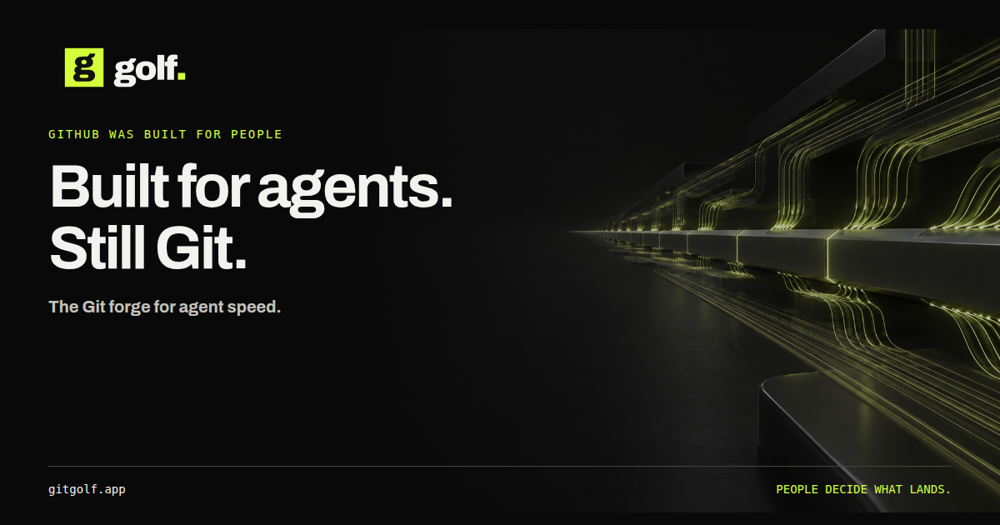

<p align="center">
  <a href="https://gitgolf.app"></a>
</p>

<h3 align="center">GitHub was built for people. Golf is built for agents.</h3>

<p align="center">
  The Git forge being built for agent speed, with people deciding what lands.<br />
  Run it on Cloudflare or on your own infrastructure.
</p>

<p align="center">
  <a href="https://gitgolf.app"><b>Website</b></a> ·
  <a href="https://docs.gitgolf.app"><b>Docs</b></a> ·
  <a href="https://gitgolf.app/try"><b>Try it in your browser</b></a> ·
  <a href="https://docs.gitgolf.app/docs/agentic-mode/"><b>Agentic mode</b></a> ·
  <a href="https://gitgolf.app/roadmap"><b>Roadmap</b></a> ·
  <a href="https://gitgolf.app/presentations"><b>Presentations</b></a>
</p>

<p align="center">
  <a href="https://gitgolf.app"></a>
</p>

> **Developer preview.** Golf works today for real Git, review, checks and previews. Agentic mode is the active roadmap. [Status](https://docs.gitgolf.app/docs/status/) separates what has shipped from what is planned.

## Why Golf

GitHub and GitLab were built for people pushing a few times an hour. Coding agents push, read and land changes continuously, and they run into limits designed for human pace:

- **Pushes wait in line.** A repository-wide lock means one push at a time, even on different branches.
- **Reading means cloning.** To read three files, an agent downloads the whole repository.
- **Landing takes a global lock.** Every merge waits for the one before it.
- **Every line waits for a person.** Review rules can't tell a typo fix from an auth change.

Golf removes those limits one measured milestone at a time, and stays Git: no custom protocol, no new storage engine, and every Git client keeps working.

## Agentic mode

| Milestone | What it delivers | Status |
| --- | --- | --- |
| **AM-0** Measure | Speed bench: racing pushes, parallel branches, clones and reads at 1–64 concurrent agents | Built; hosted baseline next |
| **AM-1** Concurrent Git | Clones, fetches and pushes overlap; a branch-level push fence replaces the repository-wide one | Built, verified locally |
| **AM-2** Source API | Read many files and commit on the server, without a clone | Built, verified locally |
| **AM-3** Agent access | Scoped, revocable API tokens and remote MCP for Claude Code, Codex and OpenCode | Planned |
| **AM-4** Land at agent speed | Three-way merges, compare-and-swap landing, checks after landing, automatic revert | Planned |
| **AM-5** Agentic inbox | Intent and risk summaries for every agent change; approve in batches | Planned |

**People stay in control.** Agentic mode is a per-repository setting, off by default. A change lands without a person only when every changed path is marked low-risk and every required check passed. Sensitive paths always need approval from someone who is neither the author nor an agent. Read the [agentic mode guide](https://docs.gitgolf.app/docs/agentic-mode/) and the [plan](docs/AGENTIC_MODE_PLAN.md).

## What works today

- **Git, issues and pull requests.** Hosted repositories, history, diffs and code review over SSH or HTTP Git.
- **Checks on every change.** Supported Actions and GitLab workflows on configured runners, with results kept against the commit.
- **Private previews.** A temporary, access-checked preview of the tested commit.
- **AI review and proposals.** Workers AI advice, review drafts and code proposals that return a tested patch for people to review.
- **Agents on your machines.** Connect a host with `golf-agent-host`, assign an issue to an agent and follow its task from the pull request.
- **CLI and MCP.** A scoped JSON CLI and a local MCP server with your permissions.

## Run it where you want

| | Cloudflare-native | Self-hosted |
| --- | --- | --- |
| **Core** | Workers, Artifacts (Git), D1 and Durable Objects | Go, Forgejo and PostgreSQL with the shared React UI |
| **Agents and checks** | A Container sandbox per task, Queues and Workflows | Enrolled Docker workers and agent hosts |
| **AI** | Workers AI and AI Gateway | Optional |
| **Install** | [One command](#deploy-on-cloudflare) | [One command](#quick-start) or [Kubernetes (Helm)](https://docs.gitgolf.app/docs/kubernetes/) |

Same interface on both. Cloudflare and AI are optional for the self-hosted core.

## Try it in your browser

Open the [local / Docker simulation](https://gitgolf.app/demo/local) or the [Cloudflare simulation](https://gitgolf.app/demo/cloudflare). They run Golf's real interface on sample data, with no account and no backend.

## Quick start

Requires Git, Python 3, curl and Docker with Compose v2 and BuildKit, on an amd64 or arm64 host.

```sh
git clone https://github.com/mjtechguy/gitgolf.git golf
cd golf
./scripts/install.sh         # or: make install
```

The installer checks prerequisites and free ports, writes a private `.env` (never overwriting one), builds and starts the stack, waits for readiness, then creates your first administrator: a Forgejo admin user, a scoped Forgejo token and a Golf account mapped to it. It asks for a username and email (`--username`, `--email`, or `--yes` to accept the defaults), generates a Golf password and saves it to a mode-0600 file under `.tmp/local-account/`; move it to a password manager and delete the file. Re-running is safe. `./scripts/install.sh --help` lists options such as `--dry-run`, `--prompt-password` and custom ports.

Open **http://localhost:8080** for Golf and **http://localhost:3001** for Forgejo. Use `localhost` throughout so request origins match the configuration. The first build takes a few minutes. To run each step yourself, follow **[your first local installation](https://docs.gitgolf.app/docs/installation/)**.

```sh
docker compose stop    # pause
docker compose start   # resume with the same data
docker compose down    # remove containers; named volumes are kept (also: make uninstall)
docker compose up -d   # recreate after down, or apply .env changes
```

Keep `.env`, the encryption keys, both databases and the Forgejo data together. Don't add `--volumes` to a routine restart.

## Deploy on Cloudflare

Needs Workers Paid, Workers for Platforms, a Zero Trust organization and a domain on Cloudflare.

```sh
npm install -g cf@1.0.0-beta.13 && cf auth create golf
python3 scripts/golf_cloudflare.py doctor --fix --remote   # checks tools and account (read-only)
python3 scripts/golf_cloudflare.py install                 # or: make cloudflare-install
```

`install` discovers your account, zone and existing Secrets Store, asks only for your hostnames, email, content and optional services, shows the plan and waits for your yes. See [what you provide and what it creates](https://docs.gitgolf.app/docs/cloudflare-setup/).

## Let your AI agent set it up

Paste this into Claude Code, Codex or OpenCode:

```text
Read https://docs.gitgolf.app/agent-setup.md and help me set up Golf.
```

The [runbook](https://docs.gitgolf.app/agent-setup.md) tells the agent how to pick a track with you, check prerequisites, run the installer and verify it, without printing secrets or creating anything billable before you agree.

## Documentation

| Start here | Go deeper |
| --- | --- |
| [Your first workflow](https://docs.gitgolf.app/docs/getting-started/) | [Architecture](https://docs.gitgolf.app/docs/architecture/) and [diagrams](https://gitgolf.app/architecture/visuals) |
| [Install with Docker](https://docs.gitgolf.app/docs/installation/) | [Cloudflare services](https://docs.gitgolf.app/docs/cloudflare-services/) |
| [Install on Kubernetes](https://docs.gitgolf.app/docs/kubernetes/) | [Coding agents](https://docs.gitgolf.app/docs/coding-agents/) and [MCP](https://docs.gitgolf.app/docs/mcp/) |
| [Deploy on Cloudflare](https://docs.gitgolf.app/docs/cloudflare-setup/) | [CLI](https://docs.gitgolf.app/docs/cli/) and [API](api/golf/v1) |
| [Status and tested limits](https://docs.gitgolf.app/docs/status/) | [Security](https://docs.gitgolf.app/docs/security/) and [recovery](https://docs.gitgolf.app/docs/recovery/) |
| [Compare Golf](https://gitgolf.app/compare) | [Implementation ledger](docs/IMPLEMENTATION_STATUS.md), [plan](GOLF_IMPLEMENTATION_PLAN.md) and [ADRs](docs/decisions) |

## Develop

Use the Go version in `go.mod` and Node 24 (`make build` also builds the web UI).

```sh
make cli
make build
make check
make helm-check
```

Read [`AGENTS.md`](AGENTS.md) before changing product scope. No repository CI workflows are configured yet; run the checks locally. The [implementation ledger](docs/IMPLEMENTATION_STATUS.md) records runnable evidence for every shipped capability.

## Current limits

Golf is a developer preview. Protected merging, full Actions and GitLab compatibility, general production delivery, coordinated restore and production scale are still being proven. Native merging today supports a merge commit when the base is already an ancestor of the head. See [status](https://docs.gitgolf.app/docs/status/) for the detail.
