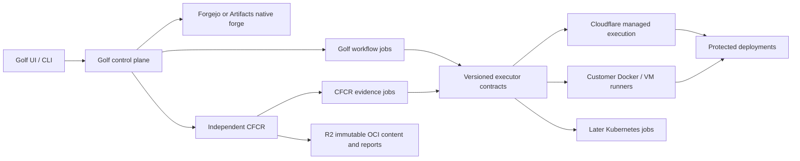

# Golf and CFCR: hybrid execution, fast scanning and delivery

Status: implementation in progress. Created 2026-10-12. Owner: Golf/CFCR.

This is the delivery plan for the agreed architecture: Cloudflare-native Golf,
independent CFCR, managed execution, customer runners, economical vulnerability
scanning, and a complete build → registry → policy → protected deployment loop.
Checkboxes are acceptance gates, not promises that an integration exists.

## 1. Checkpoint and change policy

- Golf main checkpoint: `36f7d01`.
- Independent CFCR initial main checkpoint: `1a2470b`.
- Both feature branches: `feat/hybrid-runners-cfcr`.
- Golf docs and website were clean and are outside this implementation change.
- Checkpoints are local; no remote push or hosted promotion is implied.
- Baseline: Golf `make check` passed; CFCR 47 JavaScript tests and one Python
  archive-safety test passed. Database-dependent skipped tests are not live proof.
- Runtime state, provider credentials, scanner database exports, node_modules,
  generated deployments and private receipts stay outside Git.
- The upstream checkout-action fixture preserves its original CRLF bytes.
- Each implementation slice carries tests, a setup path, capability labels,
  evidence and cleanup instructions. Commit source separately from private logs.
- Never rewrite the main checkpoint or silently migrate a retained tenant.

Read alongside [implementation status](IMPLEMENTATION_STATUS.md),
[CFCR integration](CFCR_INTEGRATION.md),
[runner pools](RUNNER_POOLS_CONTRACT.md),
[runner control](RUNNER_CONTROL_CONTRACT.md),
[Actions remote execution](ACTIONS_REMOTE.md), and
[latest hosted qualification](CLOUDFLARE_FULL_QUALIFICATION_2026-10-12.md).
The independent CFCR repository contains the registry implementation and its
execution setup contract. Golf must not import CFCR internals or its database.

## 2. Outcomes and boundaries

1. A workspace can use managed compute, its own runners, or an explicitly approved
   hybrid policy. Runner location does not change workflow language semantics.
2. CI can build and push OCI images to independent CFCR with exact-job credentials.
3. Syft inventories, Grype findings and Trivy findings are available without
   downloading a multi-gigabyte database for every warm job.
4. Qualified CI-produced evidence can remove duplicate registry scanning.
5. Policy decisions bind immutable digests, current trust and database freshness.
6. PRs and runs expose the resulting protected deployment URL and expiry.
7. Operators see queue age, timing, real capability states, failures and cost.
8. Local/Docker/Kubernetes/Cloudflare share product concepts and UI while exposing
   only supported runtime operations.

The first independent runner slice handles a fixed, approved scanner recipe.
Arbitrary repository code, Docker builds, AI agents and deployment steps are
separate workload classes. An uploaded image's entrypoint is never executed by
scanning it. A customer-controlled runner's authenticated output is an assertion
from that customer, not hardware attestation or proof of an honest host.

## 3. What exists, and what is still unqualified

| Area | Existing evidence | Remaining gate |
|---|---|---|
| CFCR distribution | Docker/regctl/Cosign; hosted OCI 71 passed, eight conditional skips | Broader client/version and large-object hosted matrix |
| Scanner engines | Five real reports in isolated Docker; gzip and zstd fixture | Full hosted scanner startup and resource qualification |
| Native CI publishing | Exact-commit image publication and Docker pull | General container builds and Actions/GitLab native execution |
| Portable Actions | Maintained engine, actual Requests workflow, Forgejo execution | Broader compatibility catalog and isolated runner enrollment |
| Native job execution | Approved Python-module tests and lifecycle gates | General Linux workflow executor adapter |
| Self-hosted runners | Existing portable Docker runner, leases and named pools | Native/CFCR outbound protocol and complete admin UX |
| Native collaboration | Shared UI with bounded implemented adapters | Full repository parity checklist remains open |
| Deployment lifecycle | Protected previews, permissions and cleanup checks | Final rollback failure and full release rehearsal |
| Performance | Warm post-index reads measured; authority admission change tested | Loaded-workspace tail and large-repository scale qualification |
| Forgejo migration | Fresh-target and workflow qualification | Private pending-review loss gate; no retained cutover |

A green unit suite does not close the right column. In particular, the latest
hosted scanner failed startup and rollback preflight failed with D1 403/API 7403.

## 4. Ownership and topology

Golf owns repository authority, workflow source, PR/check semantics, approval,
workflow dependencies and environment policy. CFCR owns OCI bytes, manifests,
tags, retention, scan admission, evidence provenance and registry policy.

Each product owns its jobs and durable state. Share a small versioned transport
and executor behavior; do not add a mandatory global scheduling service. Native
DOs serialize narrow authority decisions. D1 serves indexed inventories and
usage projections. R2 stores immutable objects. Queues carry durable intents;
the authoritative owner rechecks state when consuming them.

No distributed transaction across Golf, CFCR, R2 and provider APIs is assumed.
Every cross-service mutation needs an outbox or reconciliation record, stable
intent identifier and explicit unknown-outcome handling.

## 5. Deployment modes

| Mode | Control/metadata | Execution | Database and content |
|---|---|---|---|
| Portable Docker | Golf + Forgejo APIs | Existing Docker runner, optional CFCR runner | Existing PostgreSQL/storage configuration |
| Portable Kubernetes | Same supported APIs | Qualified isolated jobs after P8 | Operator-managed databases/object stores |
| Cloudflare managed | Workers/DO authority + D1 views + Artifacts | Containers; qualified Builds where appropriate | Private R2 and versioned snapshots |
| Cloudflare with customer compute | Same native control plane | Outbound customer runner | Local verified public DB cache; private results in CFCR |
| Customer Cloudflare account | Same provisioning contracts | Customer-account eligible services | Customer-account resources and quotas |

Optional PostgreSQL through Hyperdrive remains a separate data adapter decision.
Hyperdrive connects to an existing database; it does not make D1 into PostgreSQL.
No new PostgreSQL dependency is needed for the native scanner control path.

## 6. Cloudflare service fit

| Service | Concrete role | Admission/qualification constraint |
|---|---|---|
| Workers | Authentication, admission, HTTP/RPC, event handling, UI | Do not run a Linux scanner inside a Worker isolate |
| Durable Objects | Leases, scoped coordination, container lifecycle | Avoid one global scheduling hot spot |
| D1 | Indexed job/pool/status/usage views | Authority writes and view revisions must be distinguished |
| R2 | OCI content, reports, snapshots, CI artifacts/cache objects | Tenant authorization before reads; bounded transfer/retention |
| Artifacts | Canonical eligible Git repositories | Enforce currently supported repository/blob limits |
| Containers | On-demand trusted scanner and qualified Linux jobs | Cold-start, memory, disk, cleanup and actual bill measured |
| Sandbox | Container orchestration or supported dynamic-code workloads | It is not a separate cheaper Linux compute tier |
| Container snapshots | Clean public database filesystem templates | Image-bound restore, expiry and storage behavior qualified |
| Workers Builds | Supported connected-repository build/deploy pipelines | Must qualify trigger, output, auth and cancellation semantics |
| Queues | At-least-once dispatch/outbox consumers and dead letters | Duplicate delivery cannot mint duplicate accepted attempts |
| Workflows | Long-running approved orchestration and waits | No claim that it supplies Linux build/scanner execution |
| Workers for Platforms | Tenant application deployment | Scope bindings, limits, routes and teardown per deployment |
| Access / Zero Trust | Human outer gate and machine service authentication | Golf/CFCR still enforce current repository permissions |
| DNS and certificates | Owned preview hostname provisioning | Exact ownership inventory, propagation and cleanup receipts |
| Cache API / CDN | Immutable authorized assets and content | Private-cache keys cannot bypass permission revocation |
| KV | Optional low-risk hints/configuration | Never authoritative lease, revocation or budget balance |
| Analytics/observability | Request, queue, execution and provider metrics | Bounded labels; no tokens, source or private report bodies |
| AI Gateway / Workers AI | Optional Golf App AI calls with budgets | Separate app scopes and cost; no implicit deployment authority |
| Email | Notifications, invitations, run summaries | Optional delivery adapter; suppress unauthorized recipients |
| Hyperdrive | Optional existing Postgres/MySQL connectivity | Explicit backend adapter, no gratuitous native dependency |
| Browser Rendering | Optional bounded UI validation jobs | Separate credentials, time limits and artifact retention |
| Turnstile / rate limits | Public enrollment and abuse surfaces | Does not substitute for authentication or authorization |

Do not add a service solely to increase the integration count. Workers, R2,
DOs and a reusable engine already cover the scanner core. Redis is not required:
Trivy's Redis analysis cache is not a remotely mounted vulnerability database.
R2 FUSE is not assumed to have local SSD latency or complete POSIX semantics.

## 7. Job and attempt contract

Every admitted job has immutable:

- contract/version; owning product; workspace and repository binding;
- job ID and idempotency key; admission actor and policy revision;
- workload class and approved recipe/image identity;
- exact Git commit or OCI subject digest and platform;
- resource/network constraints, deadline and result schema;
- allowed executor/pool/trust class and fallback policy;
- budget reservation and evidence freshness policy.

An attempt adds a monotonically increasing generation, random unguessable lease,
runner identity, start time, renewable lease expiry and immutable hard deadline.
The lease is not a generic repository credential. Capabilities permit exact input
reads and bounded output publication, with current authority checked each time.
Long-lived machine credentials remain in the supervisor, never in job code.

States: queued → claimed/running → succeeded/failed/cancelled/lost. Cleanup is a
separate observation: pending/confirmed/failed/unknown. Failed cleanup quarantines
capacity until reconciliation. A terminal result never changes because a late
callback arrives. A terminal retry requires matching attempt identity.

Claims serialize with cancellation, revocation and admission changes. Heartbeats
cannot revive an expired lease or extend the immutable deadline. Outputs arriving
from a superseded or expired attempt are rejected. An RPC timeout is an unknown
outcome: query the accepted intent before retrying external side effects.

A runner disconnect must cause a local watchdog stop and eventual owner-side
lease expiry. Server revocation alone cannot prove an offline process stopped.
Retries of pure scans are distinct from replaying builds or deployments.

## 8. Runner enrollment and trust

### First repository-scoped scanner executor

Use the existing CFCR management authorization boundary. A current repository
administrator explicitly enrolls a named scanner identity. Return a random
credential once; store only its digest, scope, sponsor, expiry and revocation.
Bound enrollment count and credential lifetime. The ordinary registry credential
cannot be substituted for the machine credential, or vice versa.

The machine endpoint is outbound HTTPS, no public inbound listener. Scope it to
one repository and the configured approved scanner recipe. Polling cannot search
other tenants. Claim responses are replay-safe for the same active machine job.
No fallback to paid managed compute occurs when the customer runner is absent.

Enrollment approves this identity as an evidence producer for that repository.
Show that fact explicitly in setup. Revocation must fence active input/output and
policy use of its historical evidence. Credential expiry stops new work; historical
trust and evidence freshness are separate concepts. A sponsor losing required
administrative authority disables the enrollment until explicitly re-established.

### General workspace runner pools

Extend existing pool/control concepts rather than bypassing them:

- enrollment challenge, stable machine identity, rotation and revoke;
- workspace scope, repository allowlist, environment and trust class;
- capabilities: OS, architecture, resources, approved engines and network profile;
- active/draining/offline/quarantined state, last heartbeat and cleanup state;
- policy version pinned at admission and checked at claim;
- max parallel attempts, per-workspace fairness and resource reservations.

Labels route eligible work; they never grant authority. Fork PR jobs cannot use
secret-bearing trusted pools. Customer hosts are trusted by their own operator;
managed multi-tenant pools must enforce platform isolation independently.

## 9. Scanner recipe and database lifecycle

The recipe pins Syft, Grype, Trivy, helper versions, engine image, database schema,
immutable database identities, source timestamps and scan limits. Tool versions
and DB freshness are separate. A recipe update never mutates an in-flight job.

Database update pipeline:

1. One scheduled updater checks approved upstream sources.
2. Download to an isolated staging directory with byte/time bounds.
3. Verify upstream integrity metadata where available and record source/version.
4. Validate database schema with the pinned engine and known vulnerable fixture.
5. Hash immutable files, publish manifest/chunks or prepared image.
6. Atomically publish the approved recipe pointer after all objects exist.
7. Existing jobs finish with their original recipe; new jobs use the new pointer.
8. Retain referenced versions until jobs/reports/retention policy release them.
9. Alert on stale feed, corrupt download or unavailable upstream; never report a
   clean scan because database acquisition failed.

For customer runners use persistent local SSD content keyed by recipe digest.
Verify when installing a version; make it read-only to jobs. Each job gets fresh
private workspace and mutable analysis cache. Do not hash/copy several gigabytes
on every warm scan when an immutable verified installation can be safely reused.
Invalidate verification if the host/operator changes the cache. A customer host
can still lie; authentication does not provide remote attestation.

For Cloudflare compare the existing baked database image with a clean filesystem
snapshot. Snapshot contains public databases only: no tenant files, reports,
credentials, shell history or job workspace. Build it before running tenant work.
Restore from the exact compatible engine image. Handle expiry by rebuilding a
clean template. No production dependency on an unqualified snapshot API path.

R2 chunked export is a durable recovery/distribution format. It is not a decision
to download 1.76 GB for every job. Existing experimental schema2 helpers are not
an enabled complete restore path.

## 10. Inventory, findings and policy caches

| Cache | Required identity | Invalidation |
|---|---|---|
| Public database | Source/schema/content digest and engine compatibility | New approved feed/version, corruption, expiry |
| Syft inventory | Tenant, image+platform, cataloger version/config | Cataloger/config/input change |
| Trivy analysis | Tenant, image+platform, Trivy config/version, auxiliary DB | Native analyzer or Java identification data change |
| Grype findings | Inventory identity, Grype version, vulnerability DB, match config | Any matching input changes |
| Trivy findings | Native analysis identity, engine/DB/match config | Any matching input changes |
| Policy decision | Findings, current trust revision, policy/freshness | Authority/trust/policy/time changes |
| Build cache | Tenant/repo/trust domain/toolchain/input | Scope, branch trust, toolchain or source change |

A Grype DB refresh may reuse a compatible Syft inventory. A Syft cataloger change
may require re-analysis of the original image. Trivy keeps its own analysis path;
feeding arbitrary third-party SBOMs to Trivy is not equivalent coverage.

No cross-tenant private inventory/results dedup in the first release. Public
verified database bytes can be shared. Cache hits still require current access.

Keep native engine reports unchanged. UI shows per-engine findings and grouped
vulnerability/package identities. Do not sum overlapping CVEs as unique issues.
Unknown severity remains unknown and fails applicable policy closed.

## 11. CI evidence reuse and OCI semantics

The cheapest scan may be in the build job while the image is already local.
Provide an integration that publishes image digest plus bounded signed/authorized
reports. CFCR validates producer identity, exact subject/platform, admitted tool
recipe, source commit, freshness and current trust policy. Supplied OCI referrers
remain supplied/unverified unless they pass that separate acceptance path.

On push, index image and schedule only missing approved evidence. Normal push can
complete with analysis pending; release promotion and deployment gates can wait.
An OCI index needs acceptable evidence for every required child platform.
A scan of amd64 alone does not approve an arm64 image or the entire index.

Registry job credentials retain existing exact-job tag and digest scope. A build
cannot overwrite another job's tag, delete content, edit policy or enroll runners.
Cancellation revokes publication capability. Unknown final PUT outcome is queried
by exact digest/tag before retrying.

## 12. Workflow execution and compatibility

Portable Golf already has a maintained Actions engine and explicit GitLab support
catalog. Extend those adapters instead of writing a universal YAML interpreter.

Separate parsing/admission from execution transport. Preserve immutable source,
permissions, secret brokerage, timeout, cancellation and dependency semantics
when a job moves from local Docker to customer/native compute.

Required compatibility fixtures:

- real checkout and setup actions, composite action, Node action;
- shell failure propagation, multiline scripts, environment and output files;
- before_script/script/after_script ordering for admitted GitLab forms;
- dependent jobs, matrix limits, conditions and unsupported syntax rejection;
- cache/artifact scope and expiry; services/network boundaries;
- fork/untrusted PR credential denial and event spoofing;
- manual/push/PR intent replay and changed-head staleness;
- runner crash before start, during work and after result upload;
- workflow cancellation while dependency/preparation/publish is pending.

Explicitly unsupported language constructs fail admission with an actionable
message. Registered Forgejo runners or a Cloudflare container alone do not prove
GitHub Actions compatibility. Keep producer-specific event and token semantics.

## 13. Isolation and resource bounds

Managed jobs run without a host Docker socket, broad provider credentials or
shared writable tenant directories. Docker builds require a separately qualified
builder; rootful Docker-in-Docker is not silently enabled.

Customer scanner supervisor may use its operator's Docker daemon, but that socket
is never mounted into the scan container. Scanner container uses an approved
image ID, non-root user, read-only root, bounded memory/CPU/PIDs/disk/time, minimal
capabilities, fresh workspace and restricted network access to an input broker.
The broker forwards only admitted input/report endpoints. It holds credentials
outside the scan container. No arbitrary URL fetch/proxy and no image entrypoint.

Archive inputs are hostile: bound compressed and expanded size, path traversal,
file count, nesting and individual report size. Database extraction similarly
rejects traversal, symlinks, duplicate paths, digest mismatch and quota overflow.

Logs and receipts redact credentials; error output must not expose bearer tokens,
presigned URLs, local secret paths or report/source bodies. Retain enough stage
information to diagnose provider failures without returning raw secrets.

## 14. Scheduling, cost and budgets

Eligibility comes first: current permission, pool trust, OS/arch, engine, resource,
network and data-location constraints. Among eligible choices optimize measured
queue + transfer + startup + execution + cleanup time and marginal cost.

Policies: customer-only (wait), managed-only, customer-preferred with explicitly
bounded managed fallback. A stopped customer machine must not unexpectedly incur
managed charges. Maintain reservations at admission and settle observed usage;
budget exhaustion refuses new work without corrupting existing terminal state.

Use zero idle scanner instances initially. Prewarm only a bounded burst justified
by measured queue demand or an approved publish preparation flow. Every prewarm
has an independent deadline, cap and teardown. No always-on fleet by default.

Reference prices checked 2026-10-12, USD, before allowances/taxes/other services:

- Containers: memory $0.0000025/GiB-second, active CPU $0.000020/vCPU-second,
  provisioned disk $0.00000007/GB-second. A standard-3 at fully busy two CPUs,
  8 GiB/16 GB for 60 seconds is about $0.00367; 1,000 such executions about $3.67.
  This is arithmetic, not a measured scan duration or total bill.
- Workers Builds Paid: 6,000 minutes/month included then $0.005/minute, currently
  4 vCPU/8 GB/20 GB, six concurrent builds, 20-minute build limit. Qualify supported
  build/deploy usage before treating it as an executor candidate.
- Self-hosting shifts compute and storage cost to the customer; it is not free
  hardware. Show Golf service charges separately from customer infrastructure.

Sources: [Containers pricing](https://developers.cloudflare.com/containers/platform/pricing/),
[Builds limits/pricing](https://developers.cloudflare.com/workers/ci-cd/builds/limits-and-pricing/).

Benchmark actual CPU seconds, provisioned duration, transfer, R2 operations,
DO/Worker work and retained storage. Do not compare a hypothetical CF scan with
GitHub's subsidized public-runner price as if both were measured paid workloads.
Initial live testing remains within the user's $10/day planning envelope; this
is not a provider-enforced billing cap.

## 15. Product UI and operations

Reuse Golf's shared repository shell, tabs, Settings sidebar, tables and tokens.
No separate Cloudflare-only visual language. Settings lead with current values;
Add/Edit/Revoke are explicit forms with confirmation appropriate to the action.

Repository and workspace settings must show:

- execution mode and supported workload classes;
- pool names, eligibility, resource limits, trust and fallback policy;
- actual runner health, last contact, version, current job and draining state;
- registry endpoint, OCI digest, evidence status and current policy reasons;
- scanner recipe/tool versions/database timestamps and cache readiness;
- setup commands with credentials revealed once and no secrets in copied logs;
- supported/unsupported capability explanation specific to the runtime.

Run/PR surfaces show queue/start/scan/publish/deploy phases, live logs, exact source
and image digest, actionable failures, cancel state, cleanup state and protected
URL with copy/open/expiry. Preserve navigation state and avoid full-page reloads.
Use existing live-update facilities with bounded reconnect/backoff; no polling
fan-out per row or endpoint on every render.

Operations shows p50/p95 by stage, queue age/depth, current capacity, cache hits
by layer, scanned bytes, peak memory, DB freshness, provider errors, estimated
versus observed usage, pending cleanup and unhealthy runners. Unknown must explain
which observation is missing; configured must not be displayed as healthy.

## 16. Implementation phases and task gates

### P0 — Reproducible checkpoint and contracts

- [x] Inspect all sibling repositories and isolate legitimate source from runtime data.
- [x] Run baseline Golf and CFCR checks.
- [x] Commit existing source to each main and create aligned feature branches.
- [x] Write this plan with product boundaries and current failed qualification gates.
- [x] Record implemented contract and source-specific acceptance evidence per slice.

### P1 — Independent CFCR outbound scanner execution

- [x] Add explicit managed/external scanner mode; refuse silent fallback.
- [x] Enroll a repository-scoped, bounded, revocable scanner identity as admin.
- [x] Store only machine credential hash; never reveal it through inventory/audit.
- [x] Expose versioned HTTPS claim/input/blob/report/heartbeat/finish transport.
- [x] Fence every operation with current identity, sponsor, actor and attempt.
- [x] Keep one active attempt per identity and bounded repository concurrency.
- [x] Make claim replay safe and terminal acknowledgments attempt-authenticated.
- [x] Expire disconnected leases and preserve cancellation/terminal state.
- [x] Record external producer and make revocation invalidate policy trust.
- [x] Add supervisor using approved Docker image and a credential-free job broker.
- [x] Stop on failed heartbeat/deadline, clean up owned resources, report cleanup.
- [x] Document CLI setup, enrollment trust, stop/revoke and no-inbound-port model.
- [x] Real workerd tests for claim races, expiry, revocation, wrong repo/token,
  incomplete/conflicting reports, successful completion and terminal replay.
- [x] Real Docker scanner through that transport with five immutable reports.

P1 is done only when the real scanner, not a fake clean report, reaches the registry
through the external transport and the isolation/cleanup negatives pass.

### P2 — Fast database reuse and measured scanner execution

- [x] Add monotonic stage durations/bytes to bounded scanner receipts.
- [x] Eliminate per-job Trivy DB copy using qualified read-only DB access and
  private analysis cache; test actual pinned Trivy, not just path construction.
- [x] Verify immutable database installation once in a trusted supervisor lifecycle.
- [x] Atomically persist image-bound verification under the exclusive private journal.
- [ ] Implement versioned local cache install with atomic activation and locks.
- [x] Enforce freshness of all three database feeds without refreshing age on cache hits.
- [ ] Implement updater integrity/rollback rules and versioned cache installation.
- [ ] Compare warm and cold scans with vulnerable/clean/Java/multi-layer fixtures.
- [ ] Concurrent jobs cannot corrupt DB/analysis caches or see another tenant's files.
- [ ] Publish p50/p95, bytes transferred, CPU/memory, cache identity and cleanup.

### P3 — Inventory/evidence reuse and policy correctness

- [x] Separate inventory, matching and policy cache identities.
- [x] Reuse Syft SBOM only when cataloger/config/platform identities agree.
- [x] Keep Trivy-native analysis and Java identification data dependencies.
- [ ] Accept CI evidence through separately authorized producer contract.
- [x] Require exact digest/platform/recipe/trust/freshness and bounded schemas
  for registry-generated evidence reuse (CI import remains separate).
- [ ] Schedule only missing required scans after push.
- [x] Revoked producer, expired evidence, changed recipe and removed report fail closed,
  including revocation of an upstream inventory producer after admission.
- [ ] Index approval requires all required platforms; deduplicate DAG traversal.
- [ ] UI distinguishes supplied/generated/trusted/current without conflating them.

### P4 — Cloudflare managed execution qualification

- [x] Reproduce current native startup failure with bounded stage diagnostics.
- [ ] Qualify baked-image startup across expected instance sizes and image versions.
- [ ] Qualify clean filesystem snapshot create/restore/expiry/fallback.
- [ ] Reject snapshots containing tenant state; never snapshot after tenant execution.
- [ ] Compare Containers/Sandbox and supported Workers Builds path on the same inputs.
- [ ] Measure sustained and burst load, quota refusal, allocation failure and cleanup.
- [ ] Bound concurrency/budget/prewarm; teardown independent of test process health.
- [ ] Produce hosted five-report proof, current-authority negatives and absence receipts.

### P5 — Golf native/general runner adapter

- [ ] Map existing portable job semantics to versioned native execution contract.
- [ ] Reuse existing engine catalogs and credential brokers; preserve source fences.
- [ ] Add workspace enrollment/pool placement to native backend with matching UI.
- [ ] Implement machine rotation, revoke, drain, capacity and trusted/untrusted pools.
- [ ] Run real Actions and GitLab fixture corpus on local and native control paths.
- [ ] Show explicit unsupported forms; don't silently reduce workflow semantics.
- [ ] Test worker loss, duplicate dispatch, cancellation, reboot and cleanup failure.
- [ ] Qualify container builds without giving customer jobs the supervisor socket.

### P6 — Complete build/publish/evidence/deploy vertical

- [ ] Build immutable commit in an admitted isolated job.
- [ ] Publish exact OCI digest using existing scoped job credential.
- [ ] Reuse qualifying CI evidence or wait for independent scanner result.
- [ ] Evaluate current policy, signature/provenance and environment approval.
- [ ] Provision protected PR deployment under approved resource/budget policy.
- [ ] Show URL, image/commit, readiness and expiry on both PR and run pages.
- [ ] Revoke access after repository permission loss and stop expired deployments.
- [ ] Test mutable tag race, changed head, stale approval and cleanup interruption.

### P7 — Scheduling, usage and polished operations

- [ ] Add budget reservations, fairness and bounded fallback policy.
- [ ] Expose actual connected-service and runner health with observation age.
- [ ] Add end-to-end latency breakdown and cache metrics to existing Operations.
- [ ] Preserve fast shared navigation and live updates without request amplification.
- [ ] Browser checks desktop/mobile/keyboard and local/native settings parity.
- [ ] Alert on stale DB, oldest queue age, repeated provider failure and cleanup debt.

### P8 — Kubernetes, customer accounts and standalone integration

- [ ] Kubernetes executor: isolated namespace/job, service account, quotas,
  NetworkPolicy, termination grace, TTL and orphan reconciliation.
- [ ] Autoscaling uses eligible queued demand and bounds, not raw queue length alone.
- [ ] Customer Cloudflare account provisioning uses the same resource contracts.
- [ ] Standalone CFCR identity adapter with no mandatory Golf deployment.
- [ ] Other forge/CI adapters use explicit source and evidence contracts.
- [ ] Portability/recovery matrix and documented upgrades for each supported mode.

### P9 — Release qualification and populated demo

- [ ] Resolve D1 rollback-preflight failure, rehearse upgrade and rollback on owned data.
- [ ] Run concurrency/revocation/performance/security matrix below.
- [ ] Confirm no regression to portable Forgejo and shared UI.
- [ ] Prepare populated repositories, PRs, actual CI results and protected URLs.
- [ ] Use scoped machine tests; never depend on a user's emailed Access code.
- [ ] Four-hour demo maximum, explicit stop command and independent auto-stop.
- [ ] Prove owned resource absence after stop, including containers/images/routes,
  Access applications/tokens, queues, databases, buckets and cleanup timers.
- [ ] Final status lists passed, failed, skipped and unsupported separately.

## 17. Validation matrix and evidence format

Every packet records source commit+dirty hash if applicable, engine image digest,
recipe/DB identities, provider/tool versions, exact commands, time bounds, results,
known skips, sanitized timings and resource absence. Private raw credentials are
never committed. Tests must exercise production paths, not replacement logic.

| Boundary | Positive | Negative/fault |
|---|---|---|
| Enrollment | Admin enroll/list/revoke | Reader/writer, foreign repo, stale sponsor |
| Claim | One eligible queued job, same-identity replay | Two machines racing, duplicate request, quota full |
| Lease | Heartbeat until hard deadline | Expired, cancelled, revoked, changed attempt |
| Inputs | Exact manifest and referenced blobs | Foreign digest, URL redirects, oversized/archive bomb |
| Outputs | Five correct immutable reports | Missing kind, malformed/oversized, changed bytes, late write |
| Trust | Approved producer and recipe | Supplied reports, revoked producer, stale DB |
| Cache | Same trusted immutable recipe reused | Corruption, version mismatch, tenant crossover |
| Runtime | Approved image, non-root, bounded resources | Socket/host mount, arbitrary entrypoint, network escape |
| Workflow | Real catalog fixtures and dependencies | Unsupported syntax, stolen secret, stale source |
| Deployment | Exact digest + approval + readable URL | Changed head, expired grant, wrong repo reader |
| Recovery | Restart resumes observation without replay | Lost response, orphan, failed cleanup, provider outage |
| Scale | Independent tenants and concurrent readers/jobs | Hot tenant, thundering herd, budget exhausted |

Use unit tests for parsing/fences and workerd/D1/DO/R2 integration for durability.
Use real Docker for engine behavior. Use actual Cloudflare for provider lifecycle.
Mocked scanner reports prove protocol behavior only; label them as such.

Suggested performance targets, pending baseline calibration:

- Warm shared navigation should render cached authorized content immediately.
- Warm repository metadata p95 under 500 ms at the chosen qualification load.
- No repeated database download/copy on customer-runner warm scan.
- Display queued/running/finished changes within five seconds under normal load.
- Revoke new input/output by the next authority check, with bounded local watchdog.
- Measure cold/warm scan latency by image size; do not promise a universal scan time.

## 18. Recovery, rollout and stop rules

Feature flags/configuration default to existing managed execution. Enabling an
external path is an explicit deployment/admin decision, never an inferred fallback.
A recipe or mode change must refuse/reconcile already-admitted incompatible jobs;
never silently rewrite them. Store producer/attempt additions compatibly and
preserve old terminal evidence with clear provenance.

A release requires successful source checks, workerd boundary tests, real engine
proof, hosted resource lifecycle proof, rollback rehearsal and cleanup. A failed
step produces an honest blocked gate; it does not promote the next release.

Budget/deadline or persistent provider failure stops new paid tests. Clean up
owned resources first, retain sanitized receipts, and leave source/tests reviewable.
Do not extend a demo or keep a warm scanner running just to avoid a later cold start.

## 19. Decisions intentionally deferred until evidence exists

- Exact managed instance size and snapshot-vs-image default.
- Workers Builds as any broader job executor beyond its supported pipeline model.
- Global multi-region queue placement and data residency guarantees.
- Cross-tenant private content/result deduplication.
- Permanent warm scanner pools and Redis-backed Trivy servers.
- Hardware-attested customer evidence and multi-cloud autoscaling providers.
- General marketplace, paid repository access and unrelated service integrations.

These are not missing implementation details to guess. Each needs a concrete
cost, compatibility or security gate before becoming a default product promise.

## 20. Primary references

- [Container architecture](https://developers.cloudflare.com/containers/concepts/architecture/)
- [Container limits](https://developers.cloudflare.com/containers/platform/limits/)
- [Container snapshots](https://developers.cloudflare.com/containers/guides/snapshots/)
- [Workers limits](https://developers.cloudflare.com/workers/platform/limits/)
- [Builds configuration](https://developers.cloudflare.com/workers/ci-cd/builds/configuration/)
- [Build caching](https://developers.cloudflare.com/workers/ci-cd/builds/build-caching/)
- [Artifacts build integration](https://developers.cloudflare.com/workers/ci-cd/builds/git-integration/artifacts-integration/)
- [Queue delivery guarantees](https://developers.cloudflare.com/queues/reference/delivery-guarantees/)
- [Trivy SBOM caveats](https://trivy.dev/docs/latest/target/sbom/)
- [Trivy database configuration](https://trivy.dev/docs/latest/configuration/db/)
- [Trivy analysis cache](https://trivy.dev/docs/latest/configuration/cache/)
- [Grype scan targets](https://oss.anchore.com/docs/guides/vulnerability/scan-targets/)
- [GitHub self-hosted runner model](https://docs.github.com/en/actions/concepts/runners/self-hosted-runners)
- [Forgejo Actions](https://forgejo.org/docs/latest/admin/actions/)

Recheck mutable provider limits and prices before paid qualification and release.

## 21. First implementation packet — 2026-10-12

P1 is implemented in independent CFCR commit `9b34797`, with setup in
`golf-cfcr/docs/EXTERNAL_SCANNER.md`. The packet includes explicit external mode,
repository-admin enrollment/trust, short-lived hashed machine credentials, scoped
HTTP transport, replay-safe claims, heartbeat/deadline fences, immutable reports,
producer revocation and cleanup quarantine/reconciliation. The one-job Docker
supervisor supports rootless Docker through a private Unix-socket broker.

Actual Syft/Grype/Trivy produced all five reports twice through local workerd in
7.885 and 8.107 seconds for the small vulnerable fixture. Both runs rejected the
vulnerable image under policy and removed owned containers/networks. Running
cancellation, actual supervisor SIGKILL, independent engine/broker shutdown,
restart refusal and admin cleanup reconciliation passed. These timings are not
large-image measurements, hosted results or an SLA. Trivy's read-only database
access also passed, eliminating its per-job copy; other P2 caching tasks remain.

Source setup validation emits no Container application in external mode. The
managed Container path is unchanged in capability: its previous hosted startup
failure remains open. General Actions/GitLab native execution, UI enrollment,
credential rotation, inventory reuse and hosted qualification are not delivered
by P1. See the [sanitized execution receipt](compatibility/evidence/cfcr-external-scanner-20261012.json).

Final local regression: 54 JavaScript tests and two Python tests passed; OCI
conformance passed 75 specs with four conditional skips. No hosted deployment
was made. All scanner proof containers and networks were removed.

## 22. Database, inventory and evidence reuse packet — 2026-10-12

P2/P3 now have a concrete partial implementation in independent CFCR commit
`e5812ee`. Database
verification is cached by immutable Docker image ID and embedded recipe hash in
a private, atomic receipt, under the existing exclusive supervisor journal. The
verifier has a hard timeout, an ownership label and explicit recovery identity.
Each scan still checks the Grype, Trivy and Java feed timestamps. Seven-day
freshness is never extended by use. Database image updates remain operator
approved; this is not an automatic snapshot installer or updater.

Registry-generated exact evidence can satisfy a new scan request without any
container execution. It must match the same repository, immutable image digest,
engine image/recipe, retained reports, current producer trust and age limits.
The new audit job records its source and original evidence age. Severity/signature
policy continues to evaluate independently. A separate inventory key binds the
Syft tool, explicit cataloger profile and input limits; changed vulnerability data
need not invalidate matching inventory. The scanner verifies all downloaded
inventory bytes, then runs Grype and independent Trivy analysis. Transitive
producer dependencies preserve revocation through reuse. There is no cross-tenant
sharing or implicit acceptance of arbitrary CI-supplied SBOMs.

Bounded immutable receipts record monotonic per-stage durations, input bytes,
feed versions/expiry and hit flags. `force: true` with a new idempotency key
bypasses both inventory and result reuse. Old evidence without the new receipt
never satisfies the full result cache. Manual fresh requests are still necessary
to refresh an old terminal scan; automatic post-push freshness scheduling is open.

Final local workerd + real Docker results for the **524-byte compressed input
fixture**, with the scanner image already installed:

| Path | End-to-end supervisor time | Database verification | Scanner containers |
| --- | ---: | ---: | --- |
| First verification receipt | 8.476 s | 3.735 s | One engine plus broker |
| Verified image reused, forced full scan | 4.782 s | 0.006 s | One engine plus broker |
| Verified image and Syft inventory reused | 4.386 s | 0.010 s | One engine plus broker |
| Exact complete evidence reused | Not benchmarked | None | None; attempt zero |

These are individual samples, not p50/p95, initial-download timings, hosted
latencies or representative large/Java image results. The inventory test expires
matching evidence metadata without replacing its DB image; a real DB-version
rollout remains unqualified. Five reports and genuine vulnerable findings were
checked. Running cancellation, supervisor SIGKILL, independent shutdown, restart
refusal and owned cleanup passed again. Regression: 62 JavaScript and three Python
tests; OCI conformance 75 passed, zero failed, four conditional skips; production
external-mode preparation passed without creating cloud resources.

The new paid managed check deployed the same immutable scanner image through the
production `ScannerTask`/`ScannerOutbound`, with synthetic fixture authority and
standard-3. It failed at readiness before producing reports:
`internal error; reference = vojbhl2v9qopuuisshrub9v7`. The three-minute job deadline
and independent fifteen-minute host cleaner bounded the attempt. Worker, container
application and uploaded image absence were verified, then the timer was stopped.
The test does not qualify managed scanning, hosted external-runner transport,
full Golf/D1 integration, snapshot restore, or general Actions/GitLab execution.

The [sanitized source/timing/cleanup receipt](compatibility/evidence/cfcr-scanner-cache-20261012.json)
records both the passing local checks and failed managed attempt. Operator setup
and the separately invoked paid helper are documented in CFCR's
`docs/EXTERNAL_SCANNER.md`. P2/P3/P4 remain partially complete; their remaining
checkboxes are release gates, not implied capabilities.
