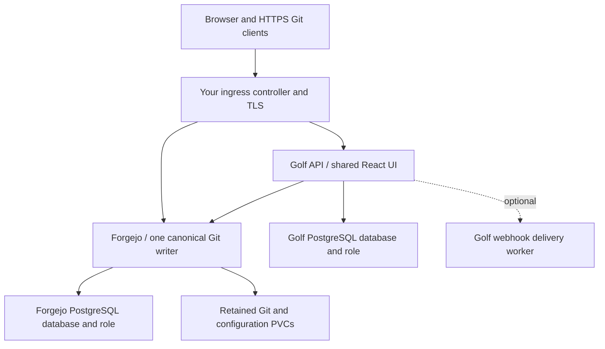

# Install Golf on Kubernetes

Golf’s Helm chart deploys the portable Golf platform: the shared React interface and Go API, Forgejo for Git and collaboration, and either bundled or operator-managed PostgreSQL. Cloudflare and AI are optional.

## What runs where



| Component | Chart behavior | Persistent ownership |
| --- | --- | --- |
| Golf | Deployment; configurable replicas; HTTP readiness/liveness/startup checks | Sessions, identity, policy and receipts in Golf’s database; shared keyring |
| Forgejo | One rootless StatefulSet writer, pinned reviewed image | Independent database plus Git/data and configuration claims |
| PostgreSQL | Optional one-replica StatefulSet | Separate `golf` and `forgejo` databases/roles; one data claim |
| Webhook delivery | Optional isolated single worker | Explicit outbox authority and approved receiver egress |
| Networking | ClusterIP services, optional HTTP ingress, default-deny policies | You supply controller, DNS, certificates and an enforcing CNI |

The core chart does not install CI runners, coding-agent workers, object storage or a production deployment controller. Those are separate Golf services with independent setup. Multiple Golf replicas do not turn the single Forgejo/PostgreSQL writers into an HA stack.

## 1. Check prerequisites

You need access to the private product repository, a built Golf image, Kubernetes **1.32+**, Helm, kubectl, Git and Python 3. The chart supplies no default Golf release image. Use the checkout’s pinned Forgejo image; do not substitute another tag and assume compatibility.

Choose a cluster/context deliberately. For a durable installation, provide a storage class with the capacity/reclaim policy you intend, a NetworkPolicy-enforcing CNI, and HTTP ingress/TLS if exposing it remotely. The default resource requests total roughly 300m CPU and 512 MiB memory for one Golf/Forgejo/PostgreSQL pod each; budget additional capacity for system services, startup, a second Golf replica and a surge pod. Defaults are starting limits, not measured sizing guidance.

```sh
export GOLF_KUBECONFIG=/absolute/path/to/your/kubeconfig
export GOLF_KUBE_CONTEXT=your-explicit-context
export GOLF_NAMESPACE=golf
export GOLF_RELEASE=golf
kubectl --kubeconfig "$GOLF_KUBECONFIG" --context "$GOLF_KUBE_CONTEXT" get nodes
kubectl --kubeconfig "$GOLF_KUBECONFIG" --context "$GOLF_KUBE_CONTEXT" get storageclass
```

Every cluster command below keeps the explicit context. Never use a production cluster for the disposable smoke test.

## 2. Build and distribute Golf

From this product checkout, build a reviewable tag. Replace the illustrative registry with your own:

```sh
docker build -f deploy/docker/Dockerfile -t registry.example.com/your-team/golf:YOUR_REVIEWED_COMMIT .
docker push registry.example.com/your-team/golf:YOUR_REVIEWED_COMMIT
```

Authenticate your registry through its normal credential mechanism. If Kubernetes requires registry credentials, create a namespace image-pull Secret through your secret manager and reference its name under `imagePullSecrets`; never put a registry password in Helm values or command arguments. For a local cluster, import the local image instead of pushing it (`k3d image import`, or `kind load docker-image`), or push to a registry the local nodes pull from; see the qualification section.

Use either one explicit tag or a digest. When setting `image.digest`, set `image.tag: ""`. `latest`, a tag inside `image.repository`, and contradictory tag/digest settings are refused.

## 3. Create the namespace and credentials

```sh
kubectl --kubeconfig "$GOLF_KUBECONFIG" --context "$GOLF_KUBE_CONTEXT" create namespace "$GOLF_NAMESPACE"
umask 077
mkdir -p .tmp/kubernetes
chmod 700 .tmp/kubernetes
```

The chart **references an existing Secret**; it never creates credentials or stores their values in a Helm release. For production, use your secret-management process. For a fresh disposable bundled-database installation, this example writes private JSON without printing credentials:

```sh
python3 - <<'PY'
import base64, json, os, secrets, uuid
from pathlib import Path
root = Path('.tmp/kubernetes')
namespace = os.environ['GOLF_NAMESPACE']
release = os.environ['GOLF_RELEASE']
values = {key: secrets.token_urlsafe(32) for key in (
    'POSTGRES_PASSWORD', 'GOLF_DB_PASSWORD', 'FORGEJO_DB_PASSWORD')}
values['GOLF_ENCRYPTION_KEY'] = base64.b64encode(secrets.token_bytes(32)).decode()
values['DATABASE_URL'] = (
    'postgresql://golf:' + values['GOLF_DB_PASSWORD'] +
    '@' + release + '-golf-postgres:5432/golf?sslmode=disable')
secret = {'apiVersion': 'v1', 'kind': 'Secret', 'type': 'Opaque',
          'metadata': {'name': 'golf-existing', 'namespace': namespace},
          'stringData': values}
for name, value in [('secret.json', json.dumps(secret)), ('installation-id', str(uuid.uuid4()))]:
    with os.fdopen(os.open(root / name, os.O_WRONLY | os.O_CREAT | os.O_EXCL, 0o600), 'w') as out:
        out.write(value)
PY
kubectl --kubeconfig "$GOLF_KUBECONFIG" --context "$GOLF_KUBE_CONTEXT" \
  -n "$GOLF_NAMESPACE" apply -f .tmp/kubernetes/secret.json
```

The example refuses existing files. Do not rerun it to replace credentials on retained volumes. Store the Secret material and installation UUID securely before removing local input copies. Kubernetes Secret base64 is not encryption at rest; configure the cluster’s protection appropriately.

| Key | Used by | Requirement |
| --- | --- | --- |
| `DATABASE_URL` | Golf API and optional delivery worker | Always; complete Golf-role DSN |
| `GOLF_ENCRYPTION_KEY` or the documented JSON keyring keys | Golf | Preserve the exact material needed by stored ciphertext |
| `POSTGRES_PASSWORD` | Bundled PostgreSQL | Administrative bootstrap only; never an application DSN |
| `GOLF_DB_PASSWORD` | Bundled database initializer | Must match the Golf DSN |
| `FORGEJO_DB_PASSWORD` | Forgejo and bundled initializer | Separate Forgejo-role password |
| OAuth client keys | Golf, only when `oauth.enabled=true` | Existing confidential Forgejo OAuth application |
| `GOLF_METRICS_TOKEN` | Golf, only when metrics enabled | Precreated private metrics credential |

Initialization creates separate databases/roles only on an empty PostgreSQL volume. Updating a Secret does not change existing database passwords. Key rotation uses Golf’s drained keyring procedure, not a routine rolling restart.

## 4. Choose and review Helm values

For a first loopback installation, create `.tmp/kubernetes/values.yaml` in your editor:

```yaml
image:
  repository: registry.example.com/your-team/golf
  tag: YOUR_REVIEWED_COMMIT
replicaCount: 2
publicURL: http://localhost:8086
allowInsecureCookies: true
existingSecret: golf-existing
forge:
  kind: forgejo
  instanceID: REPLACE_WITH_THE_UUID_FROM_YOUR_PRIVATE_INSTALLATION_ID_FILE
forgejo:
  publicURL: http://localhost:3006
  sshPort: 2226
  persistence:
    storageClass: YOUR_STORAGE_CLASS
    dataSize: 10Gi
    configSize: 1Gi
postgresql:
  persistence:
    storageClass: YOUR_STORAGE_CLASS
    size: 10Gi
```

Keep the UUID unchanged for this installation. The chart refuses an upgrade that changes the bound Forgejo identity or API endpoint. Values contain configuration and Secret names only. The strict schema rejects misspelled or unknown settings.

The three bundled claims are PostgreSQL data, Forgejo Git/data, and Forgejo configuration. The storage class must exist and support the declared access mode. `ReadWriteOnce` is not node fencing; never start a second forge writer against storage still reachable by the first.

```sh
helm lint ./deploy/helm/golf --strict -f .tmp/kubernetes/values.yaml
helm template "$GOLF_RELEASE" ./deploy/helm/golf -n "$GOLF_NAMESPACE" \
  -f .tmp/kubernetes/values.yaml > .tmp/kubernetes/rendered.yaml
```

Review images, workload counts, service origins, claims and NetworkPolicy peers. A render is configuration validation, not runtime proof.

## 5. Install and verify

```sh
helm upgrade --install "$GOLF_RELEASE" ./deploy/helm/golf \
  --kubeconfig "$GOLF_KUBECONFIG" --kube-context "$GOLF_KUBE_CONTEXT" \
  --namespace "$GOLF_NAMESPACE" -f .tmp/kubernetes/values.yaml --wait --timeout 10m
kubectl --kubeconfig "$GOLF_KUBECONFIG" --context "$GOLF_KUBE_CONTEXT" \
  -n "$GOLF_NAMESPACE" get pods,services,pvc,pdb,networkpolicy
kubectl --kubeconfig "$GOLF_KUBECONFIG" --context "$GOLF_KUBE_CONTEXT" \
  -n "$GOLF_NAMESPACE" port-forward service/"$GOLF_RELEASE"-golf 8086:8080
```

In a second terminal with the same exported context, forward Forgejo:

```sh
kubectl --kubeconfig "$GOLF_KUBECONFIG" --context "$GOLF_KUBE_CONTEXT" \
  -n "$GOLF_NAMESPACE" port-forward service/"$GOLF_RELEASE"-golf-forgejo 3006:3000 2226:2222
```

The chart's post-install NOTES print these port-forward, readiness, enrollment and uninstall commands with your release's actual names. Keep both port forwards running. In a third terminal, check readiness:

```sh
curl --fail http://localhost:8086/readyz
```

Open **http://localhost:8086** for Golf and **http://localhost:3006** for Forgejo. Use these exact origins. The readiness endpoint validates Golf’s database and Forgejo, not merely that a pod exists. Startup probes allow initialization; liveness is separate from downstream readiness.

Default-deny pod ingress still permits this local port-forward workflow. A successful port forward does not verify ordinary ingress or NetworkPolicy enforcement.

## 6. Enroll your first Golf account

Registration is disabled. Create the native identity through Forgejo’s supported administrator command:

```sh
kubectl --kubeconfig "$GOLF_KUBECONFIG" --context "$GOLF_KUBE_CONTEXT" \
  -n "$GOLF_NAMESPACE" exec "$GOLF_RELEASE"-golf-forgejo-0 -- \
  forgejo --config /etc/gitea/app.ini admin user create \
  --username golf-owner --email owner@example.com --admin \
  --random-password --must-change-password=false
```

The chart mounts Forgejo configuration at `/etc/gitea/app.ini`; the service and executable are Forgejo. Store the printed native password privately. Sign into Forgejo, then create a dedicated per-user token under Settings → Applications. Basic sign-in/browsing needs `read:user` and `read:repository`; creation needs `write:user` and `write:repository`; issues and organization features need their own documented scopes.

Prepare an ignored mode-0600 `.tmp/kubernetes/account.json` through your editor/secret manager. Its shape is:

```json
{
  "username": "golf-owner",
  "email": "owner@example.com",
  "password": "REPLACE_WITH_A_UNIQUE_GOLF_PASSWORD_AT_LEAST_15_CHARACTERS",
  "forge_token": "REPLACE_WITH_THIS_USERS_SCOPED_FORGEJO_TOKEN",
  "is_instance_admin": true
}
```

Enroll through the Golf operator command, keeping values on stdin:

```sh
kubectl --kubeconfig "$GOLF_KUBECONFIG" --context "$GOLF_KUBE_CONTEXT" \
  -n "$GOLF_NAMESPACE" exec -i deployment/"$GOLF_RELEASE"-golf -- \
  golf local-account create < .tmp/kubernetes/account.json
```

The Golf password is independent of the native password. Each person needs their own native identity/token; do not share the bootstrap administrator token. Sign into Golf and create/browse a private repository. Use the displayed Git clone URL and supported Git credentials, not your Golf password.

## 7. Expose it with HTTPS

Choose distinct public origins such as `https://golf.example.com` and `https://git.example.com`. Supply DNS, an ingress controller and an existing `kubernetes.io/tls` Secret covering both names. The chart issues no certificates and publishes no DNS records.

Replace loopback values with:

```yaml
publicURL: https://golf.example.com
allowInsecureCookies: false
forgejo:
  publicURL: https://git.example.com
  sshPort: 2222
networkPolicy:
  ingressFrom:
    - namespaceSelector:
        matchLabels:
          kubernetes.io/metadata.name: ingress-nginx
      podSelector:
        matchLabels:
          app.kubernetes.io/component: controller
ingress:
  enabled: true
  className: nginx
  tlsSecret: golf-existing-tls
```

Adjust selectors to your actual controller. A namespace and pod selector in one peer are combined; separate peers are alternatives. HTTP ingress supports the browser and Git-over-HTTPS; **it does not publish SSH**. Configure a separate TCP endpoint if needed and advertise its actual port through `forgejo.sshPort`.

The default policy permits cluster DNS in `kube-system`. For NodeLocal DNS or another resolver, set `networkPolicy.dnsPeers` explicitly, for example an `ipBlock` for the actual resolver `/32`. Only DNS ports are opened; external PostgreSQL, Forgejo, telemetry and webhook receivers need separate destination rules.

## 8. Use external PostgreSQL deliberately

Set `postgresql.enabled: false`. Provision independent `golf` and `forgejo` roles/databases through your database operator’s normal administration path. Put the Golf DSN and separate native password in the existing application Secret. The chart does not provision these roles against an external database.

```yaml
postgresql:
  enabled: false
  existingCASecret: golf-postgres-ca
forgejo:
  database:
    host: postgres.internal.example.com:5432
    name: forgejo
    user: forgejo
    sslMode: verify-full
networkPolicy:
  externalEgress:
    - to:
        - ipBlock:
            cidr: 10.20.30.4/32
      ports:
        - protocol: TCP
          port: 5432
```

Use the database’s actual route. The optional CA Secret must contain `ca.crt`; it is mounted read-only at `/etc/golf/postgres/ca.crt` into Golf, Forgejo and the optional delivery worker. Forgejo adds it to system certificate directories; set Golf’s DSN to `sslmode=verify-full&sslrootcert=/etc/golf/postgres/ca.crt`. The certificate must match the database hostname. Preserve verification; do not solve trust problems by switching TLS off. Restart clients deliberately after CA rotation; the mount alone does not prove a running connection reloads trust.

An external database can provide its own independently qualified HA/backup service. It does not replicate Forgejo Git storage. Golf’s separate CloudNativePG/Barman profile has its own prerequisites and evidence; it is not automatically installed here.

An external Forgejo is also supported through `forgejo.enabled=false`, explicit public/internal URLs, qualified version `15.0.9` and destination policies. That creates no native forge workload or claims. Do not change the bound endpoint on an existing release as a shortcut for migration.

## 9. Rollouts, maintenance and recovery

Golf API replicas prefer different nodes using soft hostname spread. With at least two replicas, an enabled API PodDisruptionBudget permits at most one unavailable replica during voluntary eviction. A five-second pre-stop delay lets service endpoints drain before Golf’s existing graceful shutdown; readiness must remain stable for five seconds before a new replica is available. With `replicaCount: 1` no budget is rendered, so node drains are never blocked (and the API is briefly unavailable during one); set `disruptionBudget.enabled: false` to omit the budget at any replica count.

Budgets do not prevent node crashes, direct pod deletion or controller rollouts, and do not make Forgejo/PostgreSQL highly available. Stateful writer replacement can cause downtime. Never force-delete an unreachable writer or use `helm --force` to bypass immutable claim-template errors. Establish real node/storage fencing first.

Before an upgrade, preserve release name, namespace, UUID, keys/passwords, claims and the supported schema/image transition. Use a server-connected dry run so Helm can inspect existing identity:

```sh
helm upgrade "$GOLF_RELEASE" ./deploy/helm/golf \
  --kubeconfig "$GOLF_KUBECONFIG" --kube-context "$GOLF_KUBE_CONTEXT" \
  -n "$GOLF_NAMESPACE" -f .tmp/kubernetes/values.yaml --dry-run=server --hide-secret
```

After review, run the same upgrade with `--wait --timeout 10m`, then verify readiness, a current session, repository source and Git access. Secret changes require coordinated client/database changes; deployment restarts do not rotate passwords. Claim size/class changes may require a supported storage expansion or migration.

A Helm rollback restores Kubernetes configuration, **not database migrations or lost Git data**. Retained PVCs are not backups. Full Forgejo/Golf recovery must preserve both databases, Git/configuration volumes, object storage and encryption keys, with stopped/quarantined writers and credential reconciliation. A complete fresh-target Kubernetes restore remains an explicit acceptance gate.

```sh
helm uninstall "$GOLF_RELEASE" --kubeconfig "$GOLF_KUBECONFIG" \
  --kube-context "$GOLF_KUBE_CONTEXT" -n "$GOLF_NAMESPACE"
```

Ordinary uninstall retains the three claims. Deleting the namespace/PVCs/backing storage is destructive; do it only when intentionally discarding the installation.

## Troubleshooting and qualification

| Symptom | Inspect | Do not do |
| --- | --- | --- |
| Pending pod/PVC | Storage class, free capacity, access mode, node placement | Delete retained claims to make scheduling work |
| Missing Secret key | Exact namespace/name and required key | Paste values into Helm flags |
| Database login fails after Secret edit | Actual native role password and Golf DSN | Assume the environment changed the database |
| API is alive but not ready | PostgreSQL, Forgejo version and explicit egress | Treat a running pod as acceptance |
| Ingress returns errors | TLS/DNS, class, controller peer selectors, exact public origins | Disable protection broadly |
| Database TLS verification fails | Hostname/SAN, CA Secret and DSN path | Disable certificate verification |
| DNS cannot resolve | Actual cluster/NodeLocal resolver and DNS peers | Open all egress |
| Upgrade rejects identity | Original UUID and bound endpoint | Create a new UUID for the retained database |

Offline checks: `python3 deploy/helm/golf/check.py` validates actual fixtures, bundled/external profiles, CA/DNS paths, disruption/placement and refused configurations. The disposable smoke exercises real Forgejo Git, sessions/authorization, two API replicas, restart persistence, denied network access, external dependencies, upgrade identity refusal and retained claims. It requires a dedicated loopback k3d or kind cluster and an image the cluster can use; it does not use your default context.

The exact observed runtime results belong in `docs/IMPLEMENTATION_STATUS.md`. Single-node proof does not qualify multi-node failover, public ingress/TLS, private-CA rotation, every CNI/storage class or whole-stack disaster recovery.

### Run the disposable Kubernetes proof

From the product checkout, use Helm, kubectl, k3d or kind, Docker, Go and a supported working container daemon. The smoke accepts only a `k3d-golf-*` or `kind-golf-*` context whose API server is on loopback; any other context is refused. It creates and deletes its own namespace, native users, repositories and claims; never point it at a retained installation.

```sh
docker build -f deploy/docker/Dockerfile -t golf-local:kubernetes-proof .
make cli
k3d cluster create golf-kubernetes-proof --servers 1 --agents 0 \
  --api-port 127.0.0.1:6558 --kubeconfig-update-default=false \
  --kubeconfig-switch-context=false
mkdir -p .tmp/kubernetes-proof
k3d kubeconfig get golf-kubernetes-proof > .tmp/kubernetes-proof/kubeconfig
chmod 600 .tmp/kubernetes-proof/kubeconfig
k3d image import golf-local:kubernetes-proof --cluster golf-kubernetes-proof
python3 deploy/helm/golf/check.py
python3 scripts/kubernetes-smoke.py \
  --kubeconfig .tmp/kubernetes-proof/kubeconfig \
  --context k3d-golf-kubernetes-proof \
  --image golf-local:kubernetes-proof --cli bin/golf
k3d cluster delete golf-kubernetes-proof
```

For kind, create the cluster as `kind create cluster --name golf-kubernetes-proof`, run `kind load docker-image golf-local:kubernetes-proof --name golf-kubernetes-proof` (or use a tag from a registry connected to kind such as `localhost:5001/golf:TAG`), and pass `--context kind-golf-kubernetes-proof`. kind's default `standard` StorageClass is used automatically; `--storage-class NAME` selects another. Add `--preflight` to check only the context, loopback API, nodes, storage class and free ports without creating anything. The full smoke needs loopback ports 8086, 8087, 8088 and 3006 free.

If your image builder and k3d use different Docker daemons, save the exact image and import that archive with k3d on the cluster daemon. The 2026-10-14 proof used this arrangement because rootless k3d DNS preparation failed locally; the isolated rootful cluster passed. Run cluster cleanup after either success or failure. The smoke's `PASS` output identifies each proven behavior.

References: [Kubernetes disruption budgets](https://kubernetes.io/docs/tasks/run-application/configure-pdb/), [topology spread](https://kubernetes.io/docs/concepts/scheduling-eviction/topology-spread-constraints/), [StatefulSet storage/fencing](https://kubernetes.io/docs/concepts/workloads/controllers/statefulset/), [Forgejo database preparation](https://forgejo.org/docs/v15.0/admin/installation/database-preparation/).
